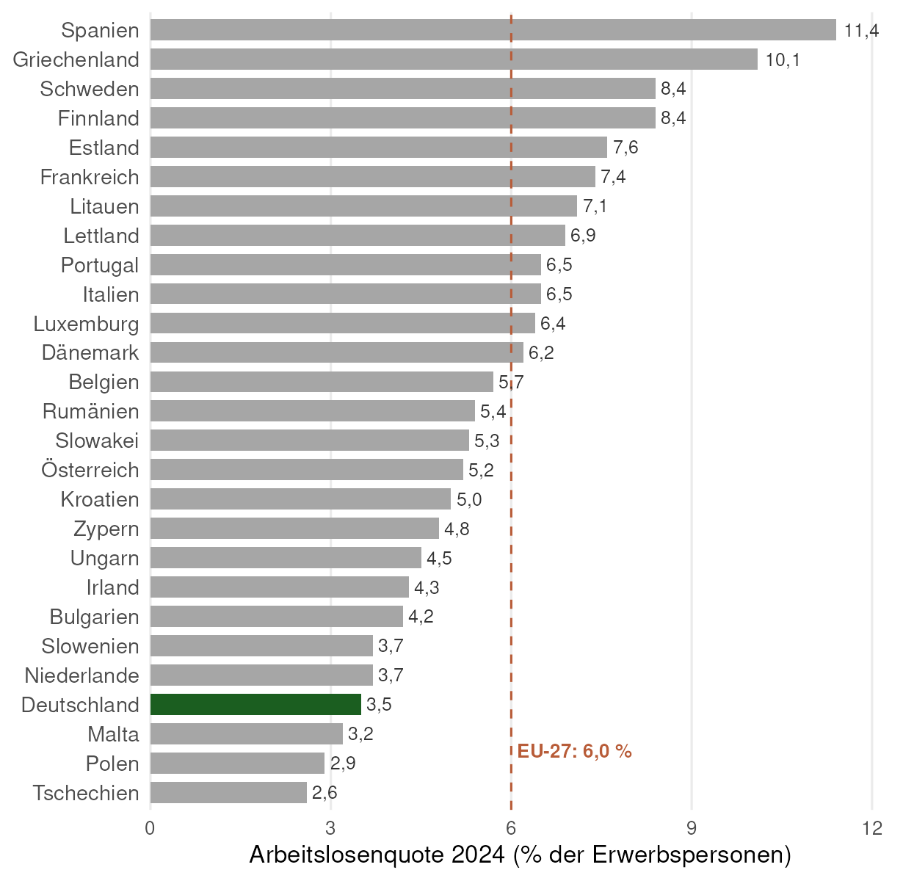
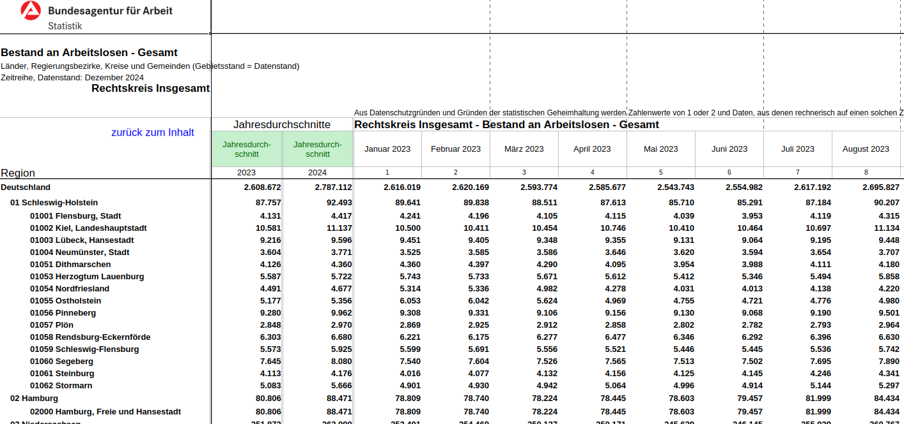
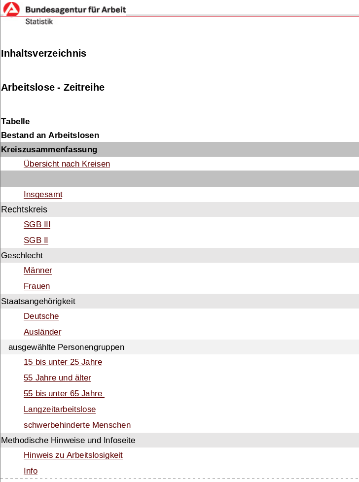
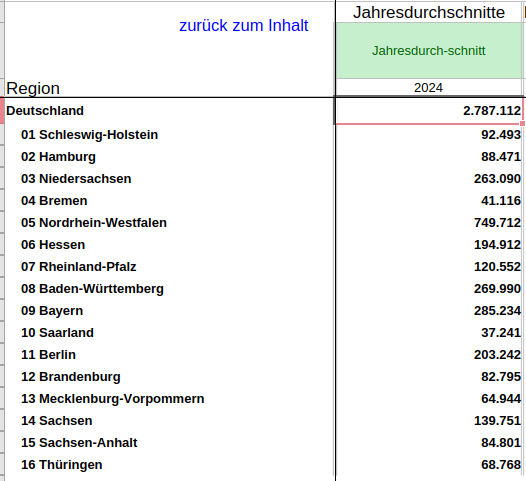



```{r setup}
#| include: false
# readxl / skimr / tidyverse werden bewusst ERST im sichtbaren Chunk "pakete"
# geladen, damit dort die Attach-/Konflikt-Meldung von tidyverse zu sehen ist.
# Hier nur, was schon vor dieser Folie gebraucht wird:
library(countdown)

# Kompakte Ausgabe: max. 4 Zeilen je Tibble, Breite begrenzt -> kein Overflow auf den Folien
options(tibble.print_min = 4, tibble.print_max = 4, width = 95, pillar.width = 95,
        pillar.min_title_chars = 8)

datenpfad <- "../case-study/data"

bl_namen <- c("01" = "Schleswig-Holstein", "02" = "Hamburg", "03" = "Niedersachsen",
              "04" = "Bremen", "05" = "Nordrhein-Westfalen", "06" = "Hessen",
              "07" = "Rheinland-Pfalz", "08" = "Baden-Württemberg", "09" = "Bayern",
              "10" = "Saarland", "11" = "Berlin", "12" = "Brandenburg",
              "13" = "Mecklenburg-Vorpommern", "14" = "Sachsen",
              "15" = "Sachsen-Anhalt", "16" = "Thüringen")

# QR-Code für kahoot.it (Paket qrcode; falls nicht installiert, erscheint nur der Link)
hat_qr <- requireNamespace("qrcode", quietly = TRUE)
```

# Worum geht es? {.section background-color="#1d3f73"}

## Ziel der Case-Study {.smaller}

Deutschland hat europaweit eine der niedrigsten Arbeitslosenquoten:

:::: {.columns}
::: {.column width="42%"}
{width="82%"}

[Quelle: [Eurostat, Arbeitslosenquote nach Ländern (`une_rt_a`)](https://ec.europa.eu/eurostat/databrowser/view/une_rt_a/default/table), Jahresdurchschnitt 2024, 15–74 Jahre. Datenstand 10.09.2026.]{.supersmall}
:::

::: {.column width="58%"}
::: {.fragment}
::: {.question}
Doch gilt dies für alle Regionen in Deutschland?
:::
::: {.question}
Warum ist die Arbeitslosenquote in manchen Regionen höher als in anderen?
:::
:::

::: {.fragment}
::: {.alert}
Dem gehen wir in dieser Case-Study auf den Grund.
:::
:::
:::
::::

## Schätzfrage zum Einstieg

::: {.instructions}
**30 Sekunden, Handzeichen:**

- Welches Bundesland hat die **höchste** Arbeitslosenquote?
- Welches die **niedrigste**?
- Wo liegt Baden-Württemberg?
:::

Auflösung am Ende des Abschnitts zu den Arbeitslosendaten.

::: {.notes}
Zuruf/Handzeichen reicht. Auflösung: Balkendiagramm am Ende von Abschnitt 1, Streudiagramm am Ende von Teil 1.
:::

## Wo wollen wir hin?

Am Ende steht eine Karte: Arbeitslosigkeit, Verschuldung und Wirtschaftskraft **pro Landkreis**. Dafür bauen wir eine Daten-Pipeline:

{width="92%" fig-align="center"}

::: {.callout-note appearance="simple"}
**Teil 1 = alles Grüne.** Unspektakulär, aber hier passieren 80 % der Fehler in echten Projekten.
:::

```{r}
#| echo: false
#| eval: !expr file.exists("figs/ziel_karte.png")
#| out-width: "35%"
#| fig-align: center
knitr::include_graphics("figs/ziel_karte.png")
```

## Ziele der Case-Study

Die Case-Study besteht aus **mehreren Teilen** und begleitet die komplette Vorlesung als **konkretes Anschauungsobjekt**. Sie dient als

- konkretes und umfangreiches Beispiel für ein Projekt,
- Quelle ökonomischer und geographischer Kenntnisse über Deutschland,
- Beispiel, wie Statistik und Programmierung in der empirischen Arbeit zusammenspielen.

. . .

::: {.callout-tip title="Das eigentliche Lernziel von Teil 1"}
Sie sollen **Code lesen, prüfen und reparieren** können, egal ob er von Ihnen, von Kommiliton:innen oder von Chat AI stammt. Deshalb gibt es regelmäßig **🐛 Bug Hunts**: Code, der läuft, aber falsch ist.
:::

## Drei Arten von Fehlern

| | Was passiert? | Wie merkt man es? | Gefahr |
|---|---|---|---|
| **Fehler** (`Error`) | Code stoppt | sofort | gering |
| **Warnung** (`Warning`) | Code läuft weiter | nur wenn man liest | mittel |
| **Stiller Fehler** | Code läuft, Ergebnis falsch | nur durch **Prüfen** | **hoch** |

. . .

::: {.alert}
KI-generierter Code produziert fast nie Fehler der ersten Art, aber regelmäßig der dritten. Alle Bug Hunts heute sind stille Fehler.
:::

. . .

**Was wir dagegen setzen ist der Review-Loop:** Verdacht → Prüfung (`nrow()`, `glimpse()`, `count()`, externe Quelle) → Fix.

## So läuft die Vorlesung {.smaller}

:::: {.columns}
::: {.column width="50%"}
**🔮 Prognose**: Sie tippen, bevor der Output kommt (Handzeichen).

**🐛 Bug Hunt**: KI-Code, der läuft, aber falsch ist. 1–2 Minuten zu zweit.

**✍️ Jetzt Sie**: kurze Programmieraufgabe im eigenen RStudio.
:::
::: {.column width="50%"}
**📱 Kahoot-Checkpoint**: am Ende jedes Abschnitts, 6–7 Fragen, 5 Minuten. Die Bug Hunts kommen dort wieder vor.

Halten Sie **kahoot.it** auf dem Handy bereit; die PIN steht jeweils auf der Folie.
:::
::::

::: {.callout-note appearance="simple"}
Bei den Kahoot-Quizzes gibt es immer etwas zu gewinnen.
:::

## Zwei Umgebungen zum Coden {.smaller}

:::: {.columns}
::: {.column width="50%"}
**Direkt auf der Folie (webR)**

Code-Felder mit *Run Code* laufen **in Ihrem Browser**; nichts installieren, nichts hochladen. Für die kurzen ✍️-Aufgaben und die Bug-Hunt-Fixes.

- Hinweise und Lösung lassen sich aufklappen
- Ein automatischer Check sagt Ihnen, ob es stimmt
- Beim ersten Öffnen lädt webR ca. 20 Sekunden

Probieren Sie es gleich aus:

```{webr}
#| autorun: false
x <- c(3, 1, 4, 1, 5)
sum(x) / length(x)
```
:::
::: {.column width="50%"}
**In RStudio (Ihr Rechner oder Posit Cloud)**

Für die 20-Minuten-Aufgaben mit den vollständigen Excel-Dateien aus dem Repository, so, wie Sie später auch im Projekt arbeiten.

- GitHub Desktop → Pull → `case-study/` öffnen
- Chat AI erlaubt, Prüfen Pflicht

::: {.callout-tip appearance="simple"}
Die Felder auf den Folien speichern nichts. Was Sie behalten wollen, kopieren Sie in Ihr eigenes R-Skript.
:::
:::
::::

# Datensätze beschaffen {.section background-color="#1d3f73"}

## Teil 1 im Überblick

- Daten einlesen
- Daten bereinigen und in eine geeignete Form bringen (`tidy`)
- Daten **prüfen** (intern und gegen externe Quellen)

Anwenden auf

- Daten zur Arbeitslosenstatistik
- Daten zur Verschuldung einzelner Landkreise bzw. Gemeinden
- Daten zum BIP

::: {.callout-note appearance="simple"}
Wir nutzen die Base-R-Pipe `|>`. Wenn Chat AI Ihnen `%>%` liefert: funktioniert genauso.
:::

## Wichtig für die Datenbeschaffung

- Zuverlässige, qualitativ hochwertige Datenquellen finden ([Beispiel: Warum man BIP-Daten diktatorisch regierter Staaten nicht trauen kann](https://www.journals.uchicago.edu/doi/full/10.1086/720458))
- Automatisierten Download programmieren
- Einlesen, verarbeiten und zusammenführen verschiedener Datensätze in R

. . .

Verbindung zum 2. RTutor Problem Set:

- **Im Problem Set:** Kennzahlen zu verschiedenen Ländern der EU
- **Hier:** Kennzahlen innerhalb Deutschlands

. . .

::: {.alert}
In Case-Study und Problem Sets treffen Sie auf konkrete Probleme, die Sie mit Ihren Kenntnissen aus der Vorlesung lösen sollen.
:::

## Daten beschaffen

Woher beziehen wir unsere Informationen?

::: {.incremental}
- Verschuldung der **Gemeinden**: Statistisches Bundesamt, [Integrierte Schulden der Gemeinden und Gemeindeverbände](https://www.statistikportal.de/de/veroeffentlichungen/integrierte-schulden-der-gemeinden-und-gemeindeverbaende)
- Arbeitslosigkeit auf **Verwaltungsgemeinschaftsebene**: [Bundesagentur für Arbeit](https://statistik.arbeitsagentur.de/DE/Navigation/Statistiken/Statistiken-nach-Regionen/BA-Gebietsstruktur-Nav.html)
- BIP auf **Landkreisebene**: [Statistische Ämter des Bundes und der Länder](https://www.statistikportal.de/de/vgrdl)
:::

. . .

::: {.instructions}
Zuverlässige und qualitativ hochwertige Datenquellen ausfindig machen ✔
:::

## Daten herunterladen

- Daten können von URLs mit `readxl` und `readr` direkt eingelesen werden
- Allerdings: Wenn die URL nicht mehr verfügbar ist, was dann?
  - Daten immer mit `download.file()` herunterladen und in `data/` abspeichern!

. . .

::: {.instructions}
Automatisierten Download programmieren (in der ausformulierten Case-Study) ✔
:::

. . .

::: {.alert}
Die Daten liegen bereits im GitHub-Repository "case-study-germany". Klonen Sie dieses Repository auf Ihren PC!
:::

## Klonen Sie unsere GitHub-Seite

- [GitHub-Seite des Projektkurses](https://github.com/projektkurs-datascience/26-27) → grüner "Code"-Button
- [HTTPS-URL](https://github.com/projektkurs-datascience/26-27.git) kopieren
- GitHub Desktop → "Clone a repository" → "URL" → einfügen

[Step-by-Step-Anleitung](https://docs.github.com/desktop/contributing-and-collaborating-using-github-desktop/adding-and-cloning-repositories/cloning-a-repository-from-github-to-github-desktop?platform=windows)

::: {.alert}
Zu Beginn jeder Woche in GitHub Desktop auf "Pull" klicken: Folien, Case-Study und Tutorials werden automatisch aktualisiert.
:::

```{r}
#| echo: false
countdown(minutes = 5, bottom = 0, right = 0)
```

## Nötige Pakete laden

```{r pakete}
#| message: true
library(readxl)
library(skimr)
library(tidyverse)
```

. . .

::: {.question}
🔮 **Prognose:** Nach `library(tidyverse)` rufen Sie `filter()` auf – welche Funktion wird genommen? Warum steht das hier?
:::

# Arbeitslose {.section background-color="#1d3f73"}

[Arbeitslose]{.hier} → Schulden → BIP → Merge → Karte

::: {.lernziele}
**Nach diesem Abschnitt können Sie …**

- eine unschöne Excel-Tabelle gezielt einlesen (`sheet`, `skip`),
- mit `str_extract()` / `str_remove()` Informationen aus Text ziehen,
- Daten intern und gegen eine externe Quelle auf Konsistenz prüfen.
:::

## Bevor wir Code schreiben: die Rohdaten

::: {.instructions}
**3 Minuten, zu zweit:** Öffnen Sie im geklonten Repository `case-study/data/Arbeitslose_2024.xlsx.zip` (Blatt "Gesamt"). Notieren Sie **drei Dinge**, die das Einlesen in R erschweren werden.
:::

{width="92%" fig-align="center"}

```{r}
#| echo: false
countdown(minutes = 3, bottom = 0, right = 0)
```

::: {.notes}
Erwartete Antworten: mehrere Kopfzeilen, Spaltennamen über mehrere Zeilen, Schlüssel und Name in einer Zelle, Summenzeilen gemischt mit Gemeinden, Leerzeilen, ZIP-Archiv.
:::

## Daten einlesen

Unterschiedliche Dateien und Tabellenblätter – was verwenden wir?

Zuerst legen wir den Pfad zum Datenordner fest. Im RStudio-Projekt `case-study/` liegen die Rohdaten im Unterordner `data/`:

```{r}
#| eval: false
datenpfad <- "data"
```

```{r}
#| code-line-numbers: "1-3|4|5"
# Im ZIP liegen zwei Tabellen; uns interessiert die Anzahl der Arbeitslosen ([1])
alo_zip  <- file.path(datenpfad, "Arbeitslose_2024.xlsx.zip")
alo_name <- as.character(unzip(alo_zip, list = TRUE)$Name)
alo_name <- alo_name[1]
unzip(alo_zip, alo_name)
```

. . .

**Vermutung:** Über das Tabellenblatt "Inhaltsverzeichnis" werden wir schlauer.

## Daten einlesen {.smaller}

:::: {.columns}
::: {.column width="55%"}
```{r}
alo_inhalt <- read_xlsx(alo_name, sheet = "Inhaltsverzeichnis")
head(alo_inhalt, 7)
```
:::
::: {.column width="45%"}
{width="50%"}

[**Alternative:** Excel-Datei in Excel/LibreOffice öffnen und dann entscheiden, welches Blatt Sie einlesen.]{.small}
:::
::::

## Welche Information brauchen wir?

- [Die Anzahl aller Arbeitslosen pro Gemeinde (SGB II und III) **aus dem Jahr 2024**]{.alert}
- … pro Gemeinde für einen bestimmten Rechtskreis (z.B. nur SGB II)
- … pro Gemeinde für Rechtskreis und Alter (z.B. SGB II, unter 25)

. . .

::: {.question}
Was ist hier eine **Beobachtung**?
:::

. . .

Dazu brauchen wir noch Regionalschlüssel und Gemeindenamen.

- Einfachster Weg: die ersten acht Zeilen abschneiden (`skip = 8`) …
- … und nur die ersten 3 Spalten behalten.

## Einlesen und bereinigen

::: {.question}
🔮 **Prognose:** Wie viele Zeilen hat `alo_skip` – mehr oder weniger als die ca. 10.800 Gemeinden in Deutschland?
:::

```{r einlesen_alo}
#| code-line-numbers: "1|3-4|5-6|7|8|9"
alo_skip <- read_xlsx(alo_name, sheet = "Gesamt", skip = 8)

data_alo <- alo_skip |>
  select(c(`...1`, Jahresdurchschnitte, `...3`)) |>          # nur die ersten 3 Spalten
  mutate(Regionalschluessel = str_extract(`...1`, "[[:digit:]]+"),
         Gemeinde           = str_extract(`...1`, "[A-Z].*")) |>
  mutate(alo = as.numeric(`...3`)) |>                         # Arbeitslose als Zahl
  select(-c(`...1`, Jahresdurchschnitte, `...3`)) |>
  filter(!is.na(alo))                                          # Leer- und Textzeilen raus
```

```{r}
#| echo: false
data_alo <- data_alo[-c(1, 2), ]   # Kopfzeile ("Region") und Deutschland gesamt entfernen
unlink(alo_name)
```

## Schritt für Schritt durch die Pipe {.smaller}

Klicken Sie sich durch die Reiter – nach jedem `|>` sehen Sie, was mit den Daten passiert:

::: {.panel-tabset}

### 1 · `select()`

Von den 27 eingelesenen Spalten nur die **drei relevanten** behalten:

```{r}
alo_skip |>
  select(c(`...1`, Jahresdurchschnitte, `...3`)) |>
  head(4)
```

### 2 · `mutate()` zerlegen

`...1` enthält Schlüssel **und** Name – wir ziehen beides in **eigene Spalten**:

```{r}
#| code-line-numbers: "3-4"
alo_skip |>
  select(c(`...1`, Jahresdurchschnitte, `...3`)) |>
  mutate(Regionalschluessel = str_extract(`...1`, "[[:digit:]]+"),
         Gemeinde           = str_extract(`...1`, "[A-Z].*")) |>
  head(4)
```

### 3 · `mutate()` als Zahl

`...3` ist **Text** – als Zahl `alo` umwandeln (Kopfzeilen werden dabei zu `NA`):

```{r}
#| code-line-numbers: "5"
alo_skip |>
  select(c(`...1`, Jahresdurchschnitte, `...3`)) |>
  mutate(Regionalschluessel = str_extract(`...1`, "[[:digit:]]+"),
         Gemeinde           = str_extract(`...1`, "[A-Z].*")) |>
  mutate(alo = as.numeric(`...3`)) |>
  head(4)
```

### 4 · aufräumen

Hilfsspalten entfernen und `NA`-Zeilen (Kopf-/Leerzeilen) herausfiltern → **fertig**:

```{r}
#| code-line-numbers: "6-7"
alo_skip |>
  select(c(`...1`, Jahresdurchschnitte, `...3`)) |>
  mutate(Regionalschluessel = str_extract(`...1`, "[[:digit:]]+"),
         Gemeinde           = str_extract(`...1`, "[A-Z].*")) |>
  mutate(alo = as.numeric(`...3`)) |>
  select(-c(`...1`, Jahresdurchschnitte, `...3`)) |>
  filter(!is.na(alo)) |>
  head(4)
```

:::

::: {.notes}
Durch die Reiter klicken und bei jedem Schritt fragen: Welche Spalte kommt dazu, welche fällt weg, welche Zeilen verschwinden? Guter Moment, um den Pipe-Operator `|>` ("… und dann …") zu erklären.
:::

## Einlesen und bereinigen: Ergebnis

```{r}
dim(alo_skip)
dim(data_alo)
head(data_alo, 4)
```

::: {.notes}
Die ersten zwei Zeilen (Kopfzeile "Region" und Deutschland gesamt) wurden im Hintergrund entfernt – kurz sagen. Warum Bundesländer und Kreise trotzdem im Datensatz bleiben dürfen, klärt der nchar-Trick gleich.
:::

## 🐛 Bug Hunt 1: Läuft, aber … {.bughunt}

Der Code von eben läuft ohne Fehler und ohne Warnung. Trotzdem steckt ein **stiller Fehler** in dieser Zeile:

```{r}
#| eval: false
Gemeinde = str_extract(`...1`, "[A-Z].*")
```

::: {.instructions}
**2 Minuten, zu zweit:** Welche Gemeindenamen werden falsch extrahiert? Wie würden Sie das **prüfen**, ohne 10.000 Zeilen anzuschauen?
:::

```{r}
#| echo: false
countdown(minutes = 2, bottom = 0, right = 0)
```

::: {.notes}
`[A-Z]` erfasst nur ASCII-Großbuchstaben. "Überlingen, Stadt" → Regex springt zum nächsten Großbuchstaben → "Stadt". Falls die Prüfung auf der nächsten Folie keine Treffer liefert, ist das Zellformat anders als angenommen – vor der Vorlesung testen.
:::

## 🐛 Bug Hunt 1: Prüfung {.bughunt}

Gezielt nach **Randfällen** suchen (Namen, die mit Umlaut beginnen) und Rohdaten mit Ergebnis vergleichen:

```{r}
alo_skip |>
  filter(str_detect(`...1`, "^[[:digit:]]+\\s+[ÄÖÜ]")) |>
  transmute(roh = `...1`, Gemeinde = str_extract(`...1`, "[A-Z].*"))
```

. . .

**Warum?** `[A-Z]` erfasst nur `A` bis `Z` – keine Umlaute. Bei "Überlingen, Stadt" springt die Regex zum ersten "echten" Großbuchstaben: "Stadt".

## ✍️ Jetzt Sie: Bug Hunt 1 reparieren {.bughunt}

`alo_roh` enthält 40 Zeilen der Rohspalte (`roh`), darunter die Umlaut-Fälle. Ersetzen Sie die Regex so, dass `Gemeinde` immer der **ganze Name** ist. Die letzte Zeile soll das Ergebnis ausgeben.

```{webr}
#| setup: true
#| exercise: ex_bh1
library(dplyr); library(stringr); library(readr)
alo_roh <- read_csv("data-webr/alo_roh.csv", show_col_types = FALSE)
```

```{webr}
#| exercise: ex_bh1
alo_roh |>
  mutate(Gemeinde = str_extract(roh, "[A-Z].*")) |>
  filter(str_detect(roh, "^[[:digit:]]+\\s+[ÄÖÜ]"))
```

::: {.hint exercise="ex_bh1"}
::: {.callout-note collapse="false"}
## Hinweis 1
Statt zu beschreiben, was Sie *behalten* wollen, entfernen Sie, was Sie *nicht* wollen: Ziffern und Leerzeichen am Anfang. `str_remove()` hilft.
:::
:::

::: {.hint exercise="ex_bh1"}
::: {.callout-note collapse="false"}
## Hinweis 2
Das Muster für "Ziffern am Anfang, danach Leerzeichen": `"^[[:digit:]]+\\s*"`
:::
:::

::: {.solution exercise="ex_bh1"}
::: {.callout-tip collapse="false"}
## Lösung
```r
alo_roh |>
  mutate(Gemeinde = str_remove(roh, "^[[:digit:]]+\\s*")) |>
  filter(str_detect(roh, "^[[:digit:]]+\\s+[ÄÖÜ]"))
```
:::
:::

```{webr}
#| exercise: ex_bh1
#| check: true
ok <- is.data.frame(.result) && "Gemeinde" %in% names(.result) &&
  all(stringr::str_detect(.result$Gemeinde, "^[ÄÖÜ]"))
if (ok) {
  list(correct = TRUE, message = "Alle Umlaut-Gemeinden haben jetzt ihren vollen Namen.")
} else {
  list(correct = FALSE, message = "Noch nicht: Mindestens eine Gemeinde beginnt nicht mit dem Umlaut aus den Rohdaten. Hinweis 1 aufklappen.")
}
```

## 🐛 Bug Hunt 1: Fix {.bughunt}

Nicht beschreiben, was wir *wollen*, sondern entfernen, was wir *nicht* wollen (Ziffern und Leerzeichen am Anfang):

```{r}
#| code-line-numbers: "2"
data_alo <- alo_skip |>
  mutate(Gemeinde = str_remove(`...1`, "^[[:digit:]]+\\s*"),
         Regionalschluessel = str_extract(`...1`, "[[:digit:]]+"),
         alo = as.numeric(`...3`)) |>
  select(Regionalschluessel, Gemeinde, alo) |>
  filter(!is.na(alo))
data_alo <- data_alo[-c(1, 2), ]

data_alo |> filter(str_detect(Gemeinde, "^[ÄÖÜ]")) |> head(3)
```

::: {.callout-tip appearance="simple"}
Eine Regex, die auf den ersten fünf Zeilen funktioniert, ist noch nicht getestet. Suchen Sie die Randfälle: Umlaute, Bindestriche, Sonderzeichen.
:::

## Konsistenzcheck

- Machen die Angaben Sinn, sind die Daten in sich konsistent?
- Externe Datenquelle suchen und intern auf Konsistenz prüfen
- Informationen aggregieren und mit anderen Quellen vergleichen

. . .

- Zunächst: Arbeitslose je **Bundesland** 2024 → zweistelliger `Regionalschluessel`
  - Zeichen zählen mit `nchar()` (number of characters)
- **Externe Quelle:** [Arbeitslose 2024 nach Ländern (Arbeitsagentur)](https://statistik.arbeitsagentur.de/Statistikdaten/Detail/202412/iiia4/akt-dat-jz/akt-dat-jz-d-0-202412-xlsx.xlsx), Tabellenblatt 8

. . .

::: {.question}
🔮 **Prognose:** Wie viele Zeilen liefert `filter(nchar(Regionalschluessel) == 2)`?
:::

## Konsistenzcheck: externe Quelle

```{r konsistenz_alo}
#| code-line-numbers: "1|2|3"
check_alo_bundesland <- data_alo |>
  filter(nchar(Regionalschluessel) == 2) |>
  rename(bundesland = Regionalschluessel)
nrow(check_alo_bundesland)
```

. . .

::: {.instructions}
**Wette (Handzeichen):** Stimmen unsere 16 Zahlen mit der Tabelle der Arbeitsagentur überein? **(a)** exakt **(b)** kleine Abweichungen **(c)** große Abweichungen
:::

## Konsistenzcheck: externe Quelle {.smaller}

:::: {.columns}
::: {.column width="50%"}
```{r}
print(check_alo_bundesland, n = 16)
```
:::
::: {.column width="50%"}
{width="88%"}
:::
::::

. . .

[Beide Datenreihen sind identisch.]{.alert .center}

## Interne Konsistenz prüfen {.smaller}

::: {.instructions}
Berechne: Arbeitslose je Bundesland als **Summe** über die Gemeinden – und vergleiche mit der Arbeitsagentur.
:::

```{r interne_konsistenz}
#| code-line-numbers: "1-4|6-8|10-13"
# Nur Gemeinden (8-stelliger Schlüssel), dann Landkreis und Bundesland ableiten
alo_meta <- data_alo |>
  filter(nchar(Regionalschluessel) == 8) |>
  mutate(landkreis  = str_extract(Regionalschluessel, "^.{5}"),
         bundesland = str_extract(Regionalschluessel, "^.{2}"))

alo_bundesland <- alo_meta |>
  group_by(bundesland) |>
  summarise(total_alo = sum(alo))

alo_landkreis <- alo_meta |>
  group_by(landkreis) |>
  summarise(total_alo = sum(alo)) |>
  rename(Regionalschluessel = landkreis)
```

## Interne Konsistenz prüfen

- `check_alo_bundesland`: von der Arbeitsagentur **bereits aggregiert**
- `alo_bundesland`: **unsere Summe** aus den Gemeinden

```{r}
#| code-line-numbers: "1|2"
check_consistency <- left_join(check_alo_bundesland, alo_bundesland, by = "bundesland") |>
  mutate(diff = alo - total_alo)
summary(check_consistency$diff)
```

. . .

::: {.alert .center}
Es bestehen keine Unstimmigkeiten.
:::

## 🐛 Bug Hunt 2: Die KI-Variante {.bughunt}

Chat AI schlägt für denselben Schritt vor:

```{r}
#| eval: false
#| code-line-numbers: true
alo_bundesland_ki <- data_alo |>
  filter(nchar(Regionalschluessel) >= 5) |>          # "alle regionalen Einheiten"
  mutate(bundesland = str_sub(Regionalschluessel, 1, 2)) |>
  group_by(bundesland) |>
  summarise(total_alo = sum(alo))
```

::: {.instructions}
**2 Minuten:** Läuft fehlerfrei. In welcher Zeile steckt der Fehler?
:::

```{r}
#| echo: false
countdown(minutes = 2, bottom = 0, right = 0)
```

## 🐛 Bug Hunt 2: Prüfung {.bughunt}

```{r}
data_alo |>
  filter(nchar(Regionalschluessel) >= 5) |>
  mutate(bundesland = str_sub(Regionalschluessel, 1, 2)) |>
  group_by(bundesland) |>
  summarise(total_alo = sum(alo)) |>
  left_join(check_alo_bundesland, by = "bundesland") |>
  mutate(faktor = total_alo / alo)
```

. . .

**Doppelzählung:** Landkreise (5 Stellen) *und* ihre Gemeinden (8 Stellen) werden addiert. Der Check gegen die externe Quelle findet das sofort – deshalb machen wir ihn.

## ✍️ Jetzt Sie: Bug Hunt 2 reparieren {.bughunt}

Reparieren Sie den KI-Code so, dass `diff` für alle 16 Bundesländer 0 ist. `data_alo` und `check_alo_bundesland` sind geladen.

```{webr}
#| setup: true
#| exercise: ex_bh2
library(dplyr); library(stringr); library(readr)
data_alo <- read_csv("data-webr/data_alo.csv", col_types = cols(Regionalschluessel = "c"))
check_alo_bundesland <- read_csv("data-webr/check_alo_bundesland.csv", col_types = cols(bundesland = "c"))
```

```{webr}
#| exercise: ex_bh2
data_alo |>
  filter(nchar(Regionalschluessel) >= 5) |>
  mutate(bundesland = str_sub(Regionalschluessel, 1, 2)) |>
  group_by(bundesland) |>
  summarise(total_alo = sum(alo)) |>
  left_join(check_alo_bundesland, by = "bundesland") |>
  mutate(diff = alo - total_alo)
```

::: {.hint exercise="ex_bh2"}
::: {.callout-note collapse="false"}
## Hinweis
Welche Schlüssellänge haben *nur* Gemeinden? Bundesländer haben 2, Landkreise 5 Stellen.
:::
:::

::: {.solution exercise="ex_bh2"}
::: {.callout-tip collapse="false"}
## Lösung
`filter(nchar(Regionalschluessel) == 8)` – nur Gemeinden summieren, keine Aggregate.
:::
:::

```{webr}
#| exercise: ex_bh2
#| check: true
ok <- is.data.frame(.result) && "diff" %in% names(.result) &&
  nrow(.result) == 16 && all(abs(.result$diff) < 1e-6)
if (ok) {
  list(correct = TRUE, message = "diff = 0 für alle 16 Bundesländer – unsere Summe stimmt mit der Arbeitsagentur überein.")
} else {
  list(correct = FALSE, message = "Die Differenzen sind noch nicht überall 0. Tipp: Welche Zeilen sind Gemeinden, welche sind schon Summen?")
}
```

## Erster Blick auf die Daten

```{r}
#| echo: false
#| fig-width: 10
#| fig-height: 4.1
alo_bundesland |>
  mutate(name = bl_namen[bundesland], hier = bundesland == "08") |>
  ggplot(aes(x = reorder(name, total_alo), y = total_alo / 1000, fill = hier)) +
  geom_col(show.legend = FALSE) +
  coord_flip() +
  scale_fill_manual(values = c("grey60", "#1b5e20")) +
  labs(x = NULL, y = "Arbeitslose 2024 (in Tausend)") +
  theme_minimal(base_size = 15)
```

::: {.question}
NRW führt klar. Beantwortet das unsere Schätzfrage? **Was fehlt**, um Regionen fair zu vergleichen?
:::

::: {.notes}
Zielantwort: Bezugsgröße (Einwohner / Erwerbspersonen). Dafür holen wir gleich Einwohner- und BIP-Daten.
:::

## 📱 Kahoot-Checkpoint 1: Arbeitslose {.kahoot}

:::: {.columns}
::: {.column width="35%"}
```{r}
#| echo: false
#| eval: !expr hat_qr
#| fig-width: 3
#| fig-height: 3
plot(qrcode::qr_code("https://kahoot.it"))
```

[**kahoot.it** · PIN am Beamer]{.pin}
:::
::: {.column width="65%"}
**7 Fragen, 5 Minuten**.

- `read_xlsx()`, `skip`, `nchar()`
- Regionalschlüssel: 2 / 5 / 8 Stellen
- Bug Hunt 1: Umlaute und `[A-Z]`
- Bug Hunt 2: Doppelzählung
- Stille Fehler erkennen

[Kahoot öffnen →](https://play.kahoot.it/v2/?quizId=09152d59-7781-4ef1-8d41-4a494f80357a&hostId=5cd1e16c-12ee-4aae-ab95-0cb9fdfa0473)
:::
::::

```{r}
#| echo: false
countdown(minutes = 5, bottom = 0, right = 0)
```

::: {.notes}
Fragen stehen in kahoot_fragen_teil1.xlsx (Checkpoint 1). Nach dem Kahoot: die Frage mit der schlechtesten Trefferquote kurz an der Folie nachbesprechen – Kahoot zeigt sie im Report.
:::

# Pro-Kopf-Verschuldung {.section background-color="#1d3f73"}

Arbeitslose ✔ → [Schulden]{.hier} → BIP → Merge → Karte

::: {.lernziele}
**Nach diesem Abschnitt können Sie …**

- viele gleich aufgebaute Tabellenblätter mit `map()` einlesen,
- Zahlen, die als Text gespeichert sind (`"{15 653}"`), sauber umwandeln,
- erklären, warum ein Mittelwert von Pro-Kopf-Werten meistens falsch ist.
:::

## Schätzfrage: Ihr Landkreis

::: {.instructions}
**Schätzen Sie (notieren!):** Kommunale Schulden **pro Kopf** in

- der Stadt Ulm?
- dem Alb-Donau-Kreis?
- dem Landkreis Biberach?

Ist Ulm stärker oder schwächer verschuldet als der Durchschnitt aller Gemeinden?
:::

Auflösung am Ende des Abschnitts.

```{r}
#| echo: false
countdown(minutes = 1, bottom = 0, right = 0)
```

## Pro-Kopf-Verschuldung auf Gemeindeebene

- Gemeindeebene, Jahr 2024, Querschnittsdaten
- Vom Statistischen Bundesamt direkt als Excel-Tabelle heruntergeladen ✔

::: {.question}
Welche Tabellenblätter sollten wir nutzen?
:::

```{r}
#| output-location: fragment
schulden_pfad <- file.path(datenpfad, "Schulden_2024.xlsx")
excel_sheets(schulden_pfad)
```

## Mehrere Tabellenblätter einlesen

- Nicht alle Informationen stehen in **einem** Tabellenblatt
  - ein Blatt je Bundesland
  - dieselbe Operation muss über mehrere Blätter laufen

. . .

::: {.instructions}
Zuerst an einem Beispiel schauen, welche Informationen wir benötigen:
:::

```{r}
#| output-location: fragment
sh <- read_xlsx(schulden_pfad, sheet = "SH")
head(sh, 8)
```

## Was wir brauchen

- Regionalschlüssel, Gemeindename
- Einwohner
- Schulden des öffentlichen Bereichs insgesamt
- Schulden je Einwohner

Variablenbezeichnungen beginnen in Zeile 5 – die ersten Zeilen überspringen wir.

::: {.question}
Was ist hier eine Beobachtung?
:::

## Ein Tabellenblatt als Vorlage

```{r schulden_einlesen}
#| code-line-numbers: "1-2|4-6|8-9"
# Blatt "SH" ohne die ersten 5 Zeilen, nur Spalten 1-7
schulden_sh <- read_xlsx(schulden_pfad, sheet = "SH", skip = 5)[1:7]

# Spalten umbenennen
colnames(schulden_sh) <- c("Regionalschluessel", "Gemeinde", "Verwaltungsform",
                           "Einwohner", "Schulden_gesamt", "Veraenderung_Vorjahr", "Schulden_pro_kopf")

# Merken, aus welchem Blatt die Daten kommen
schulden_sh$Bundesland <- "SH"
```

. . .

```{r}
head(schulden_sh, 4)
```

## ✍️ Jetzt Sie: alle Bundesländer {.smaller}

::: {.instructions}
**Teams von zwei Personen, 20 Minuten:** Code, der **alle Bundesländer** einliest und zu *einem* Datensatz zusammenfügt. Nutzen Sie **Chat AI** und posten Sie ihren Code hier (am Besten vorher prüfen):
:::

- `nrow()` – plausibel für ~11.000 Gemeinden?
- `count(Bundesland)` – sind alle 13 Blätter drin?
- `glimpse()` – welche Spalten sind `<chr>`, obwohl sie Zahlen enthalten?

:::: {.columns}
::: {.column width="65%"}
Posten Sie Ihren Code hier →
:::
::: {.column width="35%"}
{width="55%"}
:::
::::

```{r}
#| echo: false
countdown(minutes = 20, bottom = 0, right = 0)
```

## 🐛 Bug Hunt 3: Eine typische KI-Antwort {.bughunt}

```{r}
#| eval: false
#| code-line-numbers: true
sheet_names <- excel_sheets(schulden_pfad)
sheet_read  <- sheet_names[7:19]

for (s in sheet_read) {
  tmp <- read_xlsx(schulden_pfad, sheet = s, skip = 5)[1:7]
  tmp$Bundesland <- s
  schulden_individuell <- tmp
}
```

::: {.instructions}
**1 Minute:** Läuft ohne Fehler. Welche Zeile? Was steht am Ende in `schulden_individuell`?
:::

```{r}
#| echo: false
countdown(minutes = 1, bottom = 0, right = 0)
```

. . .

Zeile 7 **überschreibt** in jedem Durchlauf und am Ende ist nur Thüringen übrig. `count(Bundesland)` zeigt eine einzige Zeile.

## Lösung: `map()` statt Schleife

```{r einlesen_alle}
#| code-line-numbers: "1-2|4-5|7-10"
sheet_names <- excel_sheets(schulden_pfad)
sheet_read  <- sheet_names[7:19]           # Blätter 7-19: die Bundesländer

spalten <- c("Regionalschluessel", "Gemeinde", "Verwaltungsform",
             "Einwohner", "Schulden_gesamt", "Veraenderung_Vorjahr", "Schulden_pro_kopf")

schulden_individuell <- sheet_read |>
  set_names() |>                                                       # Namen = Blattnamen
  map(\(s) read_xlsx(schulden_pfad, sheet = s, skip = 5)[1:7] |> set_names(spalten)) |>
  list_rbind(names_to = "Bundesland")                                  # zu einem Datensatz
```

. . .

```{r}
schulden_individuell |> count(Bundesland) |> pull(n, name = Bundesland)
```

::: {.notes}
`set_names()` ohne Argument benennt den Vektor mit sich selbst; `list_rbind(names_to=)` macht daraus die Spalte Bundesland. Falls purrr < 1.0: map_df() wie bisher.
:::

## Variablen umformen

```{r}
head(schulden_individuell, 4)
```

. . .

Es gibt noch Probleme:

::: {.incremental}
- Die Werte stehen nicht direkt unter den Variablennamen → `NA` im Regionalschlüssel entfernen
- "Einwohner", "Schulden_gesamt", "Schulden_pro_kopf" sind `character` (`<chr>`)
:::

## Warum `character`?

```{r}
schulden_individuell[28, c("Gemeinde", "Einwohner", "Schulden_gesamt")]
```

::: {.question}
🔮 **Prognose:** Was liefert `as.numeric("{15 653}")`? Und `as.numeric("15 653")`?
:::

. . .

```{r}
#| warning: true
as.numeric(c("{15 653}", "15 653", "15653"))
```

. . .

::: {.alert}
Eine **Warnung**, keine Fehlermeldung. Der Code läuft weiter, aber mit "NA" statt Zahlen. Daher ist es wichtig Warnungen nicht zu ignorieren, sondern diesen nachzugehen.
:::

## Variablen umformen

```{r schulden_umformen}
#| code-line-numbers: "1-2|4-6|7|8-10"
# Hilfsfunktion: Klammern und Leerzeichen entfernen, dann in Zahl umwandeln
zahl <- function(x) as.numeric(gsub("[[:space:]{}]", "", x))

schulden_bereinigt <- schulden_individuell |>
  filter(!is.na(Regionalschluessel)) |>
  mutate(across(c(Einwohner, Schulden_gesamt, Schulden_pro_kopf), zahl)) |>
  filter(nchar(Regionalschluessel) == 12) |>   # nur echte Gemeinden – Landkreis-, Verwaltungs- und Summenzeilen raus!
  mutate(landkreis = str_extract(Regionalschluessel, "^.{5}")) |>
  select(-Veraenderung_Vorjahr) |>
  filter(!is.na(Einwohner))        # manche Einheiten haben keine Einwohnerangabe
```

. . .

```{r}
glimpse(schulden_bereinigt)
```

## Reguläre Ausdrücke

::: {.question}
Was machen `gsub("[[:space:]{}]", "", x)` und `str_extract(x, "^.{5}")` hier genau?
:::

. . .

| Muster | Bedeutung |
|---|---|
| `[[:space:]]` | ein Leerzeichen (oder Tab) |
| `[{}]` | eine geschweifte Klammer |
| `[[:space:]{}]` | eines von beidem |
| `^.{5}` | die ersten fünf beliebigen Zeichen |
| `^[[:digit:]]+\\s*` | Ziffern am Anfang, dann optionale Leerzeichen |

::: {.callout-tip appearance="simple"}
Lassen Sie ihre Regex von Chat AI schreiben, aber achten Sie in der Prüfung auf die Randfälle (Bug Hunt 1).
:::

## Interne Validität: Schulden pro Kopf

Das Statistische Bundesamt liefert "Schulden je Einwohner" fertig. Wir rechnen nach:

::: {.instructions}
**Wette:** Stimmt `Schulden_gesamt / Einwohner` mit der gelieferten Spalte überein? **(a)** exakt **(b)** bis auf Rundung **(c)** echte Abweichungen
:::

```{r schulden_konsistenz}
#| code-line-numbers: "1-3|5"
#| output-location: fragment
schulden_consistency <- schulden_bereinigt |>
  mutate(Schulden_pro_kopf_new = round(Schulden_gesamt / Einwohner, 2),
         differenz = Schulden_pro_kopf - Schulden_pro_kopf_new)

range(schulden_consistency$differenz, na.rm = TRUE)
```

. . .

::: {.alert}
± 50 Cent – Rundung auf ganze Euro in der Quelle. Intern konsistent.
:::

## Auflösung: Ihr Landkreis {.smaller}

```{r}
schulden_bereinigt |>
  filter(str_detect(Gemeinde, "Ulm, Stadtkreis|Biberach an der Riß")) |>
  select(Gemeinde, Einwohner, Schulden_pro_kopf)
```

::: {.instructions}
**Jetzt Sie:** Suchen Sie **Ihre** Gemeinde – Suchbegriff unten ersetzen, dann *Run Code* (Teil des Namens genügt):
:::

```{webr}
#| autorun: false
library(dplyr); library(stringr); library(readr)
schulden <- read_csv("data-webr/schulden_gemeinden.csv",
                     col_types = cols(Regionalschluessel = "c"))

schulden |>
  filter(str_detect(Gemeinde, regex("Ulm", ignore_case = TRUE))) |>
  select(Gemeinde, Einwohner, Schulden_pro_kopf)
```

::: {.notes}
Namensformat 2024: Die Verwaltungsform steht im Namen, z.B. "Stadt Ulm, Stadtkreis" oder "Große Kreisstadt Biberach an der Riß" – deshalb matcht `^Ulm` nicht (das fängt stattdessen Ulmen/Ulmet in RP). Alb-Donau-Kreis ist kein Gemeindename; der Landkreiswert kommt im Merge-Abschnitt (08425). Die webR-Suche nutzt `str_detect(..., ignore_case)` – "Teil des Namens" reicht.
:::

## Auflösung: Ulm im Vergleich

```{r}
#| echo: false
#| fig-width: 10
#| fig-height: 3.9
ulm <- schulden_bereinigt |> filter(str_detect(Gemeinde, "Ulm, Stadtkreis")) |> slice(1)
schulden_bereinigt |>
  filter(Schulden_pro_kopf < quantile(Schulden_pro_kopf, 0.99, na.rm = TRUE)) |>
  ggplot(aes(x = Schulden_pro_kopf)) +
  geom_histogram(bins = 60, fill = "grey70") +
  geom_vline(xintercept = ulm$Schulden_pro_kopf, colour = "#1b5e20", linewidth = 1.2) +
  annotate("text", x = ulm$Schulden_pro_kopf, y = Inf, label = "  Ulm", hjust = 0, vjust = 1.5,
           colour = "#1b5e20", size = 5) +
  labs(x = "Schulden pro Kopf 2024 (Euro, Gemeinden; oberstes 1 % ausgeblendet)", y = "Anzahl Gemeinden") +
  theme_minimal(base_size = 15)
```

::: {.question}
Wer lag mit seiner Schätzung richtig? Was überrascht Sie an der Verteilung?
:::

## 📱 Kahoot-Checkpoint 2: Schulden {.kahoot}

:::: {.columns}
::: {.column width="35%"}
```{r}
#| echo: false
#| eval: !expr hat_qr
#| fig-width: 3
#| fig-height: 3
plot(qrcode::qr_code("https://kahoot.it"))
```

[**kahoot.it** · PIN am Beamer]{.pin}
:::
::: {.column width="65%"}
**6 Fragen, 4 Minuten**

- `as.numeric("{15 653}")` – Warnung oder Fehler?
- `glimpse()` und `gsub()`
- Bug Hunt 3: die Schleife
- Pro-Kopf-Werte richtig aggregieren (Vorgriff!)
- `map()` + `list_rbind()`

[Kahoot öffnen →](https://create.kahoot.it/)
:::
::::

```{r}
#| echo: false
countdown(minutes = 4, bottom = 0, right = 0)
```

::: {.notes}
Neues Kahoot aus kahoot_fragen_teil1.xlsx (Checkpoint 2) anlegen und den Link hier eintragen. Die Frage zu mean() vs. sum()/sum() ist absichtlich *vor* Bug Hunt 4 – wer sie falsch hat, merkt sich den Bug Hunt besser.
:::

# Bruttoinlandsprodukt {.section background-color="#1d3f73"}

Arbeitslose ✔ → Schulden ✔ → [BIP]{.hier} → Merge → Karte

::: {.lernziele}
**Nach diesem Abschnitt können Sie …**

- eine Fehlermeldung von `pivot_longer()` lesen und die Ursache finden,
- Daten vom `wide`- ins `long`-Format bringen,
- wiederholten Code durch eine Funktion ersetzen.
:::

## Informationen zum Bruttoinlandsprodukt

Nach dem Download bei den Statistischen Ämtern interessieren uns:

- Blatt "1.1": BIP · Blatt "3.1": Erwerbstätige · Blatt "5": Einwohner

Außerdem:

- Die ersten vier Zeilen benötigen wir nicht
- Die letzte Zeile ist eine Beschreibung → nur Zeilen behalten, deren `Lfd. Nr.` numerisch ist
- Nicht benötigt: `Lfd. Nr.`, `EU-Code`, `NUTS 1`–`NUTS 3`, `Land`, `Gebietseinheit`

## Einlesen

```{r}
bip_pfad  <- file.path(datenpfad, "BIP_2024.xlsx")
bip       <- read_xlsx(bip_pfad, sheet = "1.1", skip = 4)
erwerb    <- read_xlsx(bip_pfad, sheet = "3.1", skip = 4)
einwohner <- read_xlsx(bip_pfad, sheet = "5",   skip = 4)
```

. . .

```{r bip_einlesen1}
#| code-line-numbers: "1|2|3|4"
bip_wide <- bip |>
  filter(!is.na(suppressWarnings(as.numeric(`Lfd. Nr.`)))) |>          # Beschreibungszeile raus
  select(-c(`Lfd. Nr.`, `EU-Code`, `NUTS 1`, `NUTS 2`, `NUTS 3`, Land, Gebietseinheit)) |>
  rename(Regionalschluessel = `Regional-schlüssel`)
```

## Panel im `wide`-Format

```{r}
bip_wide |> select(1:8) |> head(3)
```

Der Datensatz

- ist ein **Panel**: mehrere Jahre für mehrere Landkreise,
- liegt im `wide`-Format vor → nicht `tidy`.

. . .

::: {.question}
Was ist hier eine Beobachtung? Welche `tidy`-Bedingung verletzt `bip_wide`?
:::

## Dreimal dasselbe? Dann eine Funktion

Für Erwerbstätige und Einwohner wäre der Code identisch. Dreimal kopieren ist das, was Chat AI gerne tut – und ein Warnsignal:

```{r}
#| code-line-numbers: "1-6|8-9"
bereinige_vgr <- function(df) {
  df |>
    filter(!is.na(suppressWarnings(as.numeric(`Lfd. Nr.`)))) |>
    select(-c(`Lfd. Nr.`, `EU-Code`, `NUTS 1`, `NUTS 2`, `NUTS 3`, Land, Gebietseinheit)) |>
    rename(Regionalschluessel = `Regional-schlüssel`)
}

erwerb_wide    <- bereinige_vgr(erwerb)
einwohner_wide <- bereinige_vgr(einwohner)
```

::: {.callout-tip appearance="simple"}
Einen Fehler dann nur **einmal** beheben. Fragen Sie Chat AI ruhig: "Fasse die drei identischen Blöcke in eine Funktion zusammen."
:::

## Fehlermeldungen lesen

```{r}
#| eval: false
bip_long <- pivot_longer(bip_wide, cols = `1992`:`2024`, names_to = "Jahr", values_to = "bip")
```

```
Error in `pivot_longer()`:
! Can't combine `1992` <character> and `2000` <double>.
```

::: {.instructions}
**1 Minute, zu zweit:** Lesen Sie die Meldung Wort für Wort. Was sagt sie? Welcher *eine* Befehl bestätigt Ihre Vermutung?
:::

```{r}
#| echo: false
countdown(minutes = 1, bottom = 0, right = 0)
```

## Fehlermeldungen lesen: Prüfung

```{r}
bip_wide |> select(`1992`, `1999`, `2000`, `2024`) |> sapply(class)
```

. . .

1992–1999 sind `character`, ab 2000 `double`. `pivot_longer()` kann die Spalten nicht in **eine** Wertespalte stapeln. → Erst umwandeln.

::: {.callout-tip appearance="simple"}
tidyverse-Fehlermeldungen nennen fast immer die betroffenen Spalten **und** die Klassen. Lesen, nicht raten.
:::

## Umwandeln – und die Warnung ernst nehmen {.smaller}

```{r}
#| warning: true
bip_wide |> mutate(across(`1992`:`1999`, as.numeric)) |> nrow()
```

. . .

::: {.question}
Es wird gewarnt, dass `NA`s erzeugt wurden. **Warum?** Welche Werte sind betroffen?
:::

. . .

```{r}
bip_wide |>
  filter(is.na(suppressWarnings(as.numeric(`1992`)))) |>
  select(Regionalschluessel, `1992`, `1995`)
```

. . .

Betroffen sind Zellen mit `-` (kein Wert). Ein `NA` ist hier **inhaltlich richtig** – jetzt dürfen wir guten Gewissens umwandeln.

## Umwandeln

```{r double}
#| code-line-numbers: "1|3-5"
zu_zahl <- function(df) df |> mutate(across(`1992`:`1999`, \(x) suppressWarnings(as.numeric(x))))

bip_wide       <- zu_zahl(bip_wide)
erwerb_wide    <- zu_zahl(erwerb_wide)
einwohner_wide <- zu_zahl(einwohner_wide)
```

::: {.callout-important appearance="simple"}
`suppressWarnings()` erst, **nachdem** wir wissen, was die Warnung bedeutet. Vorher versteckt es einen Fehler, nachher dokumentiert es eine Entscheidung.
:::

## Ins `long`-Format

- Einwohner und Erwerbstätige in **1.000 Personen** → × 1.000
- BIP in **Mio. Euro** → × 1.000.000

```{r long}
#| code-line-numbers: "1-3|4-5|6"
bip_long <- bip_wide |>
  pivot_longer(cols = matches("^[0-9]{4}$"),        # alle Jahresspalten
               names_to = "Jahr", values_to = "bip") |>
  mutate(Jahr = as.numeric(Jahr),
         bip  = bip * 1e6) |>
  arrange(Jahr)
```

. . .

```{r}
head(bip_long, 3)
```

## ✍️ Jetzt Sie: Einwohner ins `long`-Format

**3 Minuten:** Bringen Sie `einwohner_wide` analog zu `bip_long` ins `long`-Format: Spalten `Regionalschluessel`, `Jahr` (numerisch), `einwohner` (in Personen, nicht in Tausend!). Letzte Zeile: das Ergebnis.

```{webr}
#| setup: true
#| exercise: ex_long
library(dplyr); library(tidyr); library(readr)
einwohner_wide <- read_csv("data-webr/einwohner_wide.csv", col_types = cols(Regionalschluessel = "c"))
```

```{webr}
#| exercise: ex_long
einwohner_long <- einwohner_wide |>
  pivot_longer(cols = ______, names_to = "Jahr", values_to = "einwohner") |>
  mutate(Jahr = as.numeric(Jahr),
         einwohner = ______)
einwohner_long
```

::: {.hint exercise="ex_long"}
::: {.callout-note collapse="false"}
## Hinweis
Alle Jahresspalten auswählen: `matches("^[0-9]{4}$")`. Einwohner sind in 1.000 Personen angegeben.
:::
:::

::: {.solution exercise="ex_long"}
::: {.callout-tip collapse="false"}
## Lösung
```r
einwohner_long <- einwohner_wide |>
  pivot_longer(cols = matches("^[0-9]{4}$"), names_to = "Jahr", values_to = "einwohner") |>
  mutate(Jahr = as.numeric(Jahr), einwohner = einwohner * 1000)
einwohner_long
```
:::
:::

```{webr}
#| exercise: ex_long
#| check: true
r <- .result
ok_form  <- is.data.frame(r) && all(c("Regionalschluessel", "Jahr", "einwohner") %in% names(r)) && is.numeric(r$Jahr)
ok_skala <- ok_form && max(r$einwohner, na.rm = TRUE) > 1e6
if (ok_form && ok_skala) {
  list(correct = TRUE, message = "tidy und in Personen – Berlin hat jetzt > 3 Mio. Einwohner, nicht 3.600.")
} else if (ok_form) {
  list(correct = FALSE, message = "Format stimmt, aber die Einheit nicht: Die größte Stadt hat > 1 Mio. Einwohner. Faktor vergessen?")
} else {
  list(correct = FALSE, message = "Erwartet werden genau die Spalten Regionalschluessel, Jahr (numerisch) und einwohner.")
}
```

```{r}
#| echo: false
countdown(minutes = 3, bottom = 0, right = 0)
```

## Lösung als Funktion

Dasselbe für Erwerbstätige – also wieder eine Funktion statt Copy & Paste:

```{r}
#| code-line-numbers: "1-6|8-9"
ins_long <- function(df, name, faktor) {
  df |>
    pivot_longer(cols = matches("^[0-9]{4}$"), names_to = "Jahr", values_to = name) |>
    mutate(Jahr = as.numeric(Jahr), across(all_of(name), \(x) x * faktor)) |>
    arrange(Jahr)
}

erwerb_long    <- ins_long(erwerb_wide,    "erw",       1000)
einwohner_long <- ins_long(einwohner_wide, "einwohner", 1000)
```

## Konsistenzcheck: Ihre Aufgabe

::: {.instructions}
Vergleichen Sie die **Einwohnerzahlen** aus dem BIP-Datensatz (Blatt 5, Jahr 2024) mit denen aus dem Schulden-Datensatz (2024) – auf Landkreisebene.
:::

Leitfragen:

- Welche Schlüssel-Länge brauchen Sie in beiden Datensätzen?
- Wie groß dürfen die Abweichungen sein (beide beziehen sich auf 2024)?
- Welche Landkreise fallen auf – und warum?

::: {.callout-tip appearance="simple"}
Genau diese Art Check sollten Sie bei **jedem** KI-generierten Datensatz machen: eine Zahl, die Sie aus einer *anderen* Quelle kennen.
:::

# Kartenmaterial und Merge {.section background-color="#1d3f73"}

Arbeitslose ✔ → Schulden ✔ → BIP ✔ → [Merge]{.hier} → Karte

::: {.lernziele}
**Nach diesem Abschnitt können Sie …**

- Datensätze über einen gemeinsamen Schlüssel verbinden (`left_join()`),
- einen fehlerhaften Join an der Zeilenzahl erkennen,
- erklären, warum Pro-Kopf-Werte nicht gemittelt werden dürfen.
:::

## Kartenmaterial hinzufügen

Wir benötigen eine Karte Deutschlands mit Verwaltungsgrenzen als **Shape-File**; einlesen mit dem `sf`-Paket.

Das [OpenData-Portal des BKG](https://gdz.bkg.bund.de/index.php/default/open-data/verwaltungsgebiete-1-250-000-ebenen-stand-01-01-vg250-ebenen-01-01.html) stellt die Daten kostenlos bereit. [Die Dokumentation](https://sg.geodatenzentrum.de/web_public/gdz/dokumentation/deu/vg250.pdf) sollten wir uns **immer zuerst** anschauen.

::: {.alert .center}
Das gilt nicht nur für Geodaten, sondern für alle Datenreihen.
:::

::: {.instructions}
Versuchen Sie selbst, die Daten herunterzuladen und über den Regionalschlüssel (ARS) mit BIP, Arbeitslosen und Schulden zu verbinden.
:::

## Datensätze zusammenführen

::: {.instructions}
Nun fügen wir die Datensätze zu **einem** zusammen.
:::

Vorher:

- Verschuldung auf **Landkreisebene** aggregieren
- BIP auf das Jahr **2024** einschränken (letztes verfügbares Jahr)
- Datensätze anhand des **Regionalschlüssels** verbinden

Die Geodaten speichern wir separat und mergen sie bei Bedarf hinzu.

## 🐛 Bug Hunt 4: Schulden pro Kopf je Landkreis {.bughunt}

Chat AI, gefragt nach "Schulden pro Kopf je Landkreis":

```{r}
#| eval: false
#| code-line-numbers: true
schulden_kombi_ki <- schulden_bereinigt |>
  group_by(landkreis) |>
  summarise(Schulden_pro_kopf_lk = mean(Schulden_pro_kopf))
```

::: {.instructions}
**2 Minuten:** Läuft, liefert plausible Zahlen. Was ist **ökonomisch** falsch an Zeile 3? Konstruieren Sie ein Gegenbeispiel mit zwei Gemeinden.
:::

```{r}
#| echo: false
countdown(minutes = 2, bottom = 0, right = 0)
```

. . .

Stadt: 100.000 Einwohner, 2.000 €/Kopf. Dorf: 500 Einwohner, 0 €/Kopf. Der **Mittelwert** sagt 1.000 €, der Landkreis hat fast 2.000 €/Kopf. Pro-Kopf-Werte müssen **gewichtet** werden: Summen bilden, dann teilen.

## ✍️ Jetzt Sie: Bug Hunt 4 reparieren {.bughunt}

`schulden_bw` enthält alle Gemeinden in Baden-Württemberg. Berechnen Sie `Schulden_pro_kopf_lk` je `landkreis` **richtig** und geben Sie zusätzlich `Einwohner` (Summe) aus.

```{webr}
#| setup: true
#| exercise: ex_bh4
library(dplyr); library(readr)
schulden_bw <- read_csv("data-webr/schulden_bw.csv",
                        col_types = cols(Regionalschluessel = "c", landkreis = "c"))
```

```{webr}
#| exercise: ex_bh4
schulden_bw |>
  group_by(landkreis) |>
  summarise(Schulden_pro_kopf_lk = mean(Schulden_pro_kopf))
```

::: {.hint exercise="ex_bh4"}
::: {.callout-note collapse="false"}
## Hinweis
Erst `sum(Schulden_gesamt)` und `sum(Einwohner)` bilden, dann teilen. Das ist ein einwohnergewichteter Mittelwert.
:::
:::

::: {.solution exercise="ex_bh4"}
::: {.callout-tip collapse="false"}
## Lösung
```r
schulden_bw |>
  group_by(landkreis) |>
  summarise(Schulden_pro_kopf_lk = sum(Schulden_gesamt) / sum(Einwohner),
            Einwohner = sum(Einwohner))
```
:::
:::

```{webr}
#| exercise: ex_bh4
#| check: true
r <- .result
soll <- .envir_prep$schulden_bw |> dplyr::group_by(landkreis) |>
  dplyr::summarise(s = sum(Schulden_gesamt) / sum(Einwohner))
ok <- is.data.frame(r) && all(c("landkreis", "Schulden_pro_kopf_lk") %in% names(r)) &&
  isTRUE(all.equal(sort(r$Schulden_pro_kopf_lk), sort(soll$s), tolerance = 1e-6))
if (ok) {
  list(correct = TRUE, message = "Gewichtet richtig gerechnet. Vergleichen Sie für Ulm (08421) einmal mit dem ungewichteten Mittelwert.")
} else {
  list(correct = FALSE, message = "Die Werte entsprechen noch nicht Summe(Schulden) / Summe(Einwohner) je Landkreis.")
}
```

## Schulden auf Landkreisebene

```{r kombi1}
#| code-line-numbers: "2|3-5|6-7"
schulden_kombi <- schulden_bereinigt |>
  group_by(landkreis) |>
  summarise(Schulden_pro_kopf_lk = sum(Schulden_gesamt) / sum(Einwohner),   # Summen, dann teilen
            Einwohner       = sum(Einwohner),
            Schulden_gesamt = sum(Schulden_gesamt)) |>
  ungroup() |>
  rename(Regionalschluessel = landkreis)
```

. . .

```{r}
# Gegenprobe zur KI-Variante: Ulm, Alb-Donau, Biberach
schulden_bereinigt |>
  filter(landkreis %in% c("08421", "08425", "08426")) |>
  group_by(landkreis) |>
  summarise(mittelwert_ki = mean(Schulden_pro_kopf), gewichtet = sum(Schulden_gesamt) / sum(Einwohner))
```

## Erwerbstätige und Einwohner 2024

```{r kombi2}
#| code-line-numbers: "1-3|5-7"
erwerb_kombi <- erwerb_long |>
  filter(nchar(Regionalschluessel) == 5 & Jahr == 2024) |>
  select(-Jahr)

einwohner_kombi <- einwohner_long |>
  filter(nchar(Regionalschluessel) == 5 & Jahr == 2024) |>
  select(-Jahr)
```

## 🐛 Bug Hunt 5: Der Join {.bughunt}

Chat AI, gefragt nach "BIP pro Kopf":

```{r}
#| eval: false
#| code-line-numbers: true
bip_kombi_ki <- left_join(bip_long, einwohner_long, by = "Regionalschluessel") |>
  mutate(bip_pro_kopf = bip / einwohner) |>
  filter(nchar(Regionalschluessel) == 5 & Jahr == 2024)
```

::: {.instructions}
🔮 **Prognose:** `bip_long` hat `r format(nrow(bip_long), big.mark = ".")` Zeilen. Wie viele Zeilen hat das Ergebnis von `left_join()` in Zeile 1? Wo liegt der Fehler?
:::

```{r}
#| echo: false
countdown(minutes = 1, bottom = 0, right = 0)
```

## 🐛 Bug Hunt 5: Prüfung {.bughunt}

```{r}
#| warning: true
left_join(bip_long, einwohner_long, by = "Regionalschluessel") |> nrow()
```

. . .

Jedes BIP-Jahr wird mit **jedem** Einwohner-Jahr kombiniert (32 × 32). dplyr warnt vor der *many-to-many*-Beziehung – und `filter(Jahr == 2024)` schlägt danach fehl, weil es nur noch `Jahr.x` und `Jahr.y` gibt.

::: {.callout-tip appearance="simple"}
**Faustregel:** Nach jedem `join` die Zeilenzahl prüfen. Bei `left_join` darf sie nicht steigen – sonst fehlt ein Schlüssel.
:::

## ✍️ Jetzt Sie: Bug Hunt 5 reparieren {.bughunt}

`bip_long` und `einwohner_long` (nur Landkreise, alle Jahre) sind geladen. Reparieren Sie den Join und berechnen Sie `bip_pro_kopf` für 2024. Die Zeilenzahl von `bip_long` ist `nrow(bip_long)` – prüfen Sie sie nach dem Join!

```{webr}
#| setup: true
#| exercise: ex_bh5
library(dplyr); library(readr)
bip_long       <- read_csv("data-webr/bip_long_lk.csv",       col_types = cols(Regionalschluessel = "c"))
einwohner_long <- read_csv("data-webr/einwohner_long_lk.csv", col_types = cols(Regionalschluessel = "c"))
```

```{webr}
#| exercise: ex_bh5
bip_kombi <- left_join(bip_long, einwohner_long, by = "Regionalschluessel") |>
  mutate(bip_pro_kopf = bip / einwohner) |>
  filter(Jahr == 2024)
bip_kombi
```

::: {.hint exercise="ex_bh5"}
::: {.callout-note collapse="false"}
## Hinweis
Ein Panel hat **zwei** Schlüssel: Region *und* Jahr. `by = c("Regionalschluessel", "Jahr")`.
:::
:::

::: {.solution exercise="ex_bh5"}
::: {.callout-tip collapse="false"}
## Lösung
```r
bip_kombi <- left_join(bip_long, einwohner_long, by = c("Regionalschluessel", "Jahr")) |>
  mutate(bip_pro_kopf = bip / einwohner) |>
  filter(Jahr == 2024)
bip_kombi
```
:::
:::

```{webr}
#| exercise: ex_bh5
#| check: true
r <- .result
n_lk <- length(unique(.envir_prep$bip_long$Regionalschluessel))
ok <- is.data.frame(r) && "bip_pro_kopf" %in% names(r) && "Jahr" %in% names(r) &&
  nrow(r) == n_lk && all(r$Jahr == 2024) &&
  median(r$bip_pro_kopf, na.rm = TRUE) > 20000 && median(r$bip_pro_kopf, na.rm = TRUE) < 200000
if (ok) {
  list(correct = TRUE, message = paste0("Genau ", n_lk, " Zeilen – eine je Landkreis – und ein plausibles BIP pro Kopf."))
} else if (is.data.frame(r) && !"Jahr" %in% names(r)) {
  list(correct = FALSE, message = "Es gibt kein `Jahr` mehr, sondern `Jahr.x` und `Jahr.y` – der Join hat das Jahr nicht als Schlüssel benutzt.")
} else {
  list(correct = FALSE, message = "Zeilenzahl oder Größenordnung stimmen noch nicht. Erwartet: eine Zeile je Landkreis, BIP pro Kopf in der Größenordnung 30.000–100.000 €.")
}
```

## BIP pro Kopf

```{r kombi4}
#| code-line-numbers: "1|2|3-4"
bip_kombi <- left_join(bip_long, einwohner_long, by = c("Regionalschluessel", "Jahr")) |>
  mutate(bip_pro_kopf = bip / einwohner) |>
  filter(nchar(Regionalschluessel) == 5 & Jahr == 2024) |>
  select(-c(Jahr, einwohner))
nrow(bip_kombi)
summary(bip_kombi$bip_pro_kopf)
```

. . .

::: {.question}
Plausibilitätscheck: BIP pro Kopf in Deutschland ≈ 48.000 €. Passt die Größenordnung? Was wäre ohne `* 1e6` passiert?
:::

## Alles zusammenführen

```{r kombi5}
#| code-line-numbers: "1-2|3|4|5"
gesamtdaten <- alo_landkreis |>                                   # Basis: Arbeitslose je Landkreis
  mutate(bundesland = str_extract(Regionalschluessel, "^.{2}")) |>
  left_join(schulden_kombi, by = "Regionalschluessel") |>
  left_join(bip_kombi,      by = "Regionalschluessel") |>
  left_join(erwerb_kombi,   by = "Regionalschluessel")
```

```{r}
#| echo: false
#| eval: false
saveRDS(gesamtdaten, "data/gesamtdaten.rds")
saveRDS(schulden_bereinigt, "data/schulden_bereinigt.rds")
```

. . .

```{r}
nrow(gesamtdaten)
colSums(is.na(gesamtdaten))
```

. . .

::: {.question}
Deutschland hat 400 Landkreise und kreisfreie Städte. Stimmt `nrow()`? Sind die `NA`s ein Fehler oder eine Eigenschaft der Daten?
:::

## Ein bekannter Wert

Der letzte Check ist immer derselbe: **eine Zeile, die Sie kennen.**

```{r}
gesamtdaten |>
  filter(Regionalschluessel %in% c("08421", "08425", "08426", "09775")) |>
  mutate(alo_je_100_ew = 100 * total_alo / Einwohner) |>
  select(Regionalschluessel, total_alo, Einwohner, alo_je_100_ew, Schulden_pro_kopf_lk, bip_pro_kopf)
```

::: {.notes}
08421 Ulm, 08425 Alb-Donau, 08426 Biberach, 09775 Neu-Ulm. Hier die Schätzungen aus dem Schulden-Abschnitt auflösen.
:::

## Zurück zur Ausgangsfrage

```{r}
#| echo: false
#| fig-width: 10
#| fig-height: 4.2
gesamtdaten |>
  mutate(alo_je_100_ew = 100 * total_alo / Einwohner,
         region = if_else(bundesland %in% c("11", "12", "13", "14", "15", "16"), "Ost (inkl. Berlin)", "West"),
         label  = case_when(Regionalschluessel == "08421" ~ "Ulm",
                            Regionalschluessel == "08425" ~ "Alb-Donau",
                            Regionalschluessel == "08426" ~ "Biberach",
                            TRUE ~ NA_character_)) |>
  filter(!is.na(bip_pro_kopf), !is.na(alo_je_100_ew)) |>
  ggplot(aes(x = bip_pro_kopf / 1000, y = alo_je_100_ew, colour = region)) +
  geom_point(alpha = 0.6, size = 2) +
  geom_point(data = \(d) filter(d, !is.na(label)), colour = "black", size = 3) +
  geom_text(aes(label = label), colour = "black", nudge_y = 0.35, size = 4.5, na.rm = TRUE) +
  scale_x_log10() +
  scale_colour_manual(values = c("#b85c38", "#1b5e20"), name = NULL) +
  labs(x = "BIP pro Kopf 2024 (Tsd. Euro, log-Skala)", y = "Arbeitslose je 100 Einwohner (2024)") +
  theme_minimal(base_size = 15) +
  theme(legend.position = "top")
```

::: {.question}
"Arbeitslose je 100 Einwohner" ist **nicht** die offizielle Quote. Was fehlt im Nenner? (→ Teil 2)
:::

## Code-Review-Checkliste {.smaller}

Bevor Sie Code übernehmen – von Chat AI, aus dem Internet oder von sich selbst:

:::: {.columns}
::: {.column width="50%"}
**1. Läuft er?** Fehlermeldung *lesen*, nicht wegklicken.

**2. Warnungen?** Jede Warnung einmal verstehen, dann erst unterdrücken.

**3. Dimensionen:** `nrow()` vor und nach jedem Schritt. Joins dürfen Zeilen nicht vermehren.

**4. Klassen:** `glimpse()` – Zahlen als `<chr>` sind ein Warnsignal.
:::
::: {.column width="50%"}
**5. Fehlende Werte:** `colSums(is.na())` – und *warum* fehlen sie?

**6. Ein bekannter Wert:** Ihren Landkreis nachschlagen.

**7. Externe Quelle:** eine Summe gegen die amtliche Zahl prüfen.

**8. Verstehe ich jede Zeile?** Wenn nicht: erklären lassen – und die Erklärung prüfen.
:::
::::

::: {.alert .center}
Die fünf Bug Hunts hätte jeder dieser Checks gefunden. Keiner davon war eine Fehlermeldung.
:::

## 📱 Kahoot-Checkpoint 3: BIP & Merge {.kahoot}

:::: {.columns}
::: {.column width="35%"}
```{r}
#| echo: false
#| eval: !expr hat_qr
#| fig-width: 3
#| fig-height: 3
plot(qrcode::qr_code("https://kahoot.it"))
```

[**kahoot.it** · PIN am Beamer]{.pin}
:::
::: {.column width="65%"}
**7 Fragen, 5 Minuten**

- Die `pivot_longer()`-Fehlermeldung lesen
- wide → long
- Bug Hunt 5: der Join und die Zeilenzahl
- Einheiten: × 1.000, × 1e6
- 400 Landkreise – und der letzte Check vor der Abgabe

[Kahoot öffnen →](https://play.kahoot.it/v2/lobby?quizId=4d61bc54-dfc6-4152-846f-b670642f6b5a)
:::
::::

```{r}
#| echo: false
countdown(minutes = 5, bottom = 0, right = 0)
```

::: {.notes}
Bestehendes Kahoot 2 um die Fragen aus kahoot_fragen_teil1.xlsx (Checkpoint 3) ergänzen. Zu Beginn der nächsten Sitzung dieselben 7 Fragen als Recap – das ist der billigste Lerneffekt im ganzen Kurs (spaced retrieval).
:::

# Übung {.section background-color="#1d3f73"}

## Übungsaufgaben {.smaller}

Laden Sie das durchschnittliche [Arbeitnehmerentgelt pro Arbeitnehmer und Landkreis](https://www.statistikportal.de/de/veroeffentlichungen/arbeitnehmerentgelt) herunter und lesen Sie es in R ein. Teams von 4–5 Personen; Case-Study und Chat AI nutzen.

1. Was ist der Unterschied zwischen *Arbeitnehmerentgelt* und *Bruttolöhne und -gehälter*?
2. Tabelle *Bruttolöhne und -gehälter* in R einlesen.
3. Tabelle bereinigen – der Datensatz soll danach `tidy` sein.
4. Konsistenzcheck: Bruttolöhne pro Bundesland aus den Landkreisen berechnen.
5. Mit dem Datensatz auf GitHub (`einkommen.rds`) vergleichen. Stimmen sie überein?
6. Einkommen mit `gesamtdaten` verbinden.

::: {.callout-important title="Abgabe-Check (Checkliste 3, 5, 6, 7)"}
`nrow()` vor/nach dem Join · `colSums(is.na())` · Wert für Ulm · Summe BW gegen amtliche Zahl
:::

```{r}
#| echo: false
countdown(minutes = 20, bottom = 0, right = 0)
```

## Prompting: Wie fragt man Chat AI? {.smaller}

**Wie sollte ein Prompt aufgebaut sein?**

- **Aufgabe:** Was soll Chat AI tun? Möglichst genau und spezifisch.
- **Instruktionen:** Wie soll es das tun? Persona? Beispiele für den Output? Schritt für Schritt?
- **Kontext:** Was muss Chat AI wissen? (Paket, Datenstruktur, Vorlesung)

**Wenn Sie nicht weiterwissen:**

- "Sag mir, welche Informationen du benötigst, um …"
- "Stelle mir 5 Fragen, die dir helfen, die bestmögliche Antwort zu geben."

**Komplexe Aufgaben in kleine Unteraufgaben zerlegen** – und nach jeder Unteraufgabe prüfen.

## Prompting: Verifizieren statt vertrauen

- Geben Sie `glimpse()`-Output mit – dann rät Chat AI die Spaltentypen nicht.
- Lassen Sie sich zu jedem Code-Block **einen Check** mitliefern: *"Wie prüfe ich, dass das Ergebnis stimmt?"*
- Fragen Sie: *"Welche stillen Fehler könnte dieser Code haben?"*
- Wenn Sie einen Fehler vermuten: konkret sagen – mit Zeilenzahl oder Output.

::: {.alert}
Chat AI hat heute fünfmal plausiblen, lauffähigen, falschen Code geliefert. Das wird nicht aufhören. Die Checkliste schon lesen zu können, ist der Unterschied.
:::

```{r export_webr}
#| include: false
# Kleine Datensätze für die webR-Übungen auf den Folien exportieren.
# Läuft bei jedem Rendern, damit die Übungsdaten immer zum gezeigten Code passen.
dir.create("data-webr", showWarnings = FALSE)
set.seed(2627)

alo_roh <- alo_skip |>
  transmute(roh = `...1`) |>
  filter(str_detect(roh, "^[[:digit:]]{8}"))
alo_uml  <- alo_roh |> filter(str_detect(roh, "^[[:digit:]]+\\s+[ÄÖÜ]")) |> slice_head(n = 8)
alo_rest <- alo_roh |> anti_join(alo_uml, by = "roh") |> slice_sample(n = 32)
write_csv(bind_rows(alo_uml, alo_rest) |> arrange(roh), "data-webr/alo_roh.csv")

write_csv(data_alo, "data-webr/data_alo.csv")
write_csv(check_alo_bundesland, "data-webr/check_alo_bundesland.csv")
write_csv(einwohner_wide, "data-webr/einwohner_wide.csv")
write_csv(schulden_bereinigt |>
            filter(Bundesland == "BW") |>
            select(Regionalschluessel, Gemeinde, landkreis, Einwohner, Schulden_gesamt, Schulden_pro_kopf),
          "data-webr/schulden_bw.csv")
write_csv(schulden_bereinigt |>
            select(Regionalschluessel, Gemeinde, Einwohner, Schulden_pro_kopf),
          "data-webr/schulden_gemeinden.csv")
write_csv(bip_long       |> filter(nchar(Regionalschluessel) == 5), "data-webr/bip_long_lk.csv")
write_csv(einwohner_long |> filter(nchar(Regionalschluessel) == 5), "data-webr/einwohner_long_lk.csv")
```
