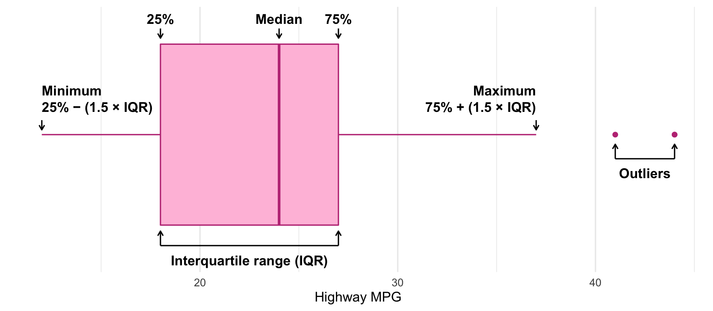



```{r setup}
#| include: false
library(countdown)

# Kompakte Ausgabe: max. 4 Zeilen je Tibble, Breite begrenzt -> kein Overflow auf den Folien
options(tibble.print_min = 4, tibble.print_max = 4, width = 95, pillar.width = 95,
        pillar.min_title_chars = 8)

datenpfad <- "../case-study/data"

# Zahlen deutsch formatieren (für Inline-Code im Text)
fmt <- function(x, d = 1) format(round(x, d), decimal.mark = ",", big.mark = ".", nsmall = d)

# QR-Code für kahoot.it (Paket qrcode; falls nicht installiert, erscheint nur der Link)
hat_qr <- requireNamespace("qrcode", quietly = TRUE)
```

# Rückblick und Ziele {.section background-color="#1d3f73"}

## Schätzfrage zum Einstieg

::: {.instructions}
**30 Sekunden, notieren Sie Ihren Tipp:**

- Welcher Landkreis hatte 2024 die **niedrigste** Arbeitslosenquote Deutschlands?
- Welcher die **höchste**?
- Auf welchem Platz liegt **Ulm**?
:::

Auflösung, sobald wir die Quote berechnet haben.

[Tipp: Öffnen Sie die Folien jetzt schon auf Ihrem Laptop. Die Code-Felder (webR) laden im Hintergrund ca. 20 Sekunden.]{.small}

::: {.notes}
Auflösung auf der Folie "Höchste und niedrigste Quote" im Abschnitt Überblick. Pointe: Platz 1 ist der Landkreis München (nicht die Stadt), Platz 2 Ulm.
:::

## Organisatorische Hinweise {.smaller}

:::: {.columns}
::: {.column width="50%"}
- Viele Deadlines
- Ungewohntes Format (sehr technisch)
- GitHub, RStudio, R
- Arbeitsschritte mit GitHub (3. Problem Set von GitHub herunterladen und lösen)

::: {.alert}
Das ist alles neu, und das ist uns bewusst!
:::
:::
::: {.column width="50%"}
::: {.question}
Warum das Ganze?
:::

::: {.fragment}
- Durch die Deadlines setzen Sie sich kontinuierlich mit dem Stoff auseinander
- GitHub, R, RStudio und Quarto brauchen Sie in den Projekten → Üben mit RTutor
- Visualisierung, Interpretation und Präsentation sind in den Projekten gefragt → Üben mit der Case-Study
- Arbeiten mit KI → lernen, wo Chat AI Ihre Arbeit sinnvoll ergänzt und wo nicht
:::
:::
::::

## Wo stehen wir? {.smaller}

**Teil 1** (✔): Daten beschaffen, bereinigen, prüfen → ein Datensatz `gesamtdaten` mit einer Zeile je Landkreis.

**Teil 2:** Was steht eigentlich in den Daten? Zwei Sitzungen:

- **Sitzung 1:** Grundlagen → Überblick → Tabellen
- **Sitzung 2:** Grafiken → Karten → Zusammenhänge

Ziele:

- Daten **beschreiben**: Kennzahlen und Tabellen (`skimr`, `kableExtra`)
- Daten **zeigen**: Verteilungen, Zeitreihen, Karten (`ggplot2`, `sf`, `plotly`)
- **Zusammenhänge** mit Korrelationen quantifizieren
- Tabellen und Grafiken **prüfen**, egal ob von Ihnen oder von Chat AI

. . .

::: {.callout-tip title="Das eigentliche Lernziel von Teil 2"}
Tabellen und Grafiken **erstellen** kann Chat AI in Sekunden. Sie sollen sie **richtig lesen, ehrlich beschreiben und prüfen** können. Die 🐛 Bug Hunts (Nr. 6–10, weiter gezählt ab Teil 1) sind deshalb oft keine Code-Fehler, sondern **Denkfehler**: falscher Nenner, falsche Formel, falsche Legende, falsche Interpretation.
:::

[*Landkreis* steht im Folgenden für Landkreise **und** kreisfreie Städte (Kreisebene). Im dritten RTutor Problem Set visualisieren Sie Daten zu Ländern auf europäischer Ebene.]{.small}

## Daten und Pakete laden

Wir laden die in Teil 1 erstellten Datensätze:

```{r pakete}
library(tidyverse)
library(skimr)
library(kableExtra)
library(sf)
library(plotly)

gesamtdaten   <- readRDS(file.path(datenpfad, "gesamtdaten.rds"))
bip_zeitreihe <- readRDS(file.path(datenpfad, "bip_zeitreihe.rds"))
landkreise    <- readRDS(file.path(datenpfad, "landkreise.rds"))   # Geodaten (sf)
bundesland    <- readRDS(file.path(datenpfad, "bundesland.rds"))   # Geodaten (sf)
```

::: {.callout-note appearance="simple"}
Im RStudio-Projekt `case-study/` lautet der Pfad einfach `datenpfad <- "data"`.
:::

# Grundlagen {.section background-color="#1d3f73"}

[Grundlagen]{.hier} → Überblick → Tabellen → Grafiken → Karten → Zusammenhänge

::: {.lernziele}
**Nach diesem Abschnitt können Sie …**

- eine Aussage als deskriptiv oder induktiv einordnen,
- die passenden Werkzeuge für eine bzw. zwei Variablen benennen,
- einen Boxplot lesen (Box, Whisker, Ausreißer).
:::

## Deskriptive vs. induktive Statistik

- **Deskriptive** (beschreibende) Statistik beschreibt den vorliegenden Datensatz
- **Induktive** (schließende) Statistik schließt von einer Stichprobe auf die Grundgesamtheit

. . .

Aber:

- Die Formel für den Mittelwert ist in beiden Fällen dieselbe
- Der Datensatz kann derselbe sein

. . .

::: {.question}
Worin genau besteht dann der Unterschied?
:::

::: {.notes}
Zielantwort: in der Frage, die man stellt. Interessiert mich der Datensatz selbst (deskriptiv) oder eine Population, aus der der Datensatz nur eine Stichprobe ist (induktiv)?
:::

## Deskriptive Statistik

:::: {.columns}
::: {.column width="50%"}
**Deskriptiv**

- Interesse gilt dem **Datensatz selbst**
- Beispiel: Arbeitslose aller Landkreise laut Arbeitsagentur (**Vollerhebung**)
- Darstellung als Tabelle oder Grafik
:::
::: {.column width="50%"}
**Induktiv**

- Interesse gilt der **Population**, beobachtet ist nur eine (zufällige) Stichprobe
- Beispiel: Mikrozensus, eine Befragung zufällig ausgewählter Haushalte
- Typische Ziele: **Vorhersage** und **kausale Zusammenhänge**
:::
::::

. . .

::: {.alert}
In die induktive Statistik tauchen wir nächstes Semester tiefer ein.
:::

## Deskriptiv oder induktiv?

::: {.instructions}
**Handzeichen:** deskriptiv ✋ oder induktiv ✌️?

1. "Bremerhaven hatte 2024 eine höhere Arbeitslosenquote als die Stadt Bremen."
2. "Laut Mikrozensus ist der Anteil der Teilzeitbeschäftigten in Deutschland gestiegen."
3. "Landkreise in Ostdeutschland haben im Mittel eine höhere Arbeitslosenquote als in Westdeutschland."
4. "Eine Umfrage unter 300 Studierenden in Ulm zeigt: Studierende in Deutschland nutzen Chat AI täglich."
:::

```{r}
#| echo: false
countdown(minutes = 1, bottom = 0, right = 0)
```

::: {.notes}
1 deskriptiv (Vollerhebung, Aussage über die Daten). 2 induktiv (Stichprobe → Population). 3 deskriptiv, solange es um genau diese Landkreise in 2024 geht; induktiv, wenn man daraus auf "Ostdeutschland generell" schließt. Schöne Diskussion. 4 induktiv, und zwar ein schlechter Schluss: Ulmer Studierende sind keine Zufallsstichprobe aller Studierenden.
:::

## Werkzeuge der deskriptiven Statistik

| | Kennzahlen | Grafiken |
|---|---|---|
| **Univariat** (eine Variable) | Mittelwert, Median, Standardabweichung, Quantile | Boxplot, Histogramm, Kerndichte |
| **Bivariat** (zwei Variablen) | Korrelationskoeffizient, Korrelationsmatrix | Streudiagramm |

. . .

Univariat: Überblick verschaffen, Eigenschaften einer Variablen aufzeigen.

Bivariat: Wenn sich eine Variable verändert, wie verändert sich die andere?

## Einen Boxplot lesen

:::: {.columns}
::: {.column width="60%"}
{width="100%"}
:::
::: {.column width="40%"}
::: {.question}
🔮 **Prognose:** Welcher Anteil der Beobachtungen liegt in der Box? Ab wann wird ein Punkt einzeln gezeichnet?
:::

::: {.fragment}
- Box = 25 %- bis 75 %-Quantil → **die mittleren 50 %**
- Whisker: bis max. 1,5 × Interquartilsabstand (IQR)
- Punkte weiter als 1,5 × IQR von der Box entfernt: einzeln gezeichnete **Ausreißer**
:::
:::
::::

# Überblick und Arbeitslosenquote {.section background-color="#1d3f73"}

Grundlagen ✔ → [Überblick]{.hier} → Tabellen → Grafiken → Karten → Zusammenhänge

::: {.lernziele}
**Nach diesem Abschnitt können Sie …**

- mit `skimr` in Sekunden einen Überblick über einen Datensatz gewinnen,
- fehlende Werte auf ihre Ursache zurückführen,
- prüfen, ob eine Kennzahl so definiert ist, wie Sie denken.
:::

## Arbeitslosenquote berechnen

::: {.instructions}
**Zuerst:** Überblick gewinnen. Wie viele Landkreise haben wir? Wie sind Schulden, Arbeitslosigkeit und BIP verteilt?
:::

Dafür brauchen wir zuerst die Arbeitslosenquote:

$$
\text{Arbeitslosenquote} = \frac{\text{Arbeitslose}}{\text{Erwerbstätige} + \text{Arbeitslose}} \times 100
$$

```{r alo_quote}
gesamtdaten <- gesamtdaten |>
  mutate(alo_quote = total_alo / (erw + total_alo) * 100)
```

```{r}
#| echo: false
n_lk      <- nrow(gesamtdaten)
n_namen   <- n_distinct(gesamtdaten$landkreis_name)
quote_agg <- 100 * sum(gesamtdaten$total_alo) / sum(gesamtdaten$erw + gesamtdaten$total_alo)

# BIP 2024 so, wie es aus der Excel-Datei kommt (vor der Korrektur in Teil 1):
# Hamburg und Berlin nur mit Länderschlüssel 02 / 11
bip_2024_roh <- bip_zeitreihe |>
  filter(Jahr == 2024,
         (nchar(Regionalschluessel) == 5 & !Regionalschluessel %in% c("02000", "11000")) |
           Regionalschluessel %in% c("02", "11")) |>
  select(Regionalschluessel, bip, bip_pro_kopf)
s_alo <- gesamtdaten |>
  summarise(mean = mean(alo_quote, na.rm = TRUE), sd = sd(alo_quote, na.rm = TRUE),
            median = median(alo_quote, na.rm = TRUE))
s_sch <- gesamtdaten |>
  summarise(mean = mean(Schulden_pro_kopf_lk, na.rm = TRUE), sd = sd(Schulden_pro_kopf_lk, na.rm = TRUE),
            median = median(Schulden_pro_kopf_lk, na.rm = TRUE))
s_bip <- gesamtdaten |>
  summarise(mean = mean(bip_pro_kopf, na.rm = TRUE), sd = sd(bip_pro_kopf, na.rm = TRUE),
            median = median(bip_pro_kopf, na.rm = TRUE))
```

## Ein erster schneller Blick

**Quick and dirty:** Wie viele Erwerbstätige und Einwohner hat Deutschland laut unseren Daten?

```{r}
gesamtdaten |>
  summarise(total_erw = sum(erw, na.rm = TRUE), total_einwohner = sum(Einwohner, na.rm = TRUE))
```

. . .

::: {.question}
Deutschland hat knapp 84 Mio. Einwohner. Wir kommen auf **`r fmt(sum(gesamtdaten$Einwohner, na.rm = TRUE) / 1e6)` Mio.** Wer fehlt?
:::

## Wer fehlt? {.smaller}

```{r}
gesamtdaten |>
  filter(is.na(Einwohner) | is.na(alo_quote)) |>
  select(Regionalschluessel, landkreis_name, Einwohner, erw, bip, alo_quote)
```

::: {.question}
Ist das eine **Eigenschaft der Daten** oder ein **Fehler**?
:::

. . .

**Eigenschaft der Daten:** `Einwohner` kommt aus der Schuldenstatistik der *Gemeinden*. Die Schulden der Stadtstaaten sind Landesschulden und stehen dort nicht drin.

::: {.callout-tip appearance="simple"}
`NA` ist nicht automatisch ein Fehler. Aber Sie sollten für **jedes** `NA` sagen können, *warum* es da ist.
:::

## 🔁 Erinnern Sie sich? Sonderfall Stadtstaaten

::: {.instructions}
**30 Sekunden, Handzeichen:** In Teil 1 haben wir vor dem Merge `stadtstaaten_als_kreis()` eingefügt. Was wäre **ohne** diesen Schritt mit Hamburg und Berlin passiert?

**(a)** Fehlermeldung **(b)** Warnung **(c)** Die Zeilen fallen weg **(d)** BIP und Erwerbstätige werden still `NA`
:::

. . .

**(d)**: Im BIP-Datensatz heißen sie nur `02` und `11`, in den Arbeitslosendaten `02000` und `11000`. `left_join()` findet keinen Partner und meldet **nichts**.

::: {.callout-tip appearance="simple"}
**Nach jedem Join:** `colSums(is.na())` **und** fragen, *welche* Zeilen `NA` sind. Fehlen bekannte, große Einheiten (Hamburg! Berlin!), ist es fast nie eine Eigenschaft der Daten.
:::

::: {.notes}
Diesen Fehler hatten wir in der ersten Version der Case-Study selbst übersehen. Das ruhig offen sagen: Genau so passieren stille Fehler in echten Projekten. Eine Übung dazu steht im Anhang "Zum Selbststudium".
:::

## Überblick mit `skimr`

::: {.instructions}
Etwas besser als `summarise()`: `skimr` liefert für alle Variablen auf einmal einen Überblick.
:::

```{r}
#| output-location: fragment
gesamtdaten |>
  select(alo_quote, Schulden_pro_kopf_lk, bip_pro_kopf, landkreis_name) |>
  skim_without_charts() |>
  yank("character")
```

. . .

::: {.question}
`r n_lk` Beobachtungen, aber nur **`r n_namen`** verschiedene Namen. Woher kommt das?
:::

## Zwei Mal "München"?

```{r}
gesamtdaten |>
  filter(landkreis_name %in% c("München", "Augsburg", "Würzburg")) |>
  select(Regionalschluessel, landkreis_name, bundesland_name) |>
  print(n = 6)
```

. . .

- `09162` ist die **Stadt** München, `09184` der **Landkreis** München
- Gleicher Name, anderer Regionalschlüssel → zwei Beobachtungen
- Das betrifft `r sum(duplicated(gesamtdaten$landkreis_name) | duplicated(gesamtdaten$landkreis_name, fromLast = TRUE))` Zeilen

::: {.alert}
Darum mergen wir **immer über den Schlüssel, nie über Namen.**
:::

## Stimmen die `r n_lk` Beobachtungen?

::: {.question}
Wie viele Landkreise und kreisfreie Städte hat Deutschland?
:::

. . .

- [294 Landkreise](https://de.wikipedia.org/wiki/Liste_der_Landkreise_in_Deutschland)
- [106 kreisfreie Städte](https://de.wikipedia.org/wiki/Liste_der_kreisfreien_St%C3%A4dte_in_Deutschland)
- Zusammen: **400** ✔

. . .

::: {.callout-tip appearance="simple"}
Das ist Prüfschritt 7 der Checkliste aus Teil 1: **eine Zahl, die Sie aus einer anderen Quelle kennen.**
:::

## Die numerischen Variablen {.smaller}

```{r}
gesamtdaten |>
  select(alo_quote, Schulden_pro_kopf_lk, bip_pro_kopf) |>
  skim_without_charts() |>
  yank("numeric")
```

::: {.instructions}
**5 Minuten, zu zweit:** Wählen Sie **eine** Variable und beschreiben Sie sie in eigenen Worten: Mittelwert, Standardabweichung, Median. Was sagt das Verhältnis von Mittelwert zu Median?
:::

```{r}
#| echo: false
countdown(minutes = 5, bottom = 0, right = 0)
```

## Die Tabelle beschrieben {.smaller}

:::: {.columns}
::: {.column width="33%"}
**Arbeitslosenquote**

- Mittelwert: **`r fmt(s_alo$mean, 2)` %**
- SD: `r fmt(s_alo$sd, 2)` Prozent**punkte** → deutliche regionale Unterschiede
- Median: `r fmt(s_alo$median, 2)` % → nahe am Mittelwert, kaum extreme Ausreißer
:::
::: {.column width="33%"}
**Schulden pro Kopf**

- Mittelwert: **`r fmt(s_sch$mean, 0)` €**
- SD: `r fmt(s_sch$sd, 0)` € → sehr hohe Streuung
- Median: `r fmt(s_sch$median, 0)` € → deutlich darunter: einige sehr hoch verschuldete Kreise ziehen den Mittelwert hoch
:::
::: {.column width="33%"}
**BIP pro Kopf**

- Mittelwert: **`r fmt(s_bip$mean, 0)` €**
- SD: `r fmt(s_bip$sd, 0)` € → hohe Streuung
- Median: `r fmt(s_bip$median, 0)` € → darunter: einige sehr reiche Kreise (Wolfsburg, Ingolstadt, …)
:::
::::

. . .

::: {.alert}
Mittelwert deutlich über dem Median → **rechtsschiefe Verteilung.** Ein Histogramm zeigt das gleich auf einen Blick.
:::

## Auflösung: höchste und niedrigste Quote

:::: {.columns}
::: {.column width="50%"}
```{r}
gesamtdaten |>
  slice_min(alo_quote, n = 3) |>
  select(Regionalschluessel, landkreis_name, alo_quote)
```
:::
::: {.column width="50%"}
```{r}
gesamtdaten |>
  slice_max(alo_quote, n = 3) |>
  select(Regionalschluessel, landkreis_name, alo_quote)
```
:::
::::

. . .

- Platz 1 ist der **Landkreis** München (`09184`), nicht die Stadt. Daher: immer über den Schlüssel!
- Platz 2: **Ulm**. Merken Sie sich das. Gleich sehen wir, warum Ulm so gut dasteht.

## Konsistenzcheck gegen die amtliche Quote

Die Bundesagentur für Arbeit meldet für 2024 eine Arbeitslosenquote von **6,0 %** im Jahresdurchschnitt ([Quelle: BA, Jahresrückblick 2024](https://www.arbeitsagentur.de/presse/2025-02-jahresrueckblick-2024)). Und wir?

```{r}
gesamtdaten |>
  summarise(quote_deutschland = sum(total_alo) / sum(erw + total_alo) * 100)
```

. . .

Erst summieren, dann teilen (wie in Bug Hunt 4 aus Teil 1): **`r fmt(quote_agg, 2)` %**. Nah dran, aber zu niedrig.

::: {.question}
Woher kommt der Rest? Schauen wir uns den Nenner genauer an.
:::

## 🐛 Bug Hunt 6: Mehr Erwerbstätige als Einwohner? {.bughunt .smaller}
Unsere Quote: `total_alo / (erw + total_alo)`. Hier das Verhältnis von Erwerbstätigen (`erw`) zu Einwohnern:

```{r}
gesamtdaten |>
  mutate(erw_je_ew = erw / Einwohner) |>
  filter(!is.na(erw_je_ew)) |>
  arrange(desc(erw_je_ew)) |>
  select(landkreis_name, erw, Einwohner, erw_je_ew, alo_quote) |>
  slice(c(1:3, (n() - 2):n())) |>     # die drei höchsten und die drei niedrigsten
  print(n = 6)
```

::: {.instructions}
**2 Minuten, zu zweit:** Wie kann ein Kreis **mehr Erwerbstätige als Einwohner** haben? Was bedeutet das für unsere Quote in Schweinfurt und in der Südwestpfalz?
:::

```{r}
#| echo: false
countdown(minutes = 2, bottom = 0, right = 0)
```

## 🐛 Bug Hunt 6: Auflösung {.bughunt}

- Arbeitslose werden am **Wohnort** gezählt, Erwerbstätige (VGR) am **Arbeitsort**
- Schweinfurt: viele **Einpendler:innen** → großer Nenner → Quote **zu niedrig**
- Südwestpfalz: viele **Auspendler:innen** (nach Pirmasens, Kaiserslautern) → kleiner Nenner → Quote **zu hoch**

. . .

::: {.callout-important appearance="simple"}
Die Formel ist mathematisch richtig, aber **Zähler und Nenner passen nicht zusammen**. Die BA rechnet mit Erwerbspersonen am Wohnort. Diese Zahl haben wir auf Kreisebene nicht.
:::

::: {.notes}
Für Deutschland insgesamt gleichen sich Ein- und Auspendler weitgehend aus. Der Rest der Lücke zu den 6 % liegt an der unterschiedlichen Abgrenzung von Erwerbstätigen (VGR) und Erwerbspersonen (BA).
:::

## ✍️ Jetzt Sie: der Pendler-Check

Wenden Sie das auf **Baden-Württemberg** an: `erw_je_ew` berechnen, absteigend sortieren. Wo liegen **Ulm** und der **Alb-Donau-Kreis**, der Ulm umschließt?

```{webr}
#| setup: true
#| exercise: ex_t2_pendler
library(dplyr); library(readr)
gesamtdaten <- read_csv("data-webr/t2_gesamtdaten.csv", col_types = cols(Regionalschluessel = "c"))
```

```{webr}
#| exercise: ex_t2_pendler
gesamtdaten |>
  filter(bundesland_name == "Baden-Württemberg") |>
  mutate(erw_je_ew = ______) |>
  arrange(______) |>
  select(landkreis_name, erw_je_ew, alo_quote) |>
  print(n = 44)
```

```{r}
#| echo: false
countdown(minutes = 4, bottom = 0, right = 0)
```

::: {.hint exercise="ex_t2_pendler"}
::: {.callout-note collapse="false"}
## Hinweis
Absteigend sortieren mit `arrange(desc(erw_je_ew))`.
:::
:::

::: {.solution exercise="ex_t2_pendler"}
::: {.callout-tip collapse="false"}
## Lösung
```r
gesamtdaten |>
  filter(bundesland_name == "Baden-Württemberg") |>
  mutate(erw_je_ew = erw / Einwohner) |>
  arrange(desc(erw_je_ew)) |>
  select(landkreis_name, erw_je_ew, alo_quote) |>
  print(n = 44)
```
:::
:::

```{webr}
#| exercise: ex_t2_pendler
#| check: true
r <- .result
ok <- is.data.frame(r) && "erw_je_ew" %in% names(r) && nrow(r) == 44 &&
  !is.unsorted(rev(r$erw_je_ew), na.rm = TRUE)
if (ok) {
  list(correct = TRUE, message = "Richtig. Ulm (oben) hat mehr Erwerbstätige als Einwohner, der Alb-Donau-Kreis (ganz unten) nur 0,41. Dieselbe Region, nur anders zerschnitten. Daher Ulms Platz 2 bei der Quote.")
} else if (is.data.frame(r) && "erw_je_ew" %in% names(r)) {
  list(correct = FALSE, message = "Berechnet, aber noch nicht absteigend sortiert (oder nicht nur Baden-Württemberg).")
} else {
  list(correct = FALSE, message = "Es fehlt die Spalte erw_je_ew = erw / Einwohner.")
}
```

## 🐛 Bug Hunt 6: Was lernen wir? {.bughunt}

- Unsere Quote ist eine **Näherung**: Für Städte und ihr Umland ist sie verzerrt, auch für die Stadtstaaten. Für große Regionen (Ost/West, Flächenländer) gleichen sich Ein- und Auspendler weitgehend aus.
- Dieselbe Verzerrung steckt in **jeder** Kennzahl, die Arbeitsort- und Wohnort-Größen mischt, z.B. im BIP pro Kopf.

. . .

::: {.callout-important appearance="simple"}
Chat AI berechnet Ihnen jede Kennzahl, die Sie verlangen. Ob **Zähler und Nenner zusammenpassen** (gleiches Gebiet, gleiches Jahr, gleiche Zählweise), müssen Sie prüfen: **Dokumentation der Quelle lesen.**
:::

# Deskriptive Tabellen {.section background-color="#1d3f73"}

Grundlagen ✔ → Überblick ✔ → [Tabellen]{.hier} → Grafiken → Karten → Zusammenhänge

::: {.lernziele}
**Nach diesem Abschnitt können Sie …**

- Kennzahlen je Gruppe mit `group_by()` und `summarise()` berechnen,
- eine Tabelle mit `kableExtra` ansprechend gestalten,
- prüfen, ob eine Kennzahl das misst, was in der Überschrift steht.
:::

## Arbeitslosenquote auf Bundeslandebene

::: {.instructions}
Gibt es deutliche Unterschiede zwischen den Bundesländern? Wir aggregieren die Landkreise je Bundesland.
:::

```{r bula_data}
#| code-line-numbers: "2|3-5"
bula_data <- gesamtdaten |>
  group_by(bundesland_name) |>
  summarise(mean_alo   = mean(alo_quote),
            sd_alo     = sd(alo_quote),
            median_alo = median(alo_quote))
```

. . .

::: {.question}
🔮 **Prognose:** Welches Bundesland hat die **höchste** mittlere Arbeitslosenquote? Und wo landet Baden-Württemberg?
:::

```{r}
#| echo: false
ost_laender <- c("Brandenburg", "Mecklenburg-Vorpommern", "Sachsen", "Sachsen-Anhalt", "Thüringen")
bula_tabelle <- bula_data |> arrange(mean_alo)
ost_zeilen   <- which(bula_tabelle$bundesland_name %in% ost_laender)
bremen       <- gesamtdaten |> filter(bundesland_name == "Bremen")
bremen_gew   <- 100 * sum(bremen$total_alo) / sum(bremen$erw + bremen$total_alo)
```

## Vom Tibble zur Tabelle {.smaller}

:::: {.columns}
::: {.column width="60%"}
```{r}
#| eval: false
#| code-line-numbers: "1|2-3|4|5|6|7|8-10"
bula_data |>
  arrange(mean_alo) |>
  kbl(col.names = c("Bundesland", "Mittelwert", "SD", "Median"),
      digits = 2, format.args = list(decimal.mark = ",")) |>
  kable_styling(font_size = 14) |>
  kable_paper(full_width = FALSE) |>
  row_spec(c(8, 9, 10, 12, 13), bold = TRUE, color = "white", background = "#BBBBBB") |>
  add_header_above(c(" " = 1, "Arbeitslosenquote" = 3)) |>
  footnote(general = "Die ostdeutschen Bundesländer sind grau hinterlegt.",
           general_title = "Bitte beachten: ")
```
:::
::: {.column width="40%"}
| Funktion | macht … |
|---|---|
| `kbl()` | Tibble → HTML-Tabelle, Spaltennamen, Rundung |
| `kable_styling()` | Schriftgröße, Layout |
| `row_spec()` | einzelne Zeilen hervorheben |
| `add_header_above()` | Überschrift über mehrere Spalten |
| `footnote()` | Fußnote |
:::
::::

Das Ergebnis sehen Sie auf der nächsten Folie.

::: {.notes}
Nur die Funktionen erklären. Die Tabelle selbst kommt auf der nächsten Folie als Bug Hunt 7.
:::

## 🐛 Bug Hunt 7: Was stimmt nicht? {.bughunt}

:::: {.columns}
::: {.column width="45%"}
Das ist der Code von eben. Er stammt aus der Vorlesung im letzten Jahr und lief damals einwandfrei. Dieses Jahr läuft er auch: ohne Fehler, ohne Warnung.

::: {.instructions}
**2 Minuten, zu zweit:** Lesen Sie die Fußnote und dann die grauen Zeilen. Was ist falsch? **Warum** war es letztes Jahr richtig?
:::

```{r}
#| echo: false
countdown(minutes = 2, bottom = 0, right = 0)
```
:::
::: {.column width="55%"}
```{r}
#| echo: false
bula_tabelle |>
  kbl(col.names = c("Bundesland", "Mittelwert", "SD", "Median"), digits = 2,
      format.args = list(decimal.mark = ",")) |>
  kable_styling(font_size = 14) |>
  kable_paper(full_width = FALSE) |>
  row_spec(c(8, 9, 10, 12, 13), bold = TRUE, color = "white", background = "#BBBBBB") |>
  footnote(general = "Die ostdeutschen Bundesländer sind grau hinterlegt.",
           general_title = "Bitte beachten: ")
```
:::
::::

::: {.notes}
Grau hinterlegt sind Saarland und NRW, Brandenburg und Sachsen-Anhalt dagegen nicht. Letztes Jahr fehlten Hamburg und Berlin (Stadtstaaten-Join) und wurden herausgefiltert. Jetzt steht Hamburg auf Platz 6 und schiebt alle Länder darunter um eine Zeile nach unten (Berlin steht auf Platz 15, unterhalb der markierten Zeilen).
:::

## 🐛 Bug Hunt 7: Prüfung {.bughunt .smaller}

In welchen Zeilen stehen die ostdeutschen Länder wirklich?

:::: {.columns}
::: {.column width="52%"}
```{r}
bula_tabelle |>
  mutate(zeile = row_number()) |>
  filter(bundesland_name %in% ost_laender) |>
  select(zeile, bundesland_name, mean_alo) |>
  print(n = 5)
```
:::
::: {.column width="48%"}
::: {.fragment}
- `row_spec(c(8, 9, 10, 12, 13))` war **per Hand abgezählt**.
- Durch die Stadtstaaten-Korrektur steht Hamburg jetzt auf Platz 6, alles darunter verschiebt sich.
- Dieselbe Falle wie in Teil 1: `sheet_names[7:19]`, `[1:7]`, `data_alo[-c(1, 2), ]`.

::: {.callout-tip appearance="simple"}
**Nie per Hand abzählen.** Zeilen und Spalten über ihren **Inhalt** auswählen, nicht über ihre **Position**.
:::
:::
:::
::::

## ✍️ Jetzt Sie: Bug Hunt 7 reparieren {.bughunt}

`bula_tabelle` ist die sortierte Tabelle, `ost_laender` der Vektor mit den fünf ostdeutschen Ländern. Berechnen Sie `ost_zeilen` so, dass sie **immer** stimmen, egal wie die Tabelle sortiert ist.

```{webr}
#| setup: true
#| exercise: ex_t2_bh3
library(dplyr); library(readr)
bula_tabelle <- read_csv("data-webr/t2_bula_tabelle.csv", show_col_types = FALSE)
ost_laender  <- c("Brandenburg", "Mecklenburg-Vorpommern", "Sachsen", "Sachsen-Anhalt", "Thüringen")
```

```{webr}
#| exercise: ex_t2_bh3
ost_zeilen <- c(8, 9, 10, 12, 13)

bula_tabelle$bundesland_name[ost_zeilen]
```

```{r}
#| echo: false
countdown(minutes = 4, bottom = 0, right = 0)
```

::: {.hint exercise="ex_t2_bh3"}
::: {.callout-note collapse="false"}
## Hinweis
`which()` gibt die Positionen zurück, an denen eine Bedingung `TRUE` ist. Die Bedingung: `bula_tabelle$bundesland_name %in% ost_laender`.
:::
:::

::: {.solution exercise="ex_t2_bh3"}
::: {.callout-tip collapse="false"}
## Lösung
```r
ost_zeilen <- which(bula_tabelle$bundesland_name %in% ost_laender)

bula_tabelle$bundesland_name[ost_zeilen]
```
In der Tabelle dann: `row_spec(ost_zeilen, bold = TRUE, ...)`
:::
:::

```{webr}
#| exercise: ex_t2_bh3
#| check: true
r <- .result
ok <- is.character(r) && length(r) == 5 && setequal(r, .envir_prep$ost_laender)
if (ok) {
  list(correct = TRUE, message = "Genau die fünf ostdeutschen Länder. Und das bleibt so, auch wenn nächstes Jahr wieder eine Zeile dazukommt.")
} else {
  list(correct = FALSE, message = "Die ausgegebenen Länder sind noch nicht genau die fünf ostdeutschen. Hinweis aufklappen.")
}
```

## Die korrigierte Tabelle {.smaller}

:::: {.columns}
::: {.column width="55%"}
```{r}
#| echo: false
bula_tabelle |>
  kbl(col.names = c("Bundesland", "Mittelwert", "SD", "Median"), digits = 2,
      format.args = list(decimal.mark = ",")) |>
  kable_styling(font_size = 14) |>
  kable_paper(full_width = FALSE) |>
  row_spec(ost_zeilen, bold = TRUE, color = "white", background = "#BBBBBB") |>
  add_header_above(c(" " = 1, "Arbeitslosenquote" = 3)) |>
  footnote(general = "Berlin und Hamburg bestehen aus nur einem Kreis, daher keine SD.",
           general_title = "Bitte beachten: ",
           number = "Die ostdeutschen Bundesländer sind grau hinterlegt.")
```
:::
::: {.column width="45%"}
::: {.question}
Was ist hier eine **Beobachtung**? Und was lernen wir aus der Tabelle?
:::

::: {.fragment}

- Süden: Bayern und Baden-Württemberg im Mittel um **4 % oder darunter**, mit geringer Streuung
- Alle ostdeutschen Länder über **`r fmt(floor(10 * min(bula_tabelle$mean_alo[ost_zeilen])) / 10, 1)` %**

:::
::: {.fragment}

- Aber: NRW (`r fmt(bula_tabelle$mean_alo[bula_tabelle$bundesland_name == "Nordrhein-Westfalen"], 1)` %) liegt im Ost-Bereich und hat die **höchste Streuung** der Flächenländer (`r fmt(bula_tabelle$sd_alo[bula_tabelle$bundesland_name == "Nordrhein-Westfalen"], 2)`): Ruhrgebiet vs. Münsterland
- Median meist nahe am Mittelwert
:::
:::
::::

::: {.notes}
Beobachtung: ein Bundesland (aggregiert aus Landkreisen). Bremen steht ganz unten. Das leitet über zu Bug Hunt 4 aus Teil 1.
:::

## 🔁 Wiedersehen mit Bug Hunt 4 (Teil 1): Bremen {.bughunt}

Laut Tabelle hat **Bremen** die höchste Arbeitslosenquote: **`r fmt(bula_tabelle$mean_alo[bula_tabelle$bundesland_name == "Bremen"], 1)` %**. Das Land Bremen besteht aus zwei Kreisen:

```{r}
gesamtdaten |>
  filter(bundesland_name == "Bremen") |>
  select(landkreis_name, total_alo, erw, alo_quote)
```

::: {.instructions}
**2 Minuten:** Ist `r fmt(bula_tabelle$mean_alo[bula_tabelle$bundesland_name == "Bremen"], 1)` % die Arbeitslosenquote **des Landes Bremen**? Wie hoch ist sie wirklich? Woher kennen Sie das Problem?
:::

```{r}
#| echo: false
countdown(minutes = 2, bottom = 0, right = 0)
```

## 🔁 Bremen: Prüfung {.bughunt .smaller}
`mean(alo_quote)` ist das Mittel aus Bremen (`r fmt(bremen$alo_quote[1], 1)` %) und Bremerhaven (`r fmt(bremen$alo_quote[2], 1)` %), obwohl Bremen sechsmal so viele Erwerbstätige hat. Die Quote des Landes: **erst summieren, dann teilen.**

```{r}
gesamtdaten |>
  group_by(bundesland_name) |>
  summarise(mittel_kreise = mean(alo_quote),
            quote_land    = sum(total_alo) / sum(erw + total_alo) * 100) |>
  arrange(desc(abs(quote_land - mittel_kreise))) |>
  print(n = 4)
```

. . .

::: {.callout-important appearance="simple"}
Beide Zahlen sind richtig gerechnet, sie beantworten nur **verschiedene Fragen**: "Wie geht es dem *durchschnittlichen Landkreis*?" vs. "Wie hoch ist die Quote *im Land*?" Der Fehler ist, die eine zu berechnen und die andere in die Überschrift zu schreiben.
:::

[**Faustregel:** Ob das Mittel der Kreise über oder unter der Landesquote liegt, hängt davon ab, ob die **großen** Kreise eine niedrige oder hohe Quote haben. In Bremen hat die große Stadt die niedrigere Quote → das Mittel ist zu hoch.]{.small}

## ✍️ Jetzt Sie: die Länderquote

Berechnen Sie je Bundesland `quote_land` (gewichtet: Summen, dann teilen) und `mittel_kreise` (ungewichtet), sowie deren Differenz `diff`. Sortieren Sie nach `diff`.

```{webr}
#| setup: true
#| exercise: ex_t2_land
library(dplyr); library(readr)
gesamtdaten <- read_csv("data-webr/t2_gesamtdaten.csv", col_types = cols(Regionalschluessel = "c"))
```

```{webr}
#| exercise: ex_t2_land
gesamtdaten |>
  group_by(bundesland_name) |>
  summarise(mittel_kreise = ______,
            quote_land    = ______) |>
  mutate(diff = quote_land - mittel_kreise) |>
  arrange(diff) |>
  print(n = 16)
```

```{r}
#| echo: false
countdown(minutes = 4, bottom = 0, right = 0)
```

::: {.hint exercise="ex_t2_land"}
::: {.callout-note collapse="false"}
## Hinweis
Die Quote eines Landkreises ist `total_alo / (erw + total_alo) * 100`. Für das Land: dieselbe Formel, aber mit `sum()` um Zähler und Nenner.
:::
:::

::: {.solution exercise="ex_t2_land"}
::: {.callout-tip collapse="false"}
## Lösung
```r
gesamtdaten |>
  group_by(bundesland_name) |>
  summarise(mittel_kreise = mean(alo_quote),
            quote_land    = sum(total_alo) / sum(erw + total_alo) * 100) |>
  mutate(diff = quote_land - mittel_kreise) |>
  arrange(diff) |>
  print(n = 16)
```
:::
:::

```{webr}
#| exercise: ex_t2_land
#| check: true
r <- .result
soll <- .envir_prep$gesamtdaten |> dplyr::group_by(bundesland_name) |>
  dplyr::summarise(q = sum(total_alo) / sum(erw + total_alo) * 100)
ok <- is.data.frame(r) && all(c("bundesland_name", "quote_land", "diff") %in% names(r)) &&
  nrow(r) == 16 &&
  isTRUE(all.equal(r$quote_land[order(r$bundesland_name)], soll$q[order(soll$bundesland_name)], tolerance = 1e-6))
if (ok) {
  list(correct = TRUE, message = "Richtig. In 12 der 14 Länder mit mehr als einem Kreis liegt das Mittel der Kreise über der Landesquote: Die Kreise mit vielen Erwerbstätigen, oft Städte mit vielen Einpendler:innen, haben dort eine niedrigere Quote (Bug Hunt 6).")
} else {
  list(correct = FALSE, message = "quote_land stimmt noch nicht: Summe der Arbeitslosen geteilt durch Summe von Erwerbstätigen plus Arbeitslosen, mal 100.")
}
```

::: {.notes}
Auflösung der Frage aus dem Check: Große Städte haben viele Einpendler, also einen großen Nenner und eine (künstlich) niedrige Quote. Im gewichteten Wert zählen sie stark, im Mittel nur einfach. Gewichtung und Pendler-Verzerrung wirken hier zusammen.
:::

## Ost und West

Die Tabelle legt nahe: Der Unterschied verläuft zwischen Ost und West. Dafür eine neue Variable:

```{r ost}
#| code-line-numbers: "2|3"
gesamtdaten <- gesamtdaten |>
  mutate(ost      = bundesland_name %in% ost_laender,
         ost_name = if_else(ost, "Ostdeutschland", "Westdeutschland"))
```

. . .

::: {.question}
🔮 **Prognose:** Wohin gehört Berlin? Was würden Sie entscheiden, und warum?
:::

. . .

Wir ordnen Berlin **Westdeutschland** zu: Ost- und Westberlin sind in den Daten nicht getrennt. Wichtig ist nicht *welche* Entscheidung, sondern dass sie **dokumentiert** ist (Fußnote!).

## Ost und West im Vergleich {.smaller}
```{r ost_tabelle}
#| code-line-numbers: "1-6|7-11"
ost_west <- gesamtdaten |>
  group_by(ost_name) |>
  summarise(mean = mean(alo_quote), sd = sd(alo_quote),
            min  = min(alo_quote),  p25 = quantile(alo_quote, 0.25),
            median = median(alo_quote), p75 = quantile(alo_quote, 0.75),
            max  = max(alo_quote), n = n())
ost_west |>
  kbl(col.names = c("", "Mittelwert", "SD", "Min.", "P25", "Median", "P75", "Max.", "n"), digits = 2,
      format.args = list(decimal.mark = ",")) |>
  kable_styling(font_size = 16) |>
  add_header_above(c(" " = 1, "Arbeitslosenquote der Landkreise" = 7, " " = 1)) |>
  footnote(general = "Berlin ist Westdeutschland zugeordnet.", general_title = "Bitte beachten: ")
```

::: {.instructions}
**3 Min., zu zweit:** Beschreiben Sie die Tabelle in drei Sätzen, einer davon mit einem Quantil.
:::

```{r}
#| echo: false
countdown(minutes = 3, bottom = 0, right = 0)
```

## Ost und West: beschrieben

```{r}
#| echo: false
ow <- function(g, v) ost_west[[v]][ost_west$ost_name == g]
```

:::: {.columns}
::: {.column width="50%"}
- Mittelwert im Osten **`r fmt(ow("Ostdeutschland", "mean") - ow("Westdeutschland", "mean"), 1)` Prozentpunkte höher** (`r fmt(ow("Ostdeutschland", "mean"), 2)` % vs. `r fmt(ow("Westdeutschland", "mean"), 2)` %)
- Streuung im Westen **größer** (SD `r fmt(ow("Westdeutschland", "sd"), 2)` vs. `r fmt(ow("Ostdeutschland", "sd"), 2)`): Der Westen reicht von München bis Gelsenkirchen
- Westen: Median (`r fmt(ow("Westdeutschland", "median"), 2)` %) **deutlich unter** dem Mittelwert → einige Kreise mit sehr hoher Quote ziehen ihn hoch; Osten: Median ≈ Mittelwert
:::
::: {.column width="50%"}
::: {.fragment}
- **Quantile:** Drei Viertel der ostdeutschen Kreise liegen über `r fmt(ow("Ostdeutschland", "p25"), 2)` %, drei Viertel der westdeutschen unter `r fmt(ow("Westdeutschland", "p75"), 2)` %
- Selbst der beste ostdeutsche Kreis (`r fmt(ow("Ostdeutschland", "min"), 2)` %, `r gesamtdaten |> filter(ost) |> slice_min(alo_quote) |> pull(landkreis_name)`) liegt unter dem westdeutschen Median

::: {.alert}
Große Unterschiede zwischen Ost und West, aber auch **innerhalb** des Westens.
:::
:::
:::
::::

[Eine Tabelle mit Arbeitslosigkeit, BIP und Schulden je Bundesland finden Sie im Anhang und in der [ausformulierten Case-Study](../case-study/case_study_germany_2.html).]{.small}

## 📱 Kahoot-Checkpoint 1: Überblick und Tabellen {.kahoot}

:::: {.columns}
::: {.column width="35%"}
```{r}
#| echo: false
#| eval: !expr hat_qr
#| fig-width: 3
#| fig-height: 3
plot(qrcode::qr_code("https://kahoot.it"))
```

[**kahoot.it** · PIN am Beamer]{.pin}
:::
::: {.column width="65%"}
**10 Fragen, ca. 8 Minuten.** Diesmal müssen Sie nachdenken, nicht nur wiedererkennen.

- deskriptiv oder induktiv?
- Boxplot, Mittelwert vs. Median, Quantile
- Der stille Join und wie man ihn findet
- Bug Hunt 6: Wohnort vs. Arbeitsort
- Bug Hunt 7: feste Zeilennummern
- Bremen: Mittel der Kreise vs. Quote des Landes

[Kahoot öffnen →](https://create.kahoot.it/)
:::
::::

```{r}
#| echo: false
countdown(minutes = 8, bottom = 0, right = 0)
```

::: {.notes}
Fragen mit Antworten und Zeitlimits: kahoot_fragen_teil2.xlsx (im Format der Kahoot-Importvorlage). Nach dem Quiz die Frage mit der schlechtesten Trefferquote kurz an der passenden Folie nachbesprechen.
:::

## Ende von Sitzung 1

**Heute:** Daten beschreiben und prüfen: `skimr`, Tabellen, Kennzahlen je Gruppe.

**Bis zur nächsten Sitzung:**

- Abschnitt *Deskriptive Analysen* der [ausformulierten Case-Study](../case-study/case_study_germany_2.html) lesen
- Anhang "Zum Selbststudium" am Ende dieser Folien: Stadtstaaten-Join reparieren

::: {.alert}
Nächstes Mal: Grafiken, Karten und Zusammenhänge.
:::

# Sitzung 2 {.section background-color="#1d3f73"}

## Schätzfrage zum Einstieg

::: {.instructions}
**30 Sekunden, notieren:** Das mittlere BIP pro Kopf der ostdeutschen Landkreise lag 2024 bei wie viel Prozent des westdeutschen?

**(a)** 55 % **(b)** 65 % **(c)** 75 % **(d)** 85 %
:::

Und: Ist der Abstand seit 2000 kleiner oder größer geworden?

[Tipp: Folien jetzt auf dem Laptop öffnen, damit webR im Hintergrund lädt.]{.small}

::: {.notes}
Auflösung auf der Folie "Holt der Osten auf?": 75 %, relativ kleiner geworden (2000: 64 %), in Euro größer.
:::

# Grafiken {.section background-color="#1d3f73"}

Grundlagen ✔ → Überblick ✔ → Tabellen ✔ → [Grafiken]{.hier} → Karten → Zusammenhänge

::: {.lernziele}
**Nach diesem Abschnitt können Sie …**

- eine Verteilung zeigen, ohne Daten zu verstecken (Punkte + Boxplot, Histogramm),
- eine logarithmische Achse richtig lesen,
- eine Wachstumsrate richtig berechnen und prüfen,
- eine Grafik interaktiv machen (`plotly`).
:::

## Warum Grafiken?

::: {.alert}
Das Auge verarbeitet Informationen in einer Grafik deutlich schneller und intuitiver als in einer Tabelle.
:::

. . .

**Daten:** Arbeitslosenquote 2024 aller `r n_lk` Landkreise.

Die Grafik soll

- **alle Daten zeigen:** jeder Landkreis ein Punkt,
- einen **Boxplot** darüberlegen, um Ost und West zu vergleichen,
- **Baden-Württemberg** hervorheben: Wo stehen wir?

## Alle Daten zeigen {.smaller}

```{r}
#| echo: false
p_jitter <- gesamtdaten |>
  mutate(bw = bundesland_name == "Baden-Württemberg") |>
  ggplot(aes(x = ost_name, y = alo_quote)) +
  geom_jitter(aes(colour = bw), width = 0.25, height = 0, alpha = 0.6) +
  geom_boxplot(alpha = 0, outlier.shape = NA, width = 0.5) +
  scale_colour_manual(values = c("grey60", "#1b5e20"), guide = "none") +
  labs(title = "Arbeitslosenquote in Deutschland 2024",
       subtitle = "Ein Punkt = ein Landkreis, Baden-Württemberg grün",
       x = NULL, y = "Arbeitslosenquote (%)",
       caption = "Quelle: Bundesagentur für Arbeit, VGR der Länder") +
  theme_minimal(base_size = 15)
```

:::: {.columns}
::: {.column width="50%"}
```{r}
#| eval: false
#| code-line-numbers: "1-2|3|4|5|6|7-11"
gesamtdaten |>
  mutate(bw = bundesland_name == "Baden-Württemberg") |>
  ggplot(aes(x = ost_name, y = alo_quote)) +
  geom_jitter(aes(colour = bw), width = 0.25, height = 0, alpha = 0.6) +
  geom_boxplot(alpha = 0, outlier.shape = NA, width = 0.5) +
  scale_colour_manual(values = c("grey60", "#1b5e20"), guide = "none") +
  labs(title = "Arbeitslosenquote in Deutschland 2024",
       subtitle = "Ein Punkt = ein Landkreis, Baden-Württemberg grün",
       x = NULL, y = "Arbeitslosenquote (%)",
       caption = "Quelle: Bundesagentur für Arbeit, VGR der Länder") +
  theme_minimal(base_size = 15)
```

::: {.question}
🔮 Wozu `height = 0` und `outlier.shape = NA`? Was passiert ohne?
:::
:::
::: {.column width="50%"}
```{r}
#| echo: false
#| fig-width: 6
#| fig-height: 5
p_jitter
```
:::
::::

::: {.notes}
height = 0: Jitter verschiebt nur horizontal, sonst würden die Werte auf der y-Achse leicht verfälscht. outlier.shape = NA: Ausreißer sind schon als Jitter-Punkt da; ohne würden sie doppelt gezeichnet.
:::

## Beschreiben Sie das Schaubild {.smaller}
:::: {.columns}
::: {.column width="55%"}
```{r}
#| echo: false
#| fig-width: 6
#| fig-height: 5
p_jitter
```
:::
::: {.column width="45%"}
::: {.instructions}
**3 Min., zu zweit:** Beschreiben Sie das Schaubild in drei Sätzen. Wo liegt BW?
:::

```{r}
#| echo: false
countdown(minutes = 3, bottom = 0, right = 0)
```

```{r}
#| echo: false
med_west <- median(gesamtdaten$alo_quote[gesamtdaten$ost_name == "Westdeutschland"])
anteil_bw_unter <- with(gesamtdaten, mean(alo_quote[bundesland_name == "Baden-Württemberg"] < med_west))
p75_west <- quantile(gesamtdaten$alo_quote[gesamtdaten$ost_name == "Westdeutschland"], 0.75)
med_ost  <- median(gesamtdaten$alo_quote[gesamtdaten$ost_name == "Ostdeutschland"])
```

::: {.fragment}

- **`r round(100 * anteil_bw_unter)` %** der Kreise in BW liegen unter dem West-Median
- Median West `r fmt(med_west, 1)` % vs. Ost `r fmt(med_ost, 1)` %
- Selbst das 75 %-Quantil West (`r fmt(p75_west, 1)` %) liegt unter dem Ost-Median
- Fast alle Kreise unter 10 % ([Spanien: rund 11 %](https://ec.europa.eu/eurostat/databrowser/view/une_rt_a/default/table))
:::
:::
::::

## BIP pro Kopf: Unterschiede seit wann?

Gibt es auch beim **BIP pro Kopf** regionale Unterschiede? Und **war das schon immer so**?

- Bestehen die Unterschiede schon länger?
- Werden sie größer oder kleiner?

. . .

Ein hohes BIP pro Kopf kann bedeuten, dass

- viele Personen im Landkreis **erwerbstätig** sind, oder
- die Erwerbstätigen in Branchen mit **hoher Produktivität** arbeiten.

::: {.question}
Trifft der erste Punkt zu, sollte ein hohes BIP pro Kopf mit **niedriger Arbeitslosigkeit** einhergehen. Und wo kann es noch herkommen? (Tipp: Bug Hunt 6)
:::

::: {.notes}
BIP am Arbeitsort, geteilt durch Einwohner am Wohnort: Städte mit vielen Einpendler:innen haben ein sehr hohes BIP pro Kopf (Wolfsburg, Ingolstadt, München, Frankfurt). Dieselbe Pendler-Verzerrung wie bei der Quote.
:::

## BIP pro Kopf seit 2000

```{r}
#| echo: false
namen <- gesamtdaten |> select(Regionalschluessel, bundesland_name, landkreis_name, ost_name)

bip_zeitreihe_namen <- bip_zeitreihe |>
  filter(nchar(Regionalschluessel) == 5) |>
  inner_join(namen, by = "Regionalschluessel")
```

::: {.panel-tabset}

### Grafik

```{r}
#| echo: false
#| fig-width: 11
#| fig-height: 4.3
p_bip <- bip_zeitreihe_namen |>
  filter(Jahr >= 2000) |>
  group_by(ost_name, Jahr) |>
  mutate(durchschnitt = mean(bip_pro_kopf)) |>
  ungroup() |>
  ggplot(aes(x = Jahr)) +
  geom_line(aes(y = bip_pro_kopf, group = Regionalschluessel), colour = "grey80", linewidth = 0.3) +
  geom_line(aes(y = durchschnitt), colour = "#1d3f73", linewidth = 1.2) +
  geom_line(data = \(d) filter(d, landkreis_name == "Ulm"), aes(y = bip_pro_kopf),
            colour = "#1b5e20", linewidth = 1.2) +
  scale_y_log10(labels = scales::label_number(big.mark = ".", decimal.mark = ",", suffix = " €")) +
  facet_wrap(~ ost_name) +
  labs(title = "BIP pro Kopf der ost- und westdeutschen Landkreise",
       subtitle = "Grau: Landkreise, blau: Durchschnitt, grün: Ulm",
       x = NULL, y = "BIP pro Kopf (log-Skala)",
       caption = "Quelle: Statistische Ämter des Bundes und der Länder") +
  theme_minimal(base_size = 15)
p_bip
```

### Code

```{r}
#| eval: false
#| code-line-numbers: "1-3|4-6|7-11|12"
bip_zeitreihe_namen |>
  filter(Jahr >= 2000) |>
  group_by(ost_name, Jahr) |>
  mutate(durchschnitt = mean(bip_pro_kopf)) |>
  ungroup() |>
  ggplot(aes(x = Jahr)) +
  geom_line(aes(y = bip_pro_kopf, group = Regionalschluessel), colour = "grey80", linewidth = 0.3) +
  geom_line(aes(y = durchschnitt), colour = "#1d3f73", linewidth = 1.2) +
  geom_line(data = \(d) filter(d, landkreis_name == "Ulm"), aes(y = bip_pro_kopf),
            colour = "#1b5e20", linewidth = 1.2) +
  scale_y_log10() +
  facet_wrap(~ ost_name)
```

`bip_zeitreihe_namen`: BIP-Zeitreihe der Landkreise, ergänzt um Namen und `ost_name` aus `gesamtdaten`.

:::

## 🔮 Holt der Osten auf? {.smaller}

:::: {.columns}
::: {.column width="55%"}
```{r}
#| echo: false
#| fig-width: 6
#| fig-height: 3.3
bip_mittel <- bip_zeitreihe_namen |>
  group_by(ost_name, Jahr) |>
  summarise(mittel = mean(bip_pro_kopf, na.rm = TRUE), n = sum(!is.na(bip_pro_kopf)), .groups = "drop")

bip_mittel |>
  filter(Jahr >= 2000) |>
  ggplot(aes(x = Jahr, y = mittel, colour = ost_name)) +
  geom_line(linewidth = 1.2) +
  scale_y_log10(labels = scales::label_number(big.mark = ".", decimal.mark = ",", suffix = " €")) +
  scale_colour_manual(values = c("#b85c38", "#1b5e20"), name = NULL) +
  labs(x = NULL, y = "Mittleres BIP pro Kopf (log)") +
  theme_minimal(base_size = 15) +
  theme(legend.position = "top")
```

::: {.fragment}
```{r}
#| echo: false
verhaeltnis <- bip_mittel |>
  select(ost_name, Jahr, mittel) |>
  pivot_wider(names_from = ost_name, values_from = mittel) |>
  mutate(abstand_eur = Westdeutschland - Ostdeutschland,
         ost_in_prozent_west = 100 * Ostdeutschland / Westdeutschland) |>
  filter(Jahr %in% c(2000, 2010, 2024)) |>
  select(Jahr, abstand_eur, ost_in_prozent_west)
verhaeltnis
```
:::
:::
::: {.column width="45%"}
::: {.instructions}
**Handzeichen:** Die Linien laufen fast parallel. Holt der Osten seit 2000 auf?

**(a)** ja **(b)** nein **(c)** der Abstand wird größer
:::

::: {.fragment}
Alle drei Antworten sind vertretbar:

- **Absolut** wächst der Abstand in Euro
- **Relativ** holt der Osten auf, aber langsam
- **Log-Skala:** "parallel" heißt gleicher *relativer* Abstand

Schätzfrage aufgelöst: **(c) 75 %**
:::
:::
::::

::: {.notes}
Die alte Folie sagte "kein Anpassungsprozess seit 2000". Das stimmt relativ nicht: von rund 64 % (2000) auf 75 % (2024) des westdeutschen Niveaus. Gute Diskussion: Welche Zahl zeigt man, und welche Geschichte erzählt sie?
:::

## Der lange Blick: ab 1992

```{r}
#| echo: false
#| fig-width: 11
#| fig-height: 3.0
bip_mittel |>
  ggplot(aes(x = Jahr, y = mittel, colour = ost_name)) +
  geom_line(linewidth = 1.2) +
  scale_y_log10(labels = scales::label_number(big.mark = ".", decimal.mark = ",", suffix = " €")) +
  scale_colour_manual(values = c("#b85c38", "#1b5e20"), name = NULL) +
  annotate("text", x = 1993, y = 10500, label = "Ostdeutsche Landkreise", colour = "#b85c38", hjust = 0, size = 5) +
  annotate("text", x = 1993, y = 30000, label = "Westdeutsche Landkreise", colour = "#1b5e20", hjust = 0, size = 5) +
  labs(x = NULL, y = "Mittleres BIP pro Kopf (log)",
       caption = "Quelle: Statistische Ämter des Bundes und der Länder") +
  theme_minimal(base_size = 15) +
  theme(legend.position = "none")
```

- Starke **Anpassung in den 1990er Jahren**, danach deutlich langsamer
- **Vorsicht:** Bis 1999 fehlen ganz Niedersachsen und Mecklenburg-Vorpommern, 1992 zusätzlich Sachsen und das Saarland (für 1993 gibt es keine Daten). Die Mittelwerte beziehen sich also nicht jedes Jahr auf dieselben Kreise

## Wachstumsraten

Wir haben ein **Panel** und können das **Wachstum** des BIP pro Kopf für jeden Landkreis und jedes Jahr berechnen.

::: {.question}
Lässt sich ein Aufholprozess auch an den Wachstumsraten ablesen? Was müsste dann gelten?
:::

. . .

Wachstumsrate von Jahr $t-1$ auf Jahr $t$:

$$
g_t = \frac{x_t - x_{t-1}}{x_{t-1}} \times 100
$$

## 🐛 Bug Hunt 8: Die Wachstumsrate {.bughunt}

Der Code aus der Case-Study des letzten Jahres:

```{r}
#| eval: false
#| code-line-numbers: true
bip_wachstum <- bip_zeitreihe_namen |>
  group_by(Regionalschluessel) |>
  arrange(Regionalschluessel, Jahr) |>
  mutate(wachstum = 100 * (bip_pro_kopf - lag(bip_pro_kopf)) / bip_pro_kopf) |>
  ungroup()
```

::: {.instructions}
**2 Minuten:** Vergleichen Sie Zeile 4 mit der Formel. Rechnen Sie im Kopf nach: Ein Landkreis **verdoppelt** sein BIP pro Kopf von 100 auf 200. Was gibt der Code aus?
:::

```{r}
#| echo: false
countdown(minutes = 2, bottom = 0, right = 0)
```

## 🐛 Bug Hunt 8: Prüfung {.bughunt}

```{r}
#| echo: false
bip_wachstum <- bip_zeitreihe_namen |>
  group_by(Regionalschluessel) |>
  arrange(Jahr, .by_group = TRUE) |>
  mutate(wachstum = 100 * (bip_pro_kopf / lag(bip_pro_kopf) - 1),
         falsch   = 100 * (bip_pro_kopf - lag(bip_pro_kopf)) / bip_pro_kopf) |>
  ungroup()
```

:::: {.columns}
::: {.column width="50%"}
Ein Test mit Zahlen, deren Ergebnis wir kennen:

```{r}
tibble(vorjahr = c(100, 100), jetzt = c(200, 50)) |>
  mutate(falsch  = 100 * (jetzt - vorjahr) / jetzt,
         richtig = 100 * (jetzt - vorjahr) / vorjahr)
```

::: {.fragment}
Geteilt wird durch das **aktuelle** Jahr statt durch das **Vorjahr**. Kleine Raten ändern sich kaum, **große werden stark verzerrt**: Verdopplung → +50 %, Halbierung → −100 %.
:::
:::
::: {.column width="50%"}
::: {.fragment}
In unseren Daten: **Mainz** (BioNTech) 2021 und 2023

```{r}
bip_wachstum |>
  filter(landkreis_name == "Mainz", Jahr %in% 2020:2023) |>
  select(Jahr, bip_pro_kopf, falsch, wachstum)
```
:::
:::
::::

## ✍️ Jetzt Sie: Bug Hunt 8 reparieren {.bughunt}

`bip_lk` enthält das BIP pro Kopf aller Landkreise 2015–2024. Berechnen Sie `wachstum` richtig und zeigen Sie die **fünf höchsten** Wachstumsraten.

```{webr}
#| setup: true
#| exercise: ex_t2_bh5
library(dplyr); library(readr)
bip_lk <- read_csv("data-webr/t2_bip_lk.csv", col_types = cols(Regionalschluessel = "c"))
```

```{webr}
#| exercise: ex_t2_bh5
bip_lk |>
  group_by(Regionalschluessel) |>
  arrange(Jahr, .by_group = TRUE) |>
  mutate(wachstum = 100 * (bip_pro_kopf - lag(bip_pro_kopf)) / bip_pro_kopf) |>
  ungroup() |>
  slice_max(wachstum, n = 5)
```

```{r}
#| echo: false
countdown(minutes = 4, bottom = 0, right = 0)
```

::: {.hint exercise="ex_t2_bh5"}
::: {.callout-note collapse="false"}
## Hinweis
Durch `lag(bip_pro_kopf)` teilen, nicht durch `bip_pro_kopf`. Kürzer: `100 * (bip_pro_kopf / lag(bip_pro_kopf) - 1)`.
:::
:::

::: {.hint exercise="ex_t2_bh5"}
::: {.callout-note collapse="false"}
## Zusatz: Warum `group_by()`?
Ohne `group_by()` wäre der `lag()` der ersten Zeile eines Landkreises das letzte Jahr des **vorherigen** Landkreises. Probieren Sie es aus!
:::
:::

::: {.solution exercise="ex_t2_bh5"}
::: {.callout-tip collapse="false"}
## Lösung
```r
bip_lk |>
  group_by(Regionalschluessel) |>
  arrange(Jahr, .by_group = TRUE) |>
  mutate(wachstum = 100 * (bip_pro_kopf / lag(bip_pro_kopf) - 1)) |>
  ungroup() |>
  slice_max(wachstum, n = 5)
```
:::
:::

```{webr}
#| exercise: ex_t2_bh5
#| check: true
r <- .result
soll <- .envir_prep$bip_lk |>
  dplyr::group_by(Regionalschluessel) |>
  dplyr::arrange(Jahr, .by_group = TRUE) |>
  dplyr::mutate(w = 100 * (bip_pro_kopf / dplyr::lag(bip_pro_kopf) - 1),
                f = 100 * (bip_pro_kopf - dplyr::lag(bip_pro_kopf)) / bip_pro_kopf) |>
  dplyr::ungroup()
max_richtig <- max(soll$w, na.rm = TRUE)
max_falsch  <- max(soll$f, na.rm = TRUE)
ok <- is.data.frame(r) && "wachstum" %in% names(r) && nrow(r) == 5 &&
  abs(max(r$wachstum, na.rm = TRUE) - max_richtig) < 0.01
if (ok) {
  list(correct = TRUE, message = paste0("Richtig: Mainz 2021 mit +", round(max_richtig), " %. Mit der falschen Formel wären es nur +", round(max_falsch), " %."))
} else if (is.data.frame(r) && "wachstum" %in% names(r) && abs(max(r$wachstum, na.rm = TRUE) - max_falsch) < 0.01) {
  list(correct = FALSE, message = paste0("Die höchste Rate liegt noch bei ", round(max_falsch), " %. Wird noch durch das aktuelle Jahr geteilt?"))
} else {
  list(correct = FALSE, message = "Noch nicht: Erwartet werden fünf Zeilen mit der Spalte wachstum.")
}
```

## Wachstumsraten: Ost und West

```{r}
#| echo: false
#| fig-width: 11
#| fig-height: 3.6
wachstum_mittel <- bip_wachstum |>
  filter(Jahr >= 2001) |>
  group_by(ost_name, Jahr) |>
  summarise(mittel = mean(wachstum, na.rm = TRUE), .groups = "drop")

bip_wachstum |>
  filter(Jahr >= 2001) |>
  ggplot(aes(x = Jahr, y = wachstum)) +
  geom_line(aes(group = Regionalschluessel), colour = "grey85", linewidth = 0.25) +
  geom_hline(yintercept = 0, colour = "grey40") +
  geom_line(data = wachstum_mittel, aes(y = mittel, colour = ost_name), linewidth = 1.2) +
  scale_colour_manual(values = c("#b85c38", "#1b5e20"), name = NULL) +
  coord_cartesian(ylim = c(-15, 20)) +
  labs(x = NULL, y = "Wachstum BIP pro Kopf (%)",
       caption = "Ausschnitt −15 % bis +20 %; einzelne Ausreißer (z.B. Mainz) abgeschnitten") +
  theme_minimal(base_size = 15) +
  theme(legend.position = "top")
```

::: {.question}
Was sehen Sie? Und warum wachsen **2022** fast alle Landkreise, im Mittel um rund `r fmt(mean(bip_wachstum$wachstum[bip_wachstum$Jahr == 2022], na.rm = TRUE), 0)` %?
:::

::: {.notes}
2022: Inflation. Das BIP ist nominal (in jeweiligen Preisen), die Wachstumsraten enthalten also die Preissteigerung. Für echtes Wachstum bräuchte man das preisbereinigte BIP.
:::

## Wachstumsraten: beschrieben {.smaller}
**Beschreibung**

- Im Mittel sehr ähnliche Wachstumsraten, Ost meist leicht darüber
- Einbrüche in der **Finanzkrise 2009** und in **Corona 2020** in den meisten Landkreisen
- Einzelne Landkreise mit extremen Raten: ein großes Unternehmen reicht (Mainz/BioNTech 2021, Wolfsburg/VW 2016)

. . .

**Interpretation**

- Leicht höhere Raten im Osten passen zum langsamen relativen Aufholen
- Für eine schnelle Angleichung sind die Unterschiede aber zu klein
- Das BIP ist **nominal**: 2022 ist vor allem Inflation, kein Boom

::: {.alert}
Kein schneller Aufholprozess seit 2000, aber auch kein Stillstand.
:::

## Die Verteilung 2024: Histogramm

```{r}
#| echo: false
mittel_ow <- gesamtdaten |>
  group_by(ost_name) |>
  summarise(mittel = mean(bip_pro_kopf), median = median(bip_pro_kopf))
n_ueber_100k <- sum(gesamtdaten$bip_pro_kopf >= 1e5)
```

::: {.panel-tabset}

### Grafik

```{r}
#| echo: false
#| fig-width: 11
#| fig-height: 4.1
gesamtdaten |>
  filter(bip_pro_kopf < 1e5) |>
  ggplot(aes(x = bip_pro_kopf / 1000)) +
  geom_histogram(binwidth = 1, boundary = 0, fill = "grey60") +
  geom_vline(data = mittel_ow, aes(xintercept = mittel / 1000), colour = "#1d3f73", linewidth = 1) +
  geom_vline(data = mittel_ow, aes(xintercept = median / 1000), colour = "#1b5e20", linewidth = 1, linetype = "dashed") +
  facet_wrap(~ ost_name, ncol = 1, scales = "free_y") +
  labs(x = "BIP pro Kopf 2024 (Tsd. €)", y = "Anzahl Landkreise",
       subtitle = "Blau: Mittelwert, grün gestrichelt: Median",
       caption = paste0(n_ueber_100k, " Landkreise mit über 100.000 € nicht dargestellt, aber in Mittelwert und Median enthalten")) +
  theme_minimal(base_size = 15)
```

### Code

```{r}
#| eval: false
#| code-line-numbers: "1-3|5-7|8|9-10|11"
mittel_ow <- gesamtdaten |>                                 # je eine Zeile für Ost und West
  group_by(ost_name) |>
  summarise(mittel = mean(bip_pro_kopf), median = median(bip_pro_kopf))

gesamtdaten |>
  filter(bip_pro_kopf < 1e5) |>
  ggplot(aes(x = bip_pro_kopf / 1000)) +
  geom_histogram(binwidth = 1, boundary = 0) +              # 1 Balken = 1.000 €
  geom_vline(data = mittel_ow, aes(xintercept = mittel / 1000)) +
  geom_vline(data = mittel_ow, aes(xintercept = median / 1000), linetype = "dashed") +
  facet_wrap(~ ost_name, ncol = 1, scales = "free_y")
```

:::

::: {.notes}
Ostdeutschland: schmalere Verteilung, Mittelwert und Median näher beieinander als im Westen. Westdeutschland: lange rechte Flanke (Wolfsburg, Ingolstadt, München, Frankfurt), Mittelwert deutlich über dem Median. Wichtig ist die Caption: Was abgeschnitten wird, muss dranstehen.
:::

## Die Verteilung 2024: beschrieben

- Ost: Mittelwert `r fmt(mittel_ow$mittel[1], 0)` €, Median `r fmt(mittel_ow$median[1], 0)` € → **schmaler**, Mittelwert und Median näher beieinander
- West: Mittelwert `r fmt(mittel_ow$mittel[2], 0)` €, Median `r fmt(mittel_ow$median[2], 0)` € → **lange rechte Flanke**
- Es gibt westdeutsche Kreise mit niedrigerem BIP pro Kopf als viele ostdeutsche, aber der Großteil liegt rechts davon

. . .

::: {.question}
Die y-Achse zeigt die **Anzahl**. Warum ist das beim Vergleich Ost (`r sum(gesamtdaten$ost)` Kreise) und West (`r sum(!gesamtdaten$ost)` Kreise) problematisch? Was wäre die Alternative?
:::

. . .

Die Alternative ist eine **Kerndichte** (`geom_density()`), ein geglättetes Histogramm mit Fläche 1. Mehr dazu und weitere Grafiktypen (z.B. Small Multiples) finden Sie in der [ausformulierten Case-Study](../case-study/case_study_germany_2.html), bei [Data to Viz](https://www.data-to-viz.com/) und in der [R Graph Gallery](https://r-graph-gallery.com/).

## Interaktiv mit `plotly` {.smaller}
Wer ist der Ausreißer? Mit der Maus über einen Punkt fahren:

::: {.panel-tabset}

### Grafik

```{r}
#| echo: false
set.seed(1)
p_interaktiv <- gesamtdaten |>
  ggplot(aes(x = ost_name, y = alo_quote)) +
  geom_jitter(aes(text = paste0(landkreis_name, " (", bundesland_name, "): ", round(alo_quote, 1), " %")),
              width = 0.25, height = 0, alpha = 0.6, colour = "grey40") +
  geom_boxplot(alpha = 0, outlier.shape = NA, width = 0.5) +
  labs(x = NULL, y = "Arbeitslosenquote (%)") + theme_minimal(base_size = 15)
# Feste Größe: Sonst passt plotly sich beim Hochskalieren der Folie neu an
# und wird abgeschnitten
ggplotly(p_interaktiv, tooltip = "text", width = 1100, height = 420) |>
  config(responsive = FALSE, displaylogo = FALSE)
```

### Code

```{r}
#| eval: false
#| code-line-numbers: "3-4|7"
p_interaktiv <- gesamtdaten |>
  ggplot(aes(x = ost_name, y = alo_quote)) +
  geom_jitter(aes(text = paste0(landkreis_name, " (", bundesland_name, "): ", round(alo_quote, 1), " %")),
              width = 0.25, height = 0, alpha = 0.6, colour = "grey40") +
  geom_boxplot(alpha = 0, outlier.shape = NA, width = 0.5) +
  labs(x = NULL, y = "Arbeitslosenquote (%)") + theme_minimal()
ggplotly(p_interaktiv, tooltip = "text")    # Tooltip zeigt nur die Spalte "text"
```

:::

[Funktioniert in HTML (Folien, Case-Study, Quarto-Bericht), **nicht im PDF**. Für den Projektbericht: statische Grafik zusätzlich bereithalten.]{.small}

# Karten {.section background-color="#1d3f73"}

Grundlagen ✔ → Überblick ✔ → Tabellen ✔ → Grafiken ✔ → [Karten]{.hier} → Zusammenhänge

::: {.lernziele}
**Nach diesem Abschnitt können Sie …**

- eine Karte mit `geom_sf()` lesen und anpassen,
- eine stetige Variable mit `cut()` lückenlos in Klassen einteilen,
- Legende und Farbskala einer Karte kritisch prüfen.
:::

## Verschuldung und Arbeitslosigkeit

::: {.question}
Warum könnte die Verschuldung der öffentlichen Haushalte mit einer hohen Arbeitslosenquote zusammenhängen?
:::

. . .

- Strukturschwache Regionen: weniger Unternehmen → weniger **Gewerbesteuer**
- Gleichzeitig höhere **Sozialausgaben** (Kosten der Unterkunft für SGB-II-Leistungsbeziehende tragen die Kommunen)
- Folge: Kredite statt Investitionen → Region wird für Unternehmen noch unattraktiver

. . .

::: {.alert}
Ursache oder Folge? Beides ist plausibel. Mit deskriptiver Statistik können wir das **nicht** trennen.
:::

## Karten in R

Die Geodaten (`landkreise`, `bundesland`) aus Teil 1 sind `sf`-Objekte: eine Tabelle mit einer Spalte `geometry`.

```{r karten_daten}
#| code-line-numbers: "1|2-4"
karten_daten <- left_join(landkreise, gesamtdaten, by = "Regionalschluessel") |>
  mutate(anteil_schulden = Schulden_gesamt / bip * 100,
         schulden_klasse = cut(anteil_schulden, breaks = c(0, 2, 4, 6, 8, 10, Inf),
                               labels = c("0–2 %", "2–4 %", "4–6 %", "6–8 %", "8–10 %", "> 10 %")))
```

. . .

::: {.question}
🔮 Warum steht `landkreise` **zuerst** im `left_join()` und nicht `gesamtdaten`?
:::

. . .

Das Ergebnis übernimmt die Klasse des **linken** Datensatzes. Nur wenn links ein `sf`-Objekt steht, ist das Ergebnis wieder eine Karte.

## Schulden im Verhältnis zum BIP

```{r}
#| echo: false
karte <- function(daten, fuellung, legende, titel, untertitel) {
  ggplot(daten) +
    geom_sf(aes(fill = {{ fuellung }}), colour = "white", linewidth = 0.1) +
    scale_fill_viridis_d(option = "inferno", begin = 0.1, end = 0.9, direction = -1,
                         name = legende, na.value = "grey85",
                         guide = guide_legend(reverse = TRUE)) +
    geom_sf(data = bundesland, fill = NA, colour = "black", linewidth = 0.4) +
    labs(title = titel, subtitle = untertitel) +
    theme_void(base_size = 14)
}

anteil_land <- gesamtdaten |>
  filter(!is.na(Schulden_gesamt)) |>
  group_by(bundesland_name) |>
  summarise(anteil = sum(Schulden_gesamt) / sum(bip) * 100) |>
  arrange(anteil)
```

::: {.panel-tabset}

### Karte

:::: {.columns}
::: {.column width="55%"}
```{r}
#| echo: false
#| fig-width: 4.5
#| fig-height: 4.8
p_karte_schulden <- karte(karten_daten, schulden_klasse, "Schulden\nin % des BIP",
                          "Wie verschuldet sind die Landkreise?",
                          "Kommunale Schulden in % des BIP, 2024")
p_karte_schulden
```
:::
::: {.column width="45%"}
::: {.instructions}
**3 Minuten, zu zweit:** Beschreiben und interpretieren Sie die Karte. Welche Regionen fallen auf?
:::

```{r}
#| echo: false
countdown(minutes = 3, bottom = 0, right = 0)
```

[Grau: Stadtstaaten. Ihre Schulden sind Landesschulden und nicht in der Gemeindestatistik.]{.small}
:::
::::

### Code

```{r}
#| eval: false
#| code-line-numbers: "1-2|3-5|6|7-8"
ggplot(karten_daten) +
  geom_sf(aes(fill = schulden_klasse), colour = "white", linewidth = 0.1) +
  scale_fill_viridis_d(option = "inferno", begin = 0.1, end = 0.9, direction = -1,
                       name = "Schulden\nin % des BIP", na.value = "grey85",
                       guide = guide_legend(reverse = TRUE)) +
  geom_sf(data = bundesland, fill = NA, colour = "black", linewidth = 0.4) +   # Landesgrenzen
  labs(title = "Wie verschuldet sind die Landkreise?") +
  theme_void()
```

:::

## Schulden: beschrieben {.smaller}
**Beschreibung**

- **Niedrig** verschuldet (Landesebene, Schulden/BIP): `r paste(head(anteil_land$bundesland_name, 4), collapse = ", ")`
- **Hoch** verschuldet: `r paste(rev(tail(anteil_land$bundesland_name, 4)), collapse = ", ")`
- Kein klares Ost-West-Muster: Brandenburg gering, Sachsen im Mittelfeld, Sachsen-Anhalt und Mecklenburg-Vorpommern hoch

. . .

**Interpretation**

- **Ruhrgebiet und Saarland:** Strukturwandel seit dem Ende von Kohle und Stahl, hohe Sozialausgaben, lange Phase von Kassenkrediten
- **Achtung, Pendler:** Das BIP wird am Arbeitsort gemessen. Umlandkreise mit vielen Auspendler:innen haben ein kleines BIP und wirken dadurch **verschuldeter**, als sie sind

::: {.notes}
Den Pendler-Punkt mit Bug Hunt 6 verbinden: Dieselbe Verzerrung taucht bei jeder Kennzahl auf, die Wohnort- und Arbeitsort-Größen mischt.
:::

## 🐛 Bug Hunt 9: Die Arbeitslosen-Karte {.bughunt}

```{r}
#| echo: false
karten_daten_alt <- karten_daten |>
  mutate(alo_quote_lk = as.factor(case_when(
    alo_quote <= 2 ~ "0 - 2%",
    alo_quote > 2 & alo_quote <= 4 ~ "2 - 4%",
    alo_quote > 4 & alo_quote <= 6 ~ "4 - 6%",
    alo_quote > 6 & alo_quote <= 8 ~ "6 - 8%",
    alo_quote > 8 & alo_quote <= 10 ~ "8 - 10%",
    alo_quote > 10 & alo_quote <= 13.5 ~ "10 - 13.5%")))
```

:::: {.columns}
::: {.column width="50%"}
```{r}
#| echo: false
#| fig-width: 4.5
#| fig-height: 4.8
ggplot(karten_daten_alt) +
  geom_sf(aes(fill = fct_relevel(alo_quote_lk, "10 - 13.5%", after = 5)), colour = "white", linewidth = 0.1) +
  scale_fill_viridis_d(option = "inferno", begin = 0.1, end = 0.9, direction = -1,
                       name = "Schulden\npro Kopf in €", guide = guide_legend(reverse = TRUE)) +
  geom_sf(data = bundesland, fill = NA, colour = "black", linewidth = 0.4) +
  labs(title = "Arbeitslosigkeit in Deutschland",
       subtitle = "Arbeitslosenquote der Landkreise 2024") +
  theme_void(base_size = 14)
```
:::
::: {.column width="50%"}
Die Karte aus den Folien des letzten Jahres. Der Code läuft ohne Fehler und ohne Warnung.

::: {.instructions}
**2 Minuten, zu zweit:** In dieser Karte stecken **zwei** stille Fehler. Lesen Sie die Legende Wort für Wort. Und: Wo ist der Kreis mit der höchsten Arbeitslosenquote?
:::

```{r}
#| echo: false
countdown(minutes = 2, bottom = 0, right = 0)
```
:::
::::

::: {.notes}
1. Legendentitel "Schulden pro Kopf in €": per Copy & Paste von der Schuldenkarte übernommen. 2. Die oberste Klasse endet bei 13,5 %. Gelsenkirchen (14,5 %) fällt in keine Klasse, wird NA und erscheint grau, ausgerechnet der Kreis mit der höchsten Quote.
:::

## 🐛 Bug Hunt 9: Prüfung {.bughunt .smaller}
```{r}
#| code-line-numbers: "5"
#| eval: false
mutate(alo_quote_lk = as.factor(case_when(
    alo_quote <= 2 ~ "0 - 2%",
    ...
    alo_quote > 8 & alo_quote <= 10 ~ "8 - 10%",
    alo_quote > 10 & alo_quote <= 13.5 ~ "10 - 13.5%")))
```

```{r}
karten_daten_alt |>
  sf::st_drop_geometry() |>
  filter(is.na(alo_quote_lk)) |>
  select(landkreis_name, alo_quote)
```

. . .

1. **Legende:** "Schulden pro Kopf in €" auf einer Karte zur Arbeitslosenquote. Copy & Paste von der Schuldenkarte.
2. **Lücke:** `case_when()` ohne Fall für Werte über 13,5 % → `NA`. Ausgerechnet der **Extremwert** verschwindet.

::: {.callout-tip appearance="simple"}
Nach jeder Klasseneinteilung: `count(klasse)`. Eine `NA`-Klasse, die es nicht geben sollte, fällt sofort auf.
:::

## ✍️ Jetzt Sie: Klassen ohne Lücke

Ersetzen Sie `case_when()` durch `cut()`, sodass **jeder** Landkreis eine Klasse bekommt, auch wenn nächstes Jahr ein Kreis über 15 % liegt. Die letzte Zeile soll die Klassen zählen.

```{webr}
#| setup: true
#| exercise: ex_t2_cut
library(dplyr); library(readr)
gesamtdaten <- read_csv("data-webr/t2_gesamtdaten.csv", col_types = cols(Regionalschluessel = "c"))
```

```{webr}
#| exercise: ex_t2_cut
gesamtdaten |>
  mutate(klasse = case_when(alo_quote <= 2 ~ "0-2",
                            alo_quote <= 4 ~ "2-4",
                            alo_quote <= 6 ~ "4-6",
                            alo_quote <= 8 ~ "6-8",
                            alo_quote <= 10 ~ "8-10",
                            alo_quote <= 13.5 ~ "10-13.5")) |>
  count(klasse)
```

```{r}
#| echo: false
countdown(minutes = 4, bottom = 0, right = 0)
```

::: {.hint exercise="ex_t2_cut"}
::: {.callout-note collapse="false"}
## Hinweis
`cut(alo_quote, breaks = c(0, 2, 4, 6, 8, 10, Inf))`. Mit `Inf` als oberer Grenze gibt es keine Lücke nach oben. Optional: `labels = c("0–2 %", ..., "> 10 %")`.
:::
:::

::: {.solution exercise="ex_t2_cut"}
::: {.callout-tip collapse="false"}
## Lösung
```r
gesamtdaten |>
  mutate(klasse = cut(alo_quote, breaks = c(0, 2, 4, 6, 8, 10, Inf),
                      labels = c("0–2 %", "2–4 %", "4–6 %", "6–8 %", "8–10 %", "> 10 %"))) |>
  count(klasse)
```
Nebeneffekt: `cut()` liefert einen **Faktor** mit der richtigen Reihenfolge. `fct_relevel()` wird überflüssig.
:::
:::

```{webr}
#| exercise: ex_t2_cut
#| check: true
r <- .result
ok <- is.data.frame(r) && all(c("klasse", "n") %in% names(r)) &&
  sum(r$n) == 400 && !any(is.na(r$klasse)) && nrow(r) >= 5
if (ok) {
  list(correct = TRUE, message = "Alle 400 Landkreise haben eine Klasse, auch Gelsenkirchen.")
} else if (is.data.frame(r) && "klasse" %in% names(r) && any(is.na(r$klasse))) {
  list(correct = FALSE, message = "Es gibt noch eine NA-Klasse. Reicht die oberste Grenze bis Inf?")
} else {
  list(correct = FALSE, message = "Erwartet wird eine Tabelle mit den Spalten klasse und n (über count()).")
}
```

## Schulden und Arbeitslosigkeit im Vergleich

```{r}
#| echo: false
karten_daten <- karten_daten |>
  mutate(alo_klasse = cut(alo_quote, breaks = c(0, 2, 4, 6, 8, 10, Inf),
                          labels = c("0–2 %", "2–4 %", "4–6 %", "6–8 %", "8–10 %", "> 10 %")))
```

:::: {.columns}
::: {.column width="50%"}
```{r}
#| echo: false
#| fig-width: 4.2
#| fig-height: 4.3
p_karte_schulden + labs(title = "Schulden in % des BIP", subtitle = NULL)
```
:::
::: {.column width="50%"}
```{r}
#| echo: false
#| fig-width: 4.2
#| fig-height: 4.3
karte(karten_daten, alo_klasse, "Arbeitslosen-\nquote", "Arbeitslosenquote", NULL)
```
:::
::::

::: {.question}
Hängen Verschuldung und Arbeitslosigkeit zusammen? Wie sicher sind Sie sich, nur mit dem Auge?
:::

## Was die Karten zeigen und was nicht

- **Ost-West** ist bei der Arbeitslosigkeit deutlich sichtbar, bei den Schulden kaum
- **Im Westen** fallen beide Karten zusammen: Ruhrgebiet und Saarland sind hoch verschuldet **und** haben hohe Arbeitslosigkeit
- Verschuldung könnte ein erklärender Faktor sein, aber "fällt zusammen" ist keine Zahl

. . .

::: {.alert}
Das Auge ist schlecht darin, zwei Farbskalen zu vergleichen. Für Zusammenhänge brauchen wir **Streudiagramm und Korrelation** → nächster Abschnitt.
:::

::: {.callout-tip appearance="simple"}
**Gute Karten:** kontrastreiche, farbenblind-taugliche Palette (`viridis`), wenige Klassen, Grenzen per `cut()` lückenlos, fehlende Werte erklärt, Legende **gelesen**.
:::

# Zusammenhänge {.section background-color="#1d3f73"}

Grundlagen ✔ → Überblick ✔ → Tabellen ✔ → Grafiken ✔ → Karten ✔ → [Zusammenhänge]{.hier}

::: {.lernziele}
**Nach diesem Abschnitt können Sie …**

- einen Korrelationskoeffizienten aus einem Streudiagramm grob schätzen,
- Korrelationen in R berechnen, auch getrennt nach Gruppen,
- erklären, was eine Korrelation **nicht** aussagt.
:::

## Die Korrelation

**Bisher:** univariat, eine Variable. **Jetzt:** bivariat, der Zusammenhang zweier Variablen.

$$
r = \frac{1}{n} \sum_{i=1}^n \left( \frac{x_i-\mu_x}{\sigma_x} \right)\left( \frac{y_i-\mu_y}{\sigma_y} \right)
$$

mit den Mittelwerten $\mu_x, \mu_y$ und den Standardabweichungen $\sigma_x, \sigma_y$. **r sagt, wie eng die Punkte um eine Gerade liegen, nicht wie steil sie ist.**

:::: {.columns}
::: {.column width="50%"}
| $|r|$ | Zusammenhang (Faustregel) |
|---|---|
| 0,1 – 0,3 | schwach |
| 0,3 – 0,5 | mittel |
| 0,5 – 0,8 | stark |
| > 0,8 | sehr stark |
:::
::: {.column width="50%"}
::: {.question}
Was bedeutet das Produkt in der Summe, wenn ein Landkreis bei $x$ **und** $y$ über dem Mittelwert liegt? Und wenn nur bei einem?
:::
:::
::::

```{r}
#| echo: false
gesamtdaten <- gesamtdaten |>
  left_join(bip_wachstum |> filter(Jahr == 2024) |> select(Regionalschluessel, wachstum),
            by = "Regionalschluessel") |>
  mutate(anteil_schulden = Schulden_gesamt / bip * 100)

r_c <- function(x, y) cor(x, y, use = "complete.obs")
```

## 🔮 Schätzen Sie r

:::: {.columns}
::: {.column width="60%"}
```{r}
#| echo: false
#| fig-width: 6.5
#| fig-height: 4.8
gesamtdaten |>
  ggplot(aes(x = bip_pro_kopf / 1000, y = alo_quote)) +
  geom_point(alpha = 0.5) +
  scale_x_log10() +
  labs(x = "BIP pro Kopf 2024 (Tsd. €, log-Skala)", y = "Arbeitslosenquote (%)") +
  theme_minimal(base_size = 15)
```
:::
::: {.column width="40%"}
::: {.instructions}
**Handzeichen:** Wie groß ist die Korrelation?

**(a)** −0,9 **(b)** −0,5 **(c)** 0 **(d)** +0,5
:::

::: {.fragment}

```{r}
cor(log(gesamtdaten$bip_pro_kopf), gesamtdaten$alo_quote)
```

**Mittel negativ:** Wo das BIP pro Kopf hoch ist, ist die Arbeitslosigkeit eher niedrig. Aber mit viel Streuung.
:::
:::
::::

## Arbeitslosigkeit und Verschuldung

```{r}
#| echo: false
#| fig-width: 11
#| fig-height: 3.3
r_alo_schulden <- r_c(gesamtdaten$alo_quote, gesamtdaten$anteil_schulden)
p_schulden <- gesamtdaten |>
  ggplot(aes(x = anteil_schulden, y = alo_quote)) +
  geom_point(alpha = 0.5) +
  annotate("text", x = 25, y = 3, label = paste0("r = ", fmt(r_alo_schulden, 2)), size = 6) +
  labs(x = "Kommunale Schulden in % des BIP", y = "Arbeitslosenquote (%)",
       caption = "Ohne Stadtstaaten (keine Schuldendaten)") +
  theme_minimal(base_size = 15)
p_schulden
```

Deutlich **positiver** Zusammenhang: Landkreise mit hohen Schulden im Verhältnis zum BIP haben tendenziell eine höhere Arbeitslosenquote.

[`annotate()` statt `geom_text(aes(...))`: Ein fester Text wird so **einmal** gezeichnet und nicht 400-mal übereinander.]{.small}

## ✍️ Jetzt Sie: Welche Schulden-Kennzahl?

Berechnen Sie die Korrelation der Arbeitslosenquote mit **drei** Kennzahlen: Schulden in % des BIP, Schulden pro Kopf, BIP pro Kopf. Ergebnis als **eine** Zeile mit drei Spalten.

```{webr}
#| setup: true
#| exercise: ex_t2_cor
library(dplyr); library(readr)
ost_laender <- c("Brandenburg", "Mecklenburg-Vorpommern", "Sachsen", "Sachsen-Anhalt", "Thüringen")
gesamtdaten <- read_csv("data-webr/t2_gesamtdaten.csv", col_types = cols(Regionalschluessel = "c")) |>
  mutate(anteil_schulden = Schulden_gesamt / bip * 100,
         ost_name = if_else(bundesland_name %in% ost_laender, "Ostdeutschland", "Westdeutschland"))
```

```{webr}
#| exercise: ex_t2_cor
gesamtdaten |>
  summarise(r_anteil   = cor(alo_quote, anteil_schulden, use = "complete.obs"),
            r_pro_kopf = ______,
            r_bip      = ______)
```

**Zusatz:** Berechnen Sie `r_anteil` getrennt für Ost und West (`group_by(ost_name)` vor `summarise()`).

```{r}
#| echo: false
countdown(minutes = 4, bottom = 0, right = 0)
```

::: {.hint exercise="ex_t2_cor"}
::: {.callout-note collapse="false"}
## Hinweis
Die Spalten heißen `Schulden_pro_kopf_lk` und `bip_pro_kopf`. Ohne `use = "complete.obs"` liefert `cor()` bei fehlenden Werten `NA`.
:::
:::

::: {.solution exercise="ex_t2_cor"}
::: {.callout-tip collapse="false"}
## Lösung
```r
gesamtdaten |>
  summarise(r_anteil   = cor(alo_quote, anteil_schulden, use = "complete.obs"),
            r_pro_kopf = cor(alo_quote, Schulden_pro_kopf_lk, use = "complete.obs"),
            r_bip      = cor(alo_quote, bip_pro_kopf, use = "complete.obs"))
```
:::
:::

```{webr}
#| exercise: ex_t2_cor
#| check: true
r <- .result
g <- .envir_prep$gesamtdaten
soll <- c(cor(g$alo_quote, g$Schulden_pro_kopf_lk, use = "complete.obs"),
          cor(g$alo_quote, g$bip_pro_kopf, use = "complete.obs"))
ok <- is.data.frame(r) && nrow(r) == 1 && all(c("r_pro_kopf", "r_bip") %in% names(r)) &&
  isTRUE(all.equal(c(r$r_pro_kopf, r$r_bip), soll, tolerance = 1e-6))
if (ok) {
  list(correct = TRUE, message = "Richtig. Pro Kopf ist der Zusammenhang viel schwächer als in % des BIP. Warum? Tipp: Wer hat die höchsten Schulden pro Kopf? Probieren Sie slice_max(gesamtdaten, Schulden_pro_kopf_lk, n = 5).")
} else if (is.data.frame(r) && any(is.na(unlist(r)))) {
  list(correct = FALSE, message = "Mindestens ein Wert ist NA. Fehlt use = \"complete.obs\"?")
} else {
  list(correct = FALSE, message = "Die Werte stimmen noch nicht. Richtige Spalten verwendet?")
}
```

## Die Wahl der Kennzahl entscheidet mit

```{r}
gesamtdaten |>
  summarise(r_anteil   = r_c(alo_quote, anteil_schulden),
            r_pro_kopf = r_c(alo_quote, Schulden_pro_kopf_lk),
            r_bip      = r_c(alo_quote, bip_pro_kopf))
```

::: {.question}
Pro Kopf ist der Zusammenhang **schwach**, in % des BIP **stark**. Woran liegt das? Wer hat die höchsten Schulden pro Kopf?
:::

## Wer hat die höchsten Schulden pro Kopf? {.smaller}
```{r}
gesamtdaten |>
  slice_max(Schulden_pro_kopf_lk, n = 4) |>
  select(landkreis_name, Schulden_pro_kopf_lk, bip_pro_kopf, anteil_schulden, alo_quote)
```

. . .

- Überwiegend **reiche Städte mit niedriger Arbeitslosigkeit** (Darmstadt, Frankfurt, Ulm!). Sie drücken die Korrelation **pro Kopf**.
- Auch gemessen am BIP sind sie überdurchschnittlich verschuldet. Aber das Teilen durch das BIP schiebt vor allem **strukturschwache Kreise mit kleinem BIP** nach oben (Mülheim, Oberhausen, Herne), und die haben hohe Arbeitslosigkeit.

::: {.alert}
Beide Kennzahlen sind legitim. Aber wer nur eine zeigt, sollte begründen, warum diese.
:::

## 🐛 Bug Hunt 10: Die KI-Interpretation {.bughunt}

Chat AI, gefragt nach einer Interpretation des Streudiagramms:

::: {.callout-warning appearance="simple" icon="false"}
*"Die Korrelation von r = `r fmt(r_alo_schulden, 2)` belegt einen starken Zusammenhang: **Hohe Schulden verursachen Arbeitslosigkeit.** Steigt der Schuldenanteil um einen Prozentpunkt, steigt die Arbeitslosenquote um `r fmt(r_alo_schulden, 2)` Prozentpunkte. Dieser Zusammenhang gilt **für ganz Deutschland**."*
:::

::: {.instructions}
**3 Minuten, zu zweit:** Klingt kompetent. Finden Sie **drei** Fehler. Für einen davon brauchen Sie Code: Welchen?
:::

```{r}
#| echo: false
countdown(minutes = 3, bottom = 0, right = 0)
```

## 🐛 Bug Hunt 10: Prüfung {.bughunt .smaller}
:::: {.columns}
::: {.column width="55%"}
```{r}
#| echo: false
#| fig-width: 6
#| fig-height: 3.3
gesamtdaten |>
  ggplot(aes(x = anteil_schulden, y = alo_quote, colour = ost_name)) +
  geom_point(alpha = 0.6) +
  scale_colour_manual(values = c("#b85c38", "#1b5e20"), name = NULL) +
  labs(x = "Schulden in % des BIP", y = "Arbeitslosenquote (%)") +
  theme_minimal(base_size = 15) +
  theme(legend.position = "top")
```
:::
::: {.column width="45%"}
```{r}
gesamtdaten |>
  group_by(ost_name) |>
  summarise(r = r_c(alo_quote, anteil_schulden))
```
:::
::::

. . .

1. **"verursachen":** Korrelation ist keine Kausalität. Arbeitslosigkeit kann ebenso Schulden verursachen (Sozialausgaben), oder ein Strukturwandel beides.
2. **"um `r fmt(r_alo_schulden, 2)` Prozentpunkte":** r ist **keine Steigung**. Das leistet erst die Regression (nächstes Semester).
3. **"für ganz Deutschland":** Im Osten gibt es praktisch **keinen** Zusammenhang. Die Gesamtkorrelation wird vom Westen getragen.

## Interpretation der Korrelation {.smaller}
- r hat **keine quantitative** Interpretation ("um wie viel?")
- r misst nur **lineare** Zusammenhänge und reagiert auf Ausreißer
- Nützlich, um **stark korrelierte Variablen** zu finden. Das ist für die Regression wichtig (Stichwort *Multikollinearität*)

. . .

In Arbeiten steht meist eine **Korrelationsmatrix**:

```{r}
#| output-location: column
gesamtdaten |>
  select(alo_quote, anteil_schulden,
         bip_pro_kopf, wachstum) |>
  cor(use = "pairwise.complete.obs") |>
  round(2)
```

::: {.alert}
Nächstes Semester (Teil 3 der Case-Study): lineare Regression. Deren Koeffizienten lassen sich direkt interpretieren.
:::

# Abschluss {.section background-color="#1d3f73"}

## Checkliste: Tabellen und Grafiken prüfen {.smaller}

Bevor Sie eine Tabelle oder Grafik zeigen, egal ob von Chat AI oder von Ihnen:

:::: {.columns}
::: {.column width="50%"}
**1. Kennzahl = Überschrift?** Mittel der Kreise oder Quote des Landes? (Bremen)

**2. Zähler und Nenner passen?** Gleiches Gebiet, gleiche Zählweise. (BH 6)

**3. Formel getestet?** Mit Zahlen, deren Ergebnis Sie kennen. (BH 8)

**4. Nichts per Hand abgezählt?** Zeilen über Inhalt wählen, nicht über Position. (BH 7)
:::
::: {.column width="50%"}
**5. Klassen lückenlos?** `cut()` mit `Inf`, danach `count()`. (BH 9)

**6. Legende und Achsen gelesen?** Titel, Einheit, Log-Skala. (BH 9)

**7. Fehlendes erklärt?** Jedes `NA`, jeder abgeschnittene Wert in der Caption. (Stadtstaaten)

**8. Aussage gedeckt?** Korrelation ≠ Kausalität, und gilt sie für alle Gruppen? (BH 10)
:::
::::

::: {.alert .center}
Keiner der Bug Hunts in Teil 2 hat eine Fehlermeldung erzeugt.
:::

## Zusammenfassung und Ausblick {.smaller}
**Was haben wir gelernt?**

- Daten **beschreiben**: Tabellen mit `skimr` und `kableExtra`
- Daten **zeigen**: Punkte + Boxplot, Zeitreihen, Histogramme, Karten, interaktive Grafiken
- **Zusammenhänge** quantifizieren: Korrelation, auch getrennt nach Gruppen
- **Prüfen:** Kennzahl, Nenner, Formel, Klassen, Legende, Aussage

. . .

**Was wir gesehen haben:** Ost und West unterscheiden sich auch 2024, 35 Jahre nach dem Mauerfall, deutlich. Aber auch im Westen gibt es Regionen mit hoher Arbeitslosigkeit und hohen Schulden.

. . .

::: {.alert}
**Dieses Semester:** deskriptive Statistik. **Nächstes Semester (Teil 3):** induktive Statistik und lineare Regression. Dann fragen wir, *wie stark* Schulden, BIP und Arbeitslosigkeit zusammenhängen, wenn wir andere Faktoren konstant halten.
:::

## Prompting für Grafiken

Die Hinweise aus Teil 1 gelten weiter (Aufgabe, Instruktionen, Kontext; komplexe Aufgaben zerlegen). Für Grafiken zusätzlich:

- **Frage zuerst:** "Ich möchte zeigen, ob … Welcher Grafiktyp eignet sich?"
- **Daten mitgeben:** `glimpse()`-Output einfügen, dann rät Chat AI keine Spaltennamen
- **Gezielt nachbessern:** "Die Legende soll … heißen", "Werte über 100.000 € abschneiden und in der Caption erwähnen"
- **Interpretation selbst schreiben** und dann von Chat AI prüfen lassen: *"Welche Aussagen in meinem Text sind durch die Grafik nicht gedeckt?"*

::: {.alert}
Chat AI schreibt Ihnen in Sekunden eine überzeugende Interpretation. Bug Hunt 10 zeigt, wie viel darin falsch sein kann.
:::

## Hausaufgabe: Eigene Grafik erstellen {.smaller}

::: {.instructions}
**Ziel:** Eine aussagekräftige Grafik zum **Einkommen** in Deutschland erstellen und interpretieren. **Start jetzt (5 Minuten):** Gruppen bilden und Fragestellung festlegen.
:::

**Daten:** `einkommen.rds` (`case-study/data/`): Bruttolöhne und -gehälter je Arbeitnehmer:in (vgl. Übung zu Teil 1), nominal, **am Arbeitsort**, 2000–2024. Enthält Bund, Länder, Regierungsbezirke und Kreise.

1. **Gruppen** von 4–5 Personen
2. **Frage wählen**, z.B.: Holt der Osten beim Einkommen schneller auf als beim BIP pro Kopf? Wie verteilen sich die Einkommen 2024? Wo liegen die Einkommen hoch, wo niedrig (Karte)?
3. **Grafik erstellen:** Mit `gesamtdaten` verbinden; Inspiration in der [R Graph Gallery](https://r-graph-gallery.com/) und der [Case-Study](../case-study/case_study_germany_2.html); [Chat AI](https://chat-ai.academiccloud.de/) erlaubt
4. **Checkliste anwenden:** mindestens Punkte 1, 2, 6 und 7 schriftlich beantworten
5. **Hochladen:** Code + Grafik + drei Sätze Interpretation über das [Google-Formular](https://forms.gle/R4qJEegZnFoTHU7f7)
6. **Feedback-Runde** zu Beginn der nächsten Sitzung: anonymes Feedback von Kommiliton:innen und mir

```{r}
#| echo: false
countdown(minutes = 5, bottom = 0, right = 0)
```

::: {.notes}
Einkommen hat dieselbe Schlüsselstruktur wie bip_zeitreihe (2-, 3- und 5-stellig), also vor dem Merge nchar(Regionalschluessel) == 5 filtern, und Hamburg/Berlin prüfen: Sie stehen auch hier nur als 02 und 11 im Datensatz (Stadtstaaten-Falle!), also vorher auf 02000 und 11000 umkodieren. Danach 400 Kreise, keine NA. Checkliste Punkt 2: Einkommen am Arbeitsort, wie die Erwerbstätigen (Pendler, vgl. BH 6). Ergebnisse 2024 (Mittel der Kreise, ungewichtet): Ost 39.064 €, West 43.504 €. Ost/West 2000 → 2024: 79 % → 90 %, Abstand 5.340 € → 4.441 €, also auch absolut kleiner (anders als beim BIP). Höchster Wert Wolfsburg (74.909 €), niedrigster Südwestpfalz (33.321 €). Zweimal "München" (Stadt und Landkreis): Namen nicht eindeutig, Schlüssel nutzen. Korrelation mit BIP pro Kopf 0,83, mit Arbeitslosenquote −0,36, mit Anteil Schulden 0,03. Achtung Revision 2024: Ältere Downloads weichen ab, v.a. in Niedersachsen (Wolfsburg). Link zum Google-Formular vor der Vorlesung aktualisieren.
:::

## 📱 Kahoot-Checkpoint 2: Grafiken, Karten, Zusammenhänge {.kahoot}

:::: {.columns}
::: {.column width="35%"}
```{r}
#| echo: false
#| eval: !expr hat_qr
#| fig-width: 3
#| fig-height: 3
plot(qrcode::qr_code("https://kahoot.it"))
```

[**kahoot.it** · PIN am Beamer]{.pin}
:::
::: {.column width="65%"}
**10 Fragen, ca. 8 Minuten.** Auch hier: erst nachdenken, dann drücken.

- Jitter-Plot und Log-Achse lesen
- Holt der Osten auf? Relativ vs. absolut
- Bug Hunt 8: die Wachstumsrate (und `group_by()`)
- Bug Hunt 9: die Lücke in den Klassen
- Bug Hunt 10: Was eine Korrelation aussagt und was nicht
- Schulden pro Kopf oder in % des BIP?

[Kahoot öffnen →](https://create.kahoot.it/)
:::
::::

```{r}
#| echo: false
countdown(minutes = 8, bottom = 0, right = 0)
```

::: {.notes}
Fragen mit Antworten und Zeitlimits: kahoot_fragen_teil2_sitzung2.xlsx (im Format der Kahoot-Importvorlage). Nach dem Quiz die Frage mit der schlechtesten Trefferquote kurz an der passenden Folie nachbesprechen.
:::

# Anhang: Zum Selbststudium {.section background-color="#1d3f73"}

## ✍️ Stadtstaaten-Join reparieren

`alo_lk` enthält Arbeitslose je Landkreis, `bip_2024` das BIP 2024 mit den Original-Schlüsseln aus der Excel-Datei. Passen Sie `bip_2024` **vor** dem Join so an, dass Hamburg und Berlin ein `bip_pro_kopf` bekommen.

```{webr}
#| setup: true
#| exercise: ex_t2_bh1
library(dplyr); library(readr)
alo_lk   <- read_csv("data-webr/t2_alo_lk.csv",   col_types = cols(Regionalschluessel = "c"))
bip_2024 <- read_csv("data-webr/t2_bip_2024.csv", col_types = cols(Regionalschluessel = "c"))
```

```{webr}
#| exercise: ex_t2_bh1
bip_2024_fix <- bip_2024

alo_lk |>
  left_join(bip_2024_fix, by = "Regionalschluessel") |>
  filter(landkreis_name %in% c("Hamburg", "Berlin", "Bremen"))
```

::: {.hint exercise="ex_t2_bh1"}
::: {.callout-note collapse="false"}
## Hinweis
Aus `"02"` muss `"02000"` werden, aus `"11"` muss `"11000"` werden. `if_else(Regionalschluessel %in% c("02", "11"), paste0(...), ...)` in einem `mutate()`. Die Variante aus Teil 1 mit `bind_rows()` funktioniert auch.
:::
:::

::: {.solution exercise="ex_t2_bh1"}
::: {.callout-tip collapse="false"}
## Lösung
```r
bip_2024_fix <- bip_2024 |>
  mutate(Regionalschluessel = if_else(Regionalschluessel %in% c("02", "11"),
                                      paste0(Regionalschluessel, "000"),
                                      Regionalschluessel))

alo_lk |>
  left_join(bip_2024_fix, by = "Regionalschluessel") |>
  filter(landkreis_name %in% c("Hamburg", "Berlin", "Bremen"))
```
:::
:::

```{webr}
#| exercise: ex_t2_bh1
#| check: true
r <- .result
ok <- is.data.frame(r) && "bip_pro_kopf" %in% names(r) && nrow(r) == 3 &&
  all(!is.na(r$bip_pro_kopf))
if (ok) {
  list(correct = TRUE, message = "Hamburg und Berlin haben jetzt ein BIP pro Kopf. Hamburg liegt deutlich vorne. Warum? Denken Sie an Bug Hunt 6.")
} else if (is.data.frame(r) && nrow(r) != 3) {
  list(correct = FALSE, message = "Es sollten genau drei Zeilen herauskommen (Hamburg, Berlin, Bremen). Hat der Join Zeilen vervielfacht?")
} else {
  list(correct = FALSE, message = "Mindestens ein Stadtstaat hat noch kein bip_pro_kopf. Welche Schlüssel stehen in bip_2024?")
}
```

## ✍️ Ihr Bundesland hervorheben

Heben Sie statt Baden-Württemberg **ein anderes Bundesland** hervor, z.B. Ihr Heimatbundesland. Passen Sie auch den Untertitel an.

**Zusatz:** Zeichnen Sie mit `geom_hline()` den westdeutschen Median ein.

```{webr}
#| setup: true
#| exercise: ex_t2_plot
library(dplyr); library(readr); library(ggplot2)
ost_laender <- c("Brandenburg", "Mecklenburg-Vorpommern", "Sachsen", "Sachsen-Anhalt", "Thüringen")
gesamtdaten <- read_csv("data-webr/t2_gesamtdaten.csv", col_types = cols(Regionalschluessel = "c")) |>
  mutate(ost_name = if_else(bundesland_name %in% ost_laender, "Ostdeutschland", "Westdeutschland"))
```

```{webr}
#| exercise: ex_t2_plot
#| fig-width: 7
#| fig-height: 4
gesamtdaten |>
  mutate(hervor = bundesland_name == "Baden-Württemberg") |>
  ggplot(aes(x = ost_name, y = alo_quote)) +
  geom_jitter(aes(colour = hervor), width = 0.25, height = 0, alpha = 0.6) +
  geom_boxplot(alpha = 0, outlier.shape = NA, width = 0.5) +
  scale_colour_manual(values = c("grey60", "#1b5e20"), guide = "none") +
  labs(subtitle = "Baden-Württemberg grün", x = NULL, y = "Arbeitslosenquote (%)") +
  theme_minimal()
```

::: {.hint exercise="ex_t2_plot"}
::: {.callout-note collapse="false"}
## Hinweis
Den Namen in Zeile 2 und im `subtitle` ändern. Die Namen müssen exakt stimmen: `unique(gesamtdaten$bundesland_name)` zeigt alle.
:::
:::

::: {.solution exercise="ex_t2_plot"}
::: {.callout-tip collapse="false"}
## Lösung (Beispiel NRW)
```r
gesamtdaten |>
  mutate(hervor = bundesland_name == "Nordrhein-Westfalen") |>
  ggplot(aes(x = ost_name, y = alo_quote)) +
  geom_jitter(aes(colour = hervor), width = 0.25, height = 0, alpha = 0.6) +
  geom_boxplot(alpha = 0, outlier.shape = NA, width = 0.5) +
  scale_colour_manual(values = c("grey60", "#1b5e20"), guide = "none") +
  labs(subtitle = "Nordrhein-Westfalen grün", x = NULL, y = "Arbeitslosenquote (%)") +
  theme_minimal()
```
NRW streut über fast den ganzen westdeutschen Bereich: Münsterland unten, Ruhrgebiet ganz oben.
:::
:::

```{webr}
#| exercise: ex_t2_plot
#| check: true
r <- .result
ok_plot <- inherits(r, "ggplot")
n_hervor <- if (ok_plot) sum(ggplot2::ggplot_build(r)$data[[1]]$colour == "#1b5e20") else 0
if (ok_plot && n_hervor > 0 && n_hervor != 44) {
  list(correct = TRUE, message = paste0(n_hervor, " Landkreise hervorgehoben. Wo liegen sie im Vergleich zum Boxplot?"))
} else if (ok_plot && n_hervor == 44) {
  list(correct = FALSE, message = "Das ist noch Baden-Württemberg (44 Landkreise). Wählen Sie ein anderes Bundesland.")
} else if (ok_plot) {
  list(correct = FALSE, message = "Es ist kein Punkt grün. Ist der Name des Bundeslandes exakt richtig geschrieben?")
} else {
  list(correct = FALSE, message = "Die letzte Zeile muss eine ggplot-Grafik sein.")
}
```

## Arbeitslosigkeit, BIP und Schulden je Bundesland {.smaller}

```{r}
#| echo: false
bula_all <- gesamtdaten |>
  group_by(bundesland_name) |>
  summarise(mean_alo = mean(alo_quote), sd_alo = sd(alo_quote),
            mean_bip = mean(bip_pro_kopf), sd_bip = sd(bip_pro_kopf),
            mean_sch = mean(Schulden_pro_kopf_lk), sd_sch = sd(Schulden_pro_kopf_lk)) |>
  filter(!is.na(mean_sch)) |>
  arrange(mean_alo)

bula_all |>
  kbl(col.names = c("Bundesland", "Mittel", "SD", "Mittel", "SD", "Mittel", "SD"),
      digits = c(0, 2, 2, 0, 0, 0, 0), format.args = list(big.mark = ".", decimal.mark = ",")) |>
  kable_styling(font_size = 15) |>
  kable_paper(full_width = FALSE) |>
  row_spec(which(bula_all$bundesland_name %in% ost_laender), bold = TRUE, color = "white", background = "#BBBBBB") |>
  add_header_above(c(" " = 1, "Arbeitslosenquote (%)" = 2, "BIP pro Kopf (€)" = 2, "Schulden pro Kopf (€)" = 2)) |>
  add_header_above(c(" " = 1, "Mittel und Streuung über die Landkreise" = 6)) |>
  footnote(general = "Ohne Stadtstaaten (keine Schuldendaten). Ostdeutsche Bundesländer grau hinterlegt.",
           general_title = "Bitte beachten: ")
```

::: {.question}
Was lernen wir aus dieser Tabelle? Und warum steht oben "über die **Landkreise**"?
:::

## Arbeitslosenquote, BIP und Schulden: beschrieben

- Länder mit **niedriger** Arbeitslosigkeit haben im Mittel ein **hohes** BIP pro Kopf (Bayern, Baden-Württemberg, Hessen)
- Ostdeutsche Landkreise: BIP pro Kopf im Mittel **unter `r fmt(ceiling(max(bula_all$mean_bip[bula_all$bundesland_name %in% ost_laender]) / 1000), 0)`.000 €**. Die Grenze verschwimmt aber: Das Saarland liegt unter Brandenburg
- Bei den **Schulden** gibt es kein Ost-West-Muster: Bayern, Brandenburg und Sachsen niedrig; Saarland, NRW, Mecklenburg-Vorpommern und Hessen hoch

. . .

::: {.alert}
Allein mit Mittelwert und Standardabweichung lernen wir schon viel über regionale Unterschiede. Ob sie *zusammenhängen*, klären wir mit Grafiken und Korrelationen.
:::

::: {.callout-tip appearance="simple"}
Auch Zeitreihen passen in Tabellen. Ein Beispiel mit dem Paket `gt` (BIP pro Kopf 1992, 2007, 2024 je Bundesland) finden Sie in der [ausformulierten Case-Study](../case-study/case_study_germany_2.html#summary-statistics-auf-bundeslandebene-für-die-arbeitslosigkeit).
:::

## Arbeitslosigkeit und BIP-Wachstum {.smaller}
:::: {.columns}
::: {.column width="60%"}
```{r}
#| echo: false
#| fig-width: 6.5
#| fig-height: 4.8
gesamtdaten |>
  ggplot(aes(x = wachstum, y = alo_quote)) +
  geom_point(alpha = 0.5) +
  geom_text(data = \(d) slice_max(d, abs(wachstum), n = 2), aes(label = landkreis_name),
            nudge_y = 0.6, size = 4.5) +
  labs(x = "Wachstum BIP pro Kopf 2023 → 2024 (%)", y = "Arbeitslosenquote (%)") +
  theme_minimal(base_size = 15)
```
:::
::: {.column width="40%"}
::: {.question}
🔮 Positiv, negativ oder kein Zusammenhang?
:::

::: {.fragment}

```{r}
cor(gesamtdaten$alo_quote, gesamtdaten$wachstum)
```

- **Praktisch kein** Zusammenhang
- Die Ausreißer sind Einzelunternehmen: Wolfsburg (VW) wächst, Ingolstadt (Audi) schrumpft
- Ein einzelnes Jahr Wachstum sagt wenig über die Lage am Arbeitsmarkt
:::
:::
::::


```{r export_webr}
#| include: false
# Kleine Datensätze für die webR-Übungen auf den Folien exportieren.
# Läuft bei jedem Rendern, damit die Übungsdaten immer zum gezeigten Code passen.
dir.create("data-webr", showWarnings = FALSE)

write_csv(gesamtdaten |>
            select(Regionalschluessel, landkreis_name, bundesland_name, total_alo, erw,
                   Einwohner, Schulden_gesamt, Schulden_pro_kopf_lk, bip, bip_pro_kopf, alo_quote),
          "data-webr/t2_gesamtdaten.csv")
write_csv(gesamtdaten |> select(Regionalschluessel, landkreis_name, total_alo),
          "data-webr/t2_alo_lk.csv")
write_csv(bip_2024_roh, "data-webr/t2_bip_2024.csv")
write_csv(bula_tabelle, "data-webr/t2_bula_tabelle.csv")
write_csv(bip_zeitreihe_namen |>
            filter(Jahr >= 2015) |>
            select(Regionalschluessel, landkreis_name, Jahr, bip_pro_kopf),
          "data-webr/t2_bip_lk.csv")
```
