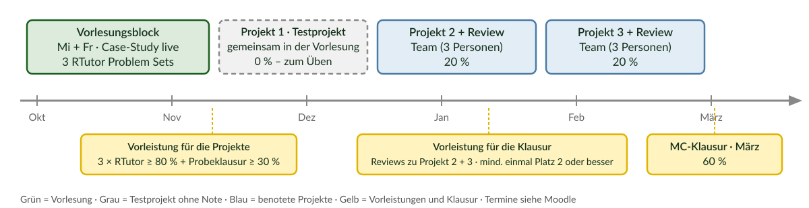
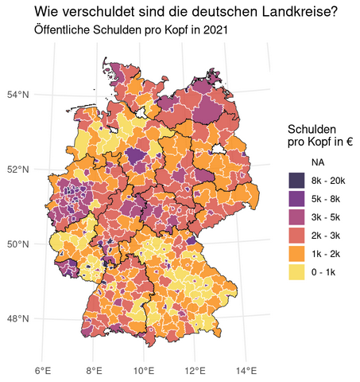
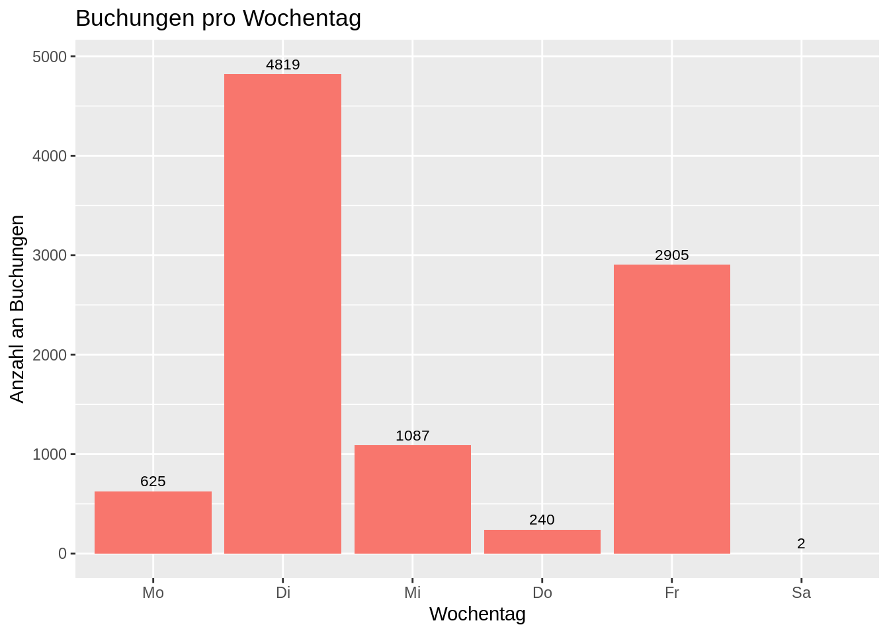
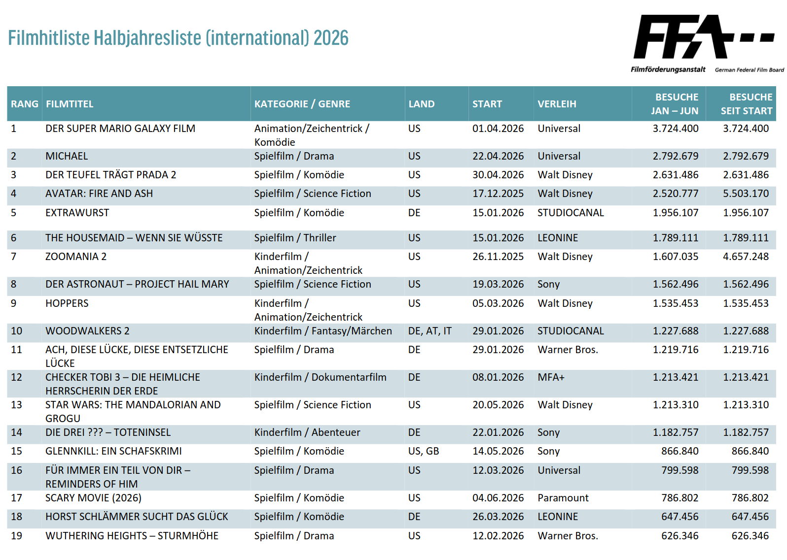
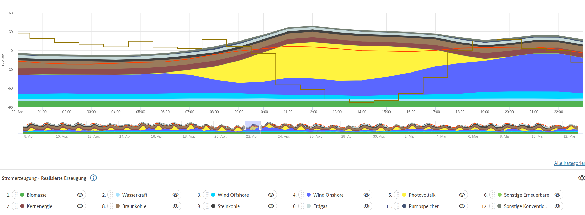
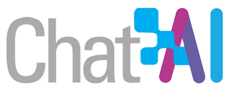
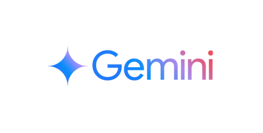



```{r setup}
#| include: false
library(countdown)

# ------------------------------------------------------------------
# ALLE TERMINE, NAMEN UND VERSIONEN HIER PFLEGEN (einzige Stelle)
# ------------------------------------------------------------------
k <- list(
  semester        = "Wintersemester 2026/27",
  stat_semester   = "Sommersemester 2027",
  # Team
  dozent          = "Dr. Alexander Rieber",      dozent_mail = "alexander.rieber@uni-ulm.de", dozent_raum = "Helmholtzstraße 18, Raum 1.22",
  uebung          = "Dr. Dennis Steinle",            uebung_mail = "dennis.steinle@uni-ulm.de",   uebung_raum = "Helmholtzstraße 18, Raum 1.10",
  tutoren         = c("Timm Rodrigues Mota", "Amy Funk-Duque", "Vincent van den Driesch", "Selen Yagci"),   # TODO 26/27
  tutoren_mail    = c("timm.rodrigues-mota@uni-ulm.de", "amy.funk-duque@uni-ulm.de",
                      "vincent.von-den-driesch@uni-ulm.de", "selen.yagci@uni-ulm.de"),
  # Termine (TODO: für 26/27 anpassen)
  vl_block_bis    = "13. November",
  vl_tag1         = "Mittwoch, 8:30–10:00 Uhr",
  vl_tag2         = "Freitag, 10:15–11:45 Uhr",
  hoersaal        = "H3",
  erste_vl        = "Freitag, 16.10., 10:15 Uhr",
  erstes_tut      = "Donnerstag, 15.10., 14–18 Uhr (online)",
  projekt1_datum  = "Freitag, 13. November",
  rtutor_deadline = "2. November",
  probeklausur    = "20. November",
  gemini_bis      = "3. November",
  # Software
  r_version       = "4.6.1",
  rstudio_version = "2026.09.0-174",
  # Links
  moodle          = "https://moodle.uni-ulm.de/course/view.php?id=85573",
  github          = "https://github.com/projektkurs-datascience/26-27",
  forum_howto     = "https://projektkurs-data-science-ulm2627.netlify.app/tutorials/fragen-im-forum",
  ki_guideline    = "https://projektkurs-data-science-ulm2627.netlify.app/tutorials/quellenverweise-und-ai-policy",
  pruefungsnummer = "16043"
)
```

## Kurz-Umfrage (Handzeichen)

::: {.instructions}
Drei Fragen und bitte antworten Sie ehrlich:
:::

::: {.incremental}
1. Wer hat **schon einmal programmiert**, irgendeine Sprache, auch Excel-Makros?
2. Wer hat **R schon einmal geöffnet**?
3. Wer hat in den letzten 7 Tagen **ChatGPT, Gemini oder Claude** benutzt?
:::

::: {.fragment}
::: {.callout-note appearance="simple"}
Typisches Bild: 1 → ein Drittel, 2 → fast niemand, 3 → fast alle. Dieser Kurs holt Sie bei 3 ab und bringt Sie zu 1 und 2. Mein Ziel ist es, dass Sie beurteilen können, ob der Code, den die KI Ihnen schreibt, **stimmt**.
:::
:::

## Was Sie am Ende können {.smaller}

:::: {.columns}
::: {.column width="50%"}
**Dieses Semester**

- 💻 **R programmieren**: Daten einlesen, bereinigen, zusammenführen
- 📊 **Daten visualisieren**: Grafiken, die eine Aussage haben
- 🔁 **Reproduzierbar arbeiten**: andere können Ihre Analyse nachvollziehen (Git, R Markdown / Quarto)
- 🤖 **AI Literacy**: KI als Tutor nutzen *und* ihren Code prüfen
- 🎤 **Präsentieren**: Ergebnisse in 5 Minuten auf den Punkt bringen
:::
::: {.column width="50%"}
**`r k$stat_semester`**

- 📈 **Statistik**: Regressionen rechnen und interpretieren
- 🎯 **Kausalität**: aus Experimenten und Beobachtungsdaten Ursache-Wirkung ableiten
:::
::::

. . .

::: {.alert}
Keine dieser Fähigkeiten lernt man durch Zuschauen. Deshalb ist dieser Kurs ein **Projektkurs**: Sie bauen drei Analysen auf echten Daten – das erste Projekt machen Sie gemeinsam mit mir in der Vorlesung.
:::

# Mit wem haben Sie es zu tun? {.section background-color="#1d3f73"}

## Ihr Team {.smaller}

:::: {.columns}
::: {.column width="50%"}
**Dozent**

`r k$dozent`
📧 [`r k$dozent_mail`](mailto:`r k$dozent_mail`)
🏢 `r k$dozent_raum`

**Übungsleiter**

`r k$uebung`
📧 [`r k$uebung_mail`](mailto:`r k$uebung_mail`)
🏢 `r k$uebung_raum`
:::
::: {.column width="50%"}
**Tutor:innen** – Ihre erste Anlaufstelle in der Projektphase

```{r}
#| results: asis
cat(paste0("- ", k$tutoren, " · [", k$tutoren_mail, "](mailto:", k$tutoren_mail, ")", collapse = "\n"))
```

::: {.callout-tip appearance="simple"}
Wer antwortet worauf? **Forum** → Tutor:innen und Übungsleiter, meist innerhalb eines Tages. **Noten und Persönliches** → E-Mail an den Dozenten.
:::
:::
::::

# So läuft der Kurs {.section background-color="#1d3f73"}

## Das Semester auf einen Blick

{width="95%" fig-align="center"}

## Warum in die Vorlesung kommen? {.smaller}

Die Lehrvideos erklären die Werkzeuge. Die Vorlesung ist für das, was **nur live** funktioniert:

:::: {.columns}
::: {.column width="50%"}
**Was in der Vorlesung passiert**

- 🐛 **Bug Hunts**: Code, der läuft, aber falsch ist – finden Sie den Fehler, bevor ich ihn zeige
- 🔮 **Prognosen**: Sie tippen, was der Code ausgibt, dann sehen wir es
- ✍️ **Mini-Aufgaben** direkt auf der Folie, im Browser
- 📱 **Kahoot-Checkpoints** am Ende jedes Abschnitts
- 🗂️ **Projekt 1** wird komplett in der Vorlesung erarbeite, als Testprojek
:::
::: {.column width="50%"}
**Was Sie zu Hause machen**

- 🎬 Lehrvideos (Werkzeug lernen)
- 🧩 RTutor Problem Sets (Werkzeug üben)
- 📖 Tutorials (Nachschlagen)
:::
::::

. . .

::: {.alert}
Die Case-Study, die wir in der Vorlesung bauen, ist die Vorlage für Ihre Projekte. Wer sie live mitgemacht hat, hat im Projekt den Code schon einmal gesehen.
:::

## Was erwarten wir von Ihnen?

:::: {.columns}
::: {.column width="50%"}
**Wir versprechen**

- Jede Vorlesung hat mindestens drei Stellen, an denen *Sie* etwas tun
- Antworten im Forum, meist am selben Tag
- Feste Tutoriumstermine pro Team in der Projektphase
:::
::: {.column width="50%"}
**Wir erwarten**

- Laptop dabei, R installiert (bis Freitag!)
- Fragen im Forum statt per Mail
- KI nutzen, aber **prüfen** – Sie sind verantwortlich für das, was Sie abgeben
:::
::::

## Vorlesung: Zeiten und Ablauf

Bis zum **`r k$vl_block_bis`** finden Vorlesungen als Präsenzveranstaltung in **`r k$hoersaal`** statt:

- **`r k$vl_tag1`**
- **`r k$vl_tag2`**

Begleitend: Lehrvideos, Tutorials und RTutor Problem Sets.

. . .

Am **`r k$projekt1_datum`** erarbeiten wir **Projekt 1 gemeinsam** in der Vorlesung – ein Testprojekt ohne Note. Danach folgen zwei eigenständige Teamprojekte (je 20 % der Endnote).

::: {.callout-note appearance="simple"}
Geblockte Vorlesungseinheiten zu Semesterbeginn: Erst das lernen Sie die Theorie, dann setzen Sie diese in konkreten projekten um. In der Projektphase gibt es keine regulären Vorlesungen, dafür wöchentliche Tutorien.
:::

## Wo finden Sie was?

::: {.instructions}
Unsere Kommunikation läuft über [Moodle](`r k$moodle`) und [GitHub](`r k$github`).
:::

:::: {.columns}
::: {.column width="50%"}
**Moodle**

- 📅 Veranstaltungsplanung und Wochenkalender
- 🎬 Lehrvideos
- 📘 Aufgabenstellungen der Projekte
- 👥 Tutoriumszeiten und Teams
- ❓ Forum für Fragen
- 📝 Abgaben
:::
::: {.column width="50%"}
**GitHub**

- 🗒️ Vorlesungsfolien (diese hier)
- 💻 Case-Study mit Code und Daten
- 🧩 RTutor Problem Sets
- 📖 Tutorials

Einmal klonen, danach jede Woche **Pull** und alles ist aktuell.
:::
::::

## RTutor: Werkzeug üben

- **Drei** RTutor Problem Sets, die die Vorlesung aufgreifen und vertiefen
- Inhalte: Einführung in R - Datenaufbereitung - Visualisierung
- Nebenbei lernen Sie R Markdown als Grundlage der späteren Projektberichte
- **Individuelle** Abgabe als **Vorleistung** (je Set mindestens 80 %), letztes Set fällig am **`r k$rtutor_deadline`**

::: {.instructions}
Bearbeitung lokal **oder** in der Posit Cloud.
:::

::: {.callout-tip appearance="simple"}
RTutor sagt Ihnen sofort, ob eine Lösung stimmt. Nutzen Sie das: Erst selbst versuchen, dann Hinweis, dann Lösung. BItte nicht umgekehrt.
:::

# Mit welchen Daten bekommen *Sie* es zu tun? {.section background-color="#1d3f73"}

## Case-Study: Verschuldung und Arbeitslosigkeit

:::: {.columns}
::: {.column width="50%"}
::: {.question}
🔮 **Schätzfrage:** Welcher Landkreis in Baden-Württemberg hat die höchsten kommunalen Schulden pro Kopf. Liegt Ulm darüber oder darunter?
:::

::: {.fragment}
In der Case-Study bauen wir gemeinsam die Antwort auf:

::: {.alert}
Gibt es einen Zusammenhang zwischen der Verschuldung eines Landkreises und dessen Arbeitslosenquote?
:::

Daten: Statistisches Bundesamt, Bundesagentur für Arbeit, Statistische Ämter der Länder – auf Landkreisebene.
:::
:::

::: {.column width="50%"}
::: {.fragment}
{width="90%"}
:::
:::
::::

## Projekt 1: Betrugserkennung im Unternehmen

:::: {.columns}
::: {.column width="50%"}
::: {.question}
🔮 **Schätzfrage:** An welchem Wochentag werden in einem Unternehmen die meisten Buchungen erfasst?
:::

::: {.fragment}
::: {.alert}
Wie kann ein:e Wirtschaftsprüfer:in mögliche Bilanzmanipulationen aufspüren?
:::

Daten: Journalbuchungen eines Unternehmens. Wir erarbeiten dieses Projekt **gemeinsam in der Vorlesung** als Testprojekt.
:::
:::

::: {.column width="50%"}
::: {.fragment}
{width="100%"}
:::
:::
::::

## Projekt 2: Kino oder Couch?

:::: {.columns}
::: {.column width="50%"}
::: {.question}
🔮 **Schätzfrage:** Wie viele der 100 meistbesuchten Kinofilme eines Jahres tauchen später bei Netflix auf – 1 von 10, 1 von 3 oder 2 von 3?
:::

::: {.fragment}
::: {.alert}
Verdrängt Streaming das Kino, oder bedienen beide Märkte unterschiedliche Bedürfnisse? Und ist die staatliche Filmförderung samt Kinofenster noch gerechtfertigt?
:::

Daten: Filmförderungsanstalt (monatliche Top 100, Bundesländer), Netflix Engagement Reports (Sehstunden je Titel), Eurostat (Streaming-Nutzung in Europa).
:::
:::

::: {.column width="50%"}
::: {.fragment}
{width="90%"}
:::
:::
::::

::: {.notes}
Auflösung Schätzfrage: 533 von 4.336 Kinotiteln überschneiden sich im Projekt mit dem Netflix-Katalog, also rund jeder achte. Fast neun von zehn Kinofilmen tauchen nie bei Netflix auf
:::

## Projekt 3: Wer zahlt für den Wind?

:::: {.columns}
::: {.column width="50%"}
::: {.question}
🔮 **Schätzfrage:** In wie vielen Stunden des Jahres 2024 war der Strompreis an der Börse **negativ** – 45, 457 oder 4.570?
:::

::: {.fragment}
::: {.alert}
Warum hat Deutschland gleichzeitig Rekordanteile erneuerbarer Energien, negative Strompreise und die höchsten Haushaltsstrompreise Europas und wer trägt die Kosten der Energiewende?
:::

Daten: SMARD der Bundesnetzagentur (stündliche Erzeugung und Börsenpreise), Marktstammdatenregister (jede PV- und Windanlage mit Standort), Eurostat (Strompreise und EE-Anteile in Europa).
:::
:::

::: {.column width="50%"}
::: {.fragment}
{width="90%"}

[Interaktive Karte hier](https://www.smard.de/page/home/marktdaten/78/?marketDataAttributes=%7B%22resolution%22:%22hour%22,%22from%22:1555884000000,%22to%22:1555970399999,%22subcategoryIds%22:%5B1,5,8%5D,%22moduleIds%22:%5B5000410,1004066,1001226,1001225,1004067,1004068,1001228,1001224,1001223,1004069,1004071,1004070,1001227,8004169%5D,%22activeChart%22:true,%22style%22:%22color%22,%22region%22:%22DE%22,%22selectedCategory%22:1%7D)
:::
:::
::::

::: {.notes}
Auflösung Schätzfrage: 457 Stunden mit negativen Day-Ahead-Preisen 2024 (2023: 301)

Interessante interaktive Karte: 
:::

## Was Sie in den Projekten lernen

::: {.incremental}
- Analysen auf **echten Daten**
- Daten selbst herunterladen und zusammenführen
- Deskriptive Analysen und Grafiken, die eine Aussage transportieren
- Die Analyse so beschreiben, dass andere sie nachvollziehen können
- **`r k$stat_semester`:** Statistische Auswertungen auf Beobachtungsdaten und Experimentaldaten
:::

## Peer Review: Sie werden zum Gutachter

::: {.alert}
Nach Projekt 2 und 3 bekommen Sie die Ausarbeitung eines anderen Teams zur Einschätzung.
:::

. . .

::: {.question}
Warum machen wir das?
:::

::: {.incremental}
- Sie sehen, wie andere dieselbe Aufgabe gelöst haben und was Sie daraus mitnehmen
- Kritisch lesen ist eine Fähigkeit, die Sie später bei jedem KI-Output brauchen
- Rekapitulation des Projekts = automatische Klausurvorbereitung
:::

. . .

::: {.instructions}
Review Reports sind **individuelle** Abgaben und die **Vorleistung für die Klausur**: Das Team, das Ihren Report erhält, rankt alle Reports nach Nützlichkeit. Mindestens einer Ihrer beiden Reports muss auf Platz 2 oder besser landen.
:::

# Wie setzt sich die Note zusammen? {.section background-color="#1d3f73"}

## Notengebung

| Leistung | Anteil an der Endnote | Wer |
|---|---|---|
| Projekt 1 – Testprojekt, gemeinsam in der Vorlesung | **0 %** (zum Üben) | Team |
| Projekt 2 – Bericht 70 % + Screencast 30 % | **20 %** | Team |
| Projekt 3 – Bericht 70 % + Screencast 30 % | **20 %** | Team |
| Multiple-Choice-Abschlussprüfung | **60 %** | individuell |

. . .

::: {.callout-note appearance="simple"}
60 % Klausur heißt nicht, dass die Projekte unwichtig sind: Die Klausur fragt genau das ab, was Sie in den Projekten gemacht haben. Wer das Testprojekt und die zwei Teamprojekte wirklich selbst erarbeitet hat, lernt für die Klausur nebenbei.
:::

. . .

Teams von **drei Personen**, Projekte werden **gemeinsam** abgegeben. Diskutieren über Teams hinweg ist erlaubt und erwünscht, Code und Texte weitergeben jedoch nicht.

## Vorleistungen {.smaller}

| | Was | Bedingung | Wann | Zulassung zu |
|---|---|---|---|---|
| **1** | Drei RTutor Problem Sets, individuell | ≥ 80 % der Punkte **pro Set** | letztes Set `r k$rtutor_deadline` | Projekte |
| **2** | Probeklausur (Multiple Choice, keine Hilfsmittel) | ≥ 30 % der Punkte | `r k$probeklausur` | Projekte |
| **3** | Review Reports zu Projekt 2 **und** 3, individuell | bei mindestens einem Projekt auf Platz 2 oder besser gerankt | nach Projekt 2 bzw. 3 | Klausur |

. . .

::: {.callout-note appearance="simple"}
Die Probeklausur ist bewusst früh und niedrigschwellig: Sie sollen ein Gefühl für die Fragen bekommen, bevor 60 % der Note daran hängen. 30 % der Punkte erreicht, wer die RTutor-Sets selbst gelöst hat.

Bei den Review Reports zählt nicht die Abgabe, sondern die **Nützlichkeit**: Das bewertete Team rankt die erhaltenen Reports. Wer zweimal einen sorgfältigen Report schreibt, ist auf der sicheren Seite. Werden alle Reports als gleich nützlich eingestuft, entscheidet der Dozent über die Zulassung.
:::

. . .

::: {.alert}
Die Abschlussprüfung fragt alles ab: die drei Projekte, die Vorlesung, die Case-Study und die RTutor Problem Sets.
:::

## Der Screencast: 30 % jeder Projektnote

- Maximal **5 Minuten**: Fragestellung, Daten, die wichtigsten Grafik und Ergebnisse
- Wird bei Projekt 2 und 3 verlangt
- Das Format, in dem Sie später im Beruf Ergebnisse präsentieren werden

::: {.instructions}
Frühzeitig vorbereiten. Jedes Jahr verschenken Teams hier Punkte, weil der Screencast am letzten Abend entsteht.
:::

::: {.callout-tip appearance="simple"}
Ihr erster R-Code heute war ein Balkendiagramm mit einem Satz als Titel. Ein guter Screencast ist genau das: eine Grafik, ein Satz, dann die nächste.
:::

# KI im Projektkurs {.section background-color="#1d3f73"}

## KI ist erlaubt

- Sie dürfen für Vorlesung und Projekte **jede Form von LLM-Unterstützung** nutzen
- Wir setzen LLMs selbst in der Vorlesung ein – auch als Gegenspieler: Code, der plausibel aussieht und falsch ist
- Für die Projekte gilt unsere [KI-Guideline](`r k$ki_guideline`), die auch die Sichtweise der Uni Ulm abbildet
- Sehen Sie das LLM als Tutorin, die 24/7 erreichbar ist und nie müde wird

. . .

::: {.alert}
Die KI ersetzt nicht das Denken. Sie sind verantwortlich für alles, was Sie einreichen, auch wenn die KI eine falsche Analyse produziert oder Dinge falsch interpretiert.
:::

## Zugang 1: Chat AI (GWDG) {.smaller}

:::: {.columns}
::: {.column width="40%"}
{width="100%"}
:::
::: {.column width="60%"}
Datenschutzkonformer Zugang über die [GWDG](https://kisski.gwdg.de/en/leistungen/2-02-llm-service/), kostenlos mit Ihrem Uni-Account.

- Von der GWDG gehostete Open-Source-Modelle (Qwen, DeepSeek, GPT-OSS, Llama, …)
- Ihre Eingaben bleiben in Deutschland
- Mehrere Modelle vergleichbar

**Darum geht es im Kurs:** LLMs in den Lernprozess integrieren, in Vorlesung und Projekten einsetzen, und ihre Grenzen im akademischen Kontext kennen (Ethik, Recht, Zitation).
:::
::::

## Zugang 2: Google Gemini für Studierende {.smaller}

:::: {.columns}
::: {.column width="40%"}
{width="100%"}
:::
::: {.column width="60%"}
Gemini Pro über einen [Studierendenaccount](https://gemini.google/students/) ist ein Jahr kostenlos.

- Sehr leistungsstarke Modelle, plus weitere Google-Dienste
- **Aber:** Nach einem Jahr kostenpflichtig, d.h. Kündigung selbst im Kalender eintragen!
:::
::::

::: {.callout-tip appearance="simple"}
Egal welches Modell: Geben Sie ihm Kontext (welche Vorlesung, welche Daten, `glimpse()`-Output) und verlangen Sie zu jedem Code einen Check: "Wie prüfe ich, dass das stimmt?"
:::

# Unterstützung {.section background-color="#1d3f73"}

## Wo bekommen Sie Hilfe?

::: {.incremental}
- **Forum auf Moodle**: erste Adresse für alle fachlichen Fragen. Bevor Sie eine Mail schreiben: Forum. Meist haben fünf andere dieselbe Frage.
  - Wie man Fragen stellt, damit sie schnell beantwortet werden: [Wie stelle ich Fragen im Forum?](`r k$forum_howto`)
- **Tutorium**: in der Projektphase ein fester Termin pro Woche und Team, online mit Break-out-Räumen
- **E-Mail an den Dozenten**: für Noten und persönliche Anliegen
:::

. . .

::: {.callout-tip appearance="simple"}
Wenn Sie die Antwort auf eine Forumsfrage wissen: posten Sie sie. Erklären ist die beste Art zu lernen.
:::

## Tutorium

- Vorlesungsbegleitendes Tutorium ab der **1. Woche**
- In der Projektphase **wöchentlich online**: eigener Zoom-Raum pro Tutor:in, Break-out-Raum pro Team
- Tutor:innen beantworten auch Fragen im Forum

::: {.instructions}
Das Tutorium ist vor allem dafür da, Sie bei Ihren **Projekten** zu unterstützen, d.h. bringen Sie konkrete Probleme mit.
:::

. . .

| | Wann |
|---|---|
| **Erstes Tutorium** (technische Probleme: Installation, GitHub, Posit Cloud) | **`r k$erstes_tut`** |
| **Erste Vorlesung** | **`r k$erste_vl`**, `r k$hoersaal` |

## Zeitmanagement in den Projekten {.smaller}

:::: {.columns}
::: {.column width="50%"}
**Was gut funktioniert**

- Meilensteine: Bis wann muss was von wem fertig sein?
- Ein gemeinsamer Kanal (GitHub Issues, WhatsApp, …)
- Fragen früh im Forum, nicht am Abend vor der Abgabe
- Schwierigkeiten im Tutorium direkt ansprechen
:::
::: {.column width="50%"}
**Woran Teams jedes Jahr scheitern**

- Screencast "machen wir am Schluss" (30 % der Projektnote!)
- Eine Person macht alles, die anderen verstehen den Code nicht und fallen in der Klausur durch
- Code aus dem Netz ohne Quelle oder vom LLM ohne Angabe in der LLM Nutzungs-Tabelle → Plagiat → 5,0 für das gesamte Projekt
:::
::::

::: {.alert}
Code aus dem Web ist erlaubt, aber mit Quellenangabe. Gleiches gilt für die Nutzung von LLMs. RTutor-Code wird nicht geteilt. Projekt-Code bleibt im Team.
:::

# Wir entwickeln den Kurs weiter {.section background-color="#1d3f73"}

## Begleitstudie

Auf Basis des Feedbacks früherer Kohorten haben wir den Kurs mehrfach umgebaut: Kahoot, Bug Hunts, Code-Felder, Einbau von LLMs, Umgestaltung der Projekte etc. sind das Ergebnis. Damit wir wissen, was wirkt, wollen wir eine wissenschaftliche Begleitstudie durchführen.

- Analysiert werden: GitHub-Commits, Vorleistungen und Prüfungsergebnisse, Ihre Einschätzung zu den Projekten
- **Pseudonymisiert**: keine Rückschlüsse auf einzelne Personen, keine Auswirkung auf Ihre Note

::: {.alert}
Bitte lesen Sie die **Einverständnis- und Datenschutzerklärung** und geben Sie im Moodle-Formular an, ob wir Ihre Daten verwenden dürfen. Wir würden uns sehr freuen, wenn Sie uns unterstützen.
:::

```{r}
countdown(minutes = 10, bottom = 0, right = 0)
```

# Bis Freitag {.section background-color="#1d3f73"}

## Ihre To-do-Liste bis zur ersten Vorlesung {.smaller}

Für jeden Punkt gibt es ein Lehrvideo auf Moodle.

:::: {.columns}
::: {.column width="50%"}
**1. R und RStudio installieren**

- [R `r k$r_version`](https://www.r-project.org/) und [RStudio `r k$rstudio_version`](https://posit.co/download/rstudio-desktop/)
- Schon installiert? `version` und `RStudio.Version()` zeigen den Stand; `installr::updateR()` aktualisiert
- Pakete: `install.packages(c("tidyverse", "RTutor"))`, danach `update.packages()`

**2. GitHub-Account** → nächste Folie

**3. Posit Cloud**: auf [posit.cloud](https://posit.cloud/) mit dem GitHub-Account einloggen
:::
::: {.column width="50%"}
**4. In Moodle eintragen**

- GitHub-Name und die E-Mail-Adresse des GitHub-Kontos (empfohlen: Uni-Ulm-Adresse – damit gibt es [GitHub Education](https://education.github.com/discount_requests/application))

**5. KI-Zugang anlegen** → übernächste Folie

**6. Erstes Tutorium** am `r k$erstes_tut`: alles, was bei 1–5 hakt, wird dort gelöst
:::
::::

## GitHub-Account anlegen

::: {.instructions}
[github.com](https://github.com/) → Account erstellen (falls noch keiner vorhanden). Ihre Projekte laufen später komplett über GitHub.
:::

**Tipps zum Nutzernamen**[^1]

- Ihren echten Namen verwenden, [insbesondere da wir die Projekte (mit ihrer Zustimmung) später veröffentlichen](https://projektkurs-datascience.github.io/Projekte/project_overview.html)
- Kein Fantasiename, der schwer zu finden ist
- Kurz und prägnant
- Keine Uni oder Jahreszahl im Namen

[^1]: Nach [Happy Git with R](http://happygitwithr.com/github-acct.html#username-advice) von Jenny Bryan

## Erste Aufgabe: Die KI auf die Probe stellen

Account bei [GWDG Chat AI](https://kisski.gwdg.de/en/leistungen/2-02-llm-service/) und/oder [Google Gemini](https://gemini.google/students/) anlegen. Dann:

1. Stellen Sie **10 Fragen** aus Gebieten, in denen Sie sich **wirklich auskennen** – Hobby, Heimatort, Lieblingsverein, Nebenjob
2. Probieren Sie dabei **mindestens zwei verschiedene Modelle** bei GWDG Chat AI
3. Bewerten Sie jede Antwort von 1 (nutzlos) bis 10 (perfekt) und notieren Sie, **wo** die KI falsch lag

. . .

::: {.question}
Am Freitag sammeln wir: Wie viele von 10 Antworten hatten einen Fehler? Was war die überzeugendste falsche Antwort?
:::

::: {.callout-tip appearance="simple"}
Das ist der Kern von AI Literacy: Sie wissen nur dann, ob die KI Recht hat, wenn Sie das Thema kennen. In R schaffen wir dieses Wissen in den nächsten Wochen.
:::

## Bis Freitag

:::: {.columns}
::: {.column width="55%"}
**Mitbringen am `r k$erste_vl`:**

- 💻 Laptop mit R und RStudio
- 🐙 GitHub-Account, in Moodle eingetragen
- 🤖 Ihre 10 KI-Antworten mit Bewertung
- ❓ Mindestens eine Frage

**Erste Vorlesung:** Wir klonen das Repository und bauen den ersten Teil der Case-Study mit dem ersten Bug Hunt.
:::
::: {.column width="45%"}
::: {.callout-note title="Kontakt"}
`r k$dozent`
[`r k$dozent_mail`](mailto:`r k$dozent_mail`)

Forum: [Moodle](`r k$moodle`)
Material: [GitHub](`r k$github`)
:::
:::
::::
